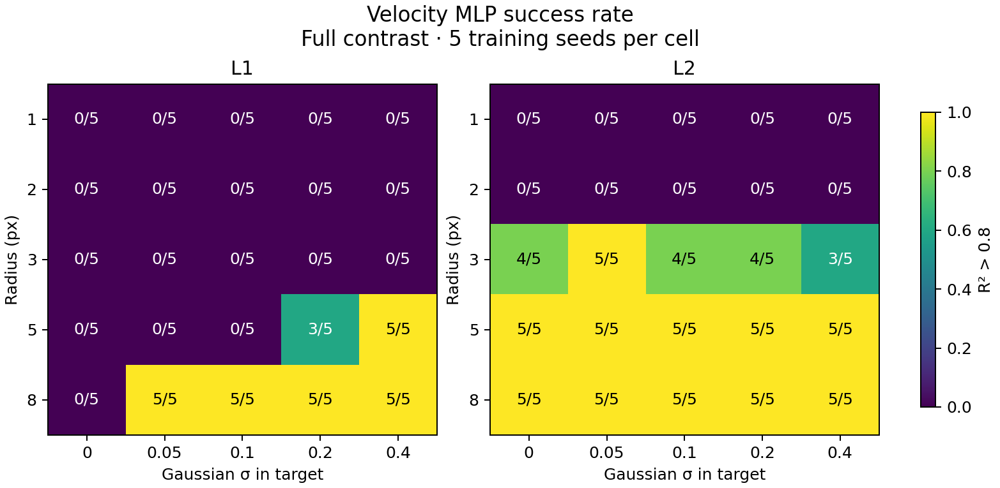
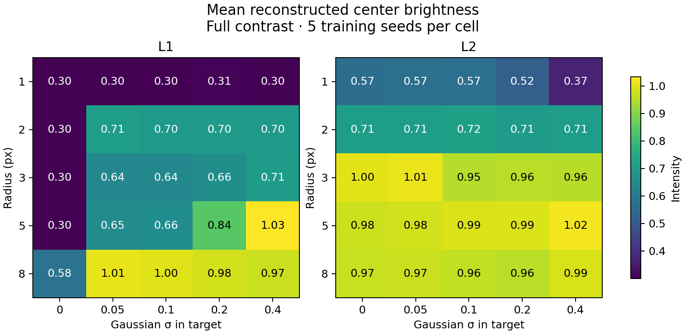
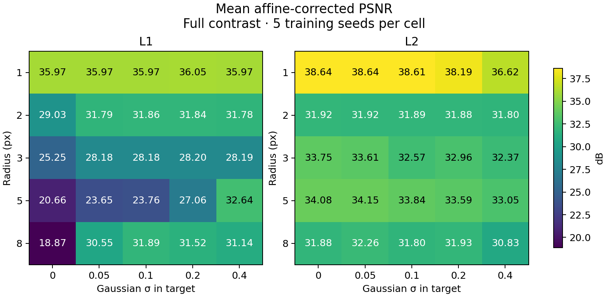
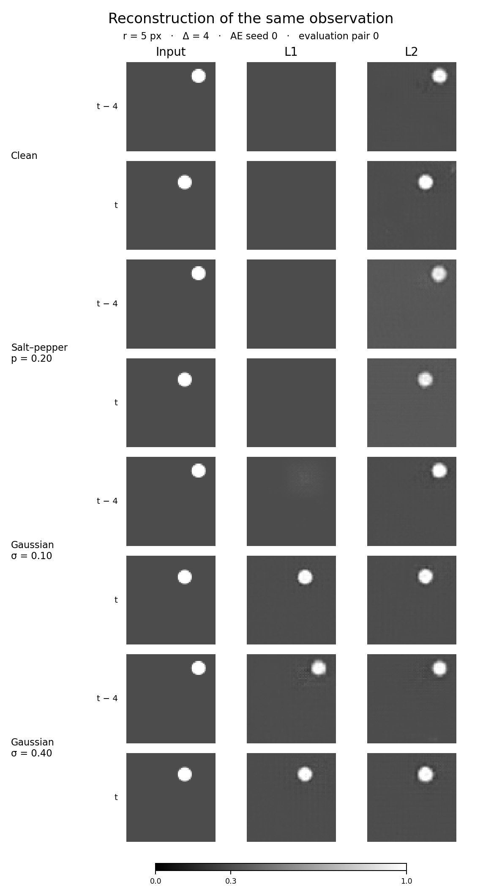
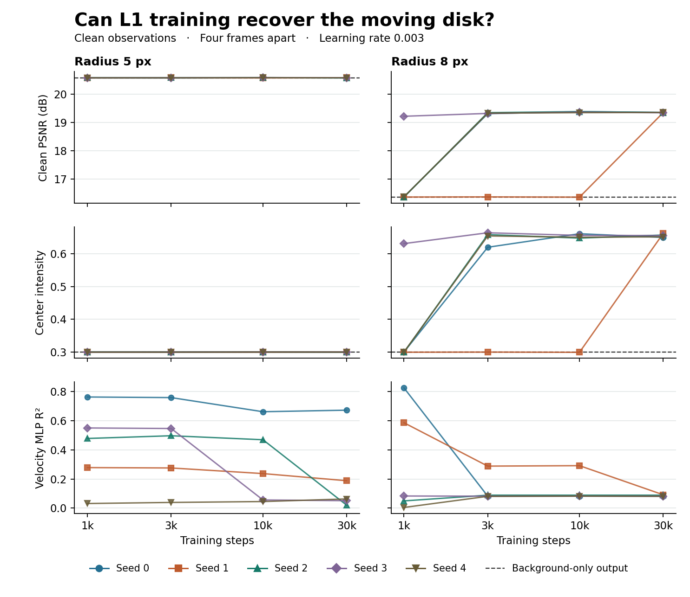
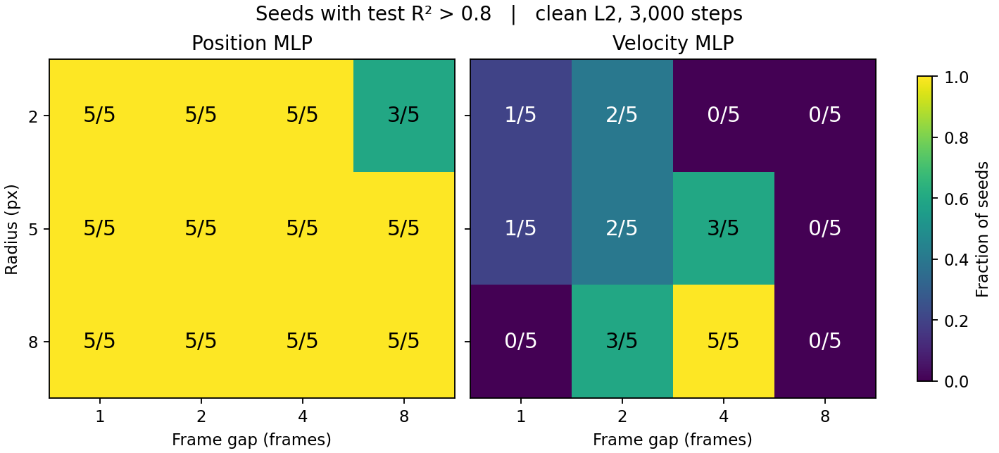

# ステージ3　円のサイズ・コントラスト・ノイズと速度の復号

**A〜Dを完了した。400設定のうち102件を再利用し、298件を新規に学習した。新規実行は合計4時間54分。** 全シードの結果と3種類のヒートマップを保存した。以前の診断はこの報告の後半に残した。

AではL1の速度成功率に半径とノイズ量による境界が現れた。r=8ではσ=0の0/5からσ≥0.05の5/5へ変わり、r=5ではσ=0.2で3/5、σ=0.4で5/5だった。r=1・2・3のL1は全5水準で0/5。L2はr=5・8で全水準が5/5、r=3でσ順に4/5・5/5・4/5・4/5・3/5、r=1・2では全水準が0/5だった。

r=2でσ=0から0.05へ増やすと、L1の補正PSNRは29.03から31.79 dB、中心輝度は0.300から0.708へ上がったが、速度R²の平均は0.098から0.056へ下がり、成功数は0/5だった。中心輝度は両フレームの平均で、片方だけの円も中程度の値になる。r=3のL1でもσ=0から0.4で補正PSNRが25.25から28.19 dBへ上がった一方、速度R²の平均は0.251から0.050へ下がった。再構成の改善だけでは速度の復号改善を判断できなかった。

速度が同じ成功率になる条件も多かった。r=1・2では全ガウス水準で両損失が0/5、r=8ではσ≥0.05で両損失が5/5。r=5・σ=0.4は両方5/5で、速度R²平均はL1 0.960、L2 0.959だった。r=8・σ=0.4ではL1の補正PSNR平均31.14 dBがL2の30.83 dBを上回り、速度R²平均は0.985と0.987だった。

Bの塩胡椒ノイズは各3シードで確認した。r=1・2ではp=0.2・0.45の両損失が速度成功0/3。r=3のL2はp=0.2で2/3、p=0.45で0/3だった。r=5・8のL2は両水準で3/3。一方L1は、r=5・8のp=0.45でそれぞれ1/3となり、それ以外は0/3だった。

通常PSNRだけでL1が上回る塩胡椒条件も、補正後は全10条件でL2の平均が上回った。例えばr=5・p=0.45の今回の3シードでは、通常PSNRがL1/L2で20.57/20.27 dB、補正PSNRが20.66/31.47 dB、中心輝度が0.300/0.805だった。この3シード比較にも背景出力と輝度偏りによる順位差が現れた。r=5のL1は背景出力でも速度R² > 0.8が1シードあり、デコーダの出力と潜在表現の情報保持は一対一には対応しなかった。

Cでは物体と背景の差を0.7から0.35に半減した。L1の片方以上のフレームで中間輝度に達した最小の測定水準は、両コントラストとも全5シードでσ=0.05だった。両フレームで達する最小水準は、seed 0が0.4→0.2、seed 2が0.2→0.1へ移り、残る3シードは同じだった。速度成功数もσ=0.1で0/5→1/5、σ=0.2で3/5→4/5となった。コントラスト半減の効果は全シードで一様ではなかった。L2は両コントラスト・全ガウス水準で速度成功5/5だった。

Dではノイズを入れる場所によってL1の結果が分かれた。ガウスσ=0.4では、教師のみ・両側で速度成功5/5、入力のみでは0/5だった。速度R²の平均はそれぞれ0.960、0.939、−0.014、中心輝度は1.033、1.073、0.300。入力のみにノイズを加えても、L1の背景出力は解消されなかった。

塩胡椒p=0.2のL1は、3つの場所すべてで速度成功0/5、平均中心輝度0.300だった。速度R²の平均は教師のみ0.493、入力のみ0.003、両側0.001。L2は両ノイズ・3つの場所すべてで成功5/5だった。入力側ノイズを追加したときに速度R²が必ず下がる傾向は得られず、L2の塩胡椒p=0.2では教師のみ0.942に対し、入力のみ0.965、両側0.960だった。

成功と未達のシードが混在したのは、位置13条件、速度10条件、未来位置18条件だった。いずれかが混在した31条件について、成功・未達のシード番号と全R²を後掲する。成功率は丸める前のR² > 0.8で判定し、Bでは3シード、他は5シードを分母にした。

円が出現したかを数値化するため、Cには背景と物体の中間輝度に達したかという基準を設定した。半径別の未学習対照は、既存のクリーン画像・物体輝度1.0での各5シードを用いた。Cの物体輝度0.65やDの入力側ノイズに条件を合わせた未学習測定は未実行。

集計は元のJSONLから独立に再計算し、92条件の4,692集計項目、図の150セル、シード別CSVを照合した。新規298件はすべて保存重みのSHA-256と記録が一致し、同じ実行コマンドの再開で残数0を確認した。実行エラーと再試行は0件。データ生成・プローブ・集計などの55テストと、記録済み結果による第5健全性チェックの1テストが通過した。従来の学習を伴うテスト3件は今回の再実行から除外した。

p=0.45の10シード追試は未実行。今回のA〜Dを終えて停止した。

## 測定条件と再利用

観測区間で壁に反射しない動画を用い、Δ=4、3,000ステップ、Adamの学習率0.003、潜在16次元、背景0.3を共通にした。各条件の入力ノイズはAEとプローブの両方に適用し、両側にノイズを入れる場合は入力と教師で別々に乱数を引いた。各モデルで系列6の10,000例を使ってプローブを学習し、系列7の5,000例で評価した。位置・速度・5フレーム先の位置のR²は、各軸のR²を平均した値。

| 比較 | シード | 学習設定数 | ステージ1・2から再利用 | 新規学習 | 新規分の合計時間 |
|---|---|---:|---:|---:|---:|
| A　全半径 × ガウス | 0〜4 | 250 | 90 | 160 | 2.55時間 |
| B　全半径 × 塩胡椒 | 0〜2 | 60 | 12 | 48 | 0.83時間 |
| C　低コントラスト × ガウス | 0〜4 | 50 | 0 | 50 | 0.80時間 |
| D　ノイズの場所 | 0〜4 | 40 | 0 | 40 | 0.71時間 |
| **合計** | | **400** | **102** | **298** | **4.90時間** |

時間は新しい学習・検証・評価の各実行時間を合計したもの。Dの教師のみの対照20件は既存の5シードを照合して再掲した。このうち16件はA・Bにも含まれる。全表は420シード行、異なる学習結果は404件。未学習の参照25行はこの件数の外にある。Bのp=0.45は各3シード。10シード追試は未実行。

補正PSNRは、各モデルのクリーンな評価5,000組・40,960,000画素で共通のスカラー係数 a, b を最小二乗で求め、a·出力+b とクリーン画像の差から計算した。同じ評価集合で可能な輝度補正の効果を測る診断値で、通常PSNRは元の出力を使う。いずれも輝度の基準値域は1。円が小さい場合は背景画素の寄与が大きく、物体を暗くした場合は背景一色でもPSNRが上がるため、半径・輝度をそろえた比較と中心輝度を併読する。

[学習・評価の原記録](results/runs.jsonl) · [全シードの値](figures/filtered/steps_3000/gap_4/main/stage_3/stage3_seeds.csv) · [条件別の平均・中央値・標準偏差・成功率](figures/filtered/steps_3000/gap_4/main/stage_3/stage3_conditions.csv) · [成功と未達が混在した設定](figures/filtered/steps_3000/gap_4/main/stage_3/stage3_mixed_seeds.csv)

## A　サイズとガウスノイズの地図

各セルは同じ5シードによる結果。左がL1、右がL2で、同じ図の左右で色の尺度を共通にした。

## C　物体輝度と2フレームの再構成

半径5・背景0.3の5,000評価例で、過去フレームと現在フレームの真の中心における再構成輝度を各々平均した。平均値が背景と物体の中点（物体1.0なら0.65、物体0.65なら0.475）以上で、そのフレームに「円あり」と数えた。表は同じ5シードで該当した数。σ=0は教師ノイズなし。

| 損失 | 物体輝度 | 指標 | σ=0 | 0.05 | 0.1 | 0.2 | 0.4 |
|---|---:|---|---:|---:|---:|---:|---:|
| L1 | 1 | 少なくとも片方 | 0/5 | 5/5 | 5/5 | 5/5 | 5/5 |
| L1 | 1 | 両方 | 0/5 | 0/5 | 0/5 | 3/5 | 5/5 |
| L1 | 0.65 | 少なくとも片方 | 0/5 | 5/5 | 5/5 | 5/5 | 5/5 |
| L1 | 0.65 | 両方 | 0/5 | 0/5 | 1/5 | 4/5 | 5/5 |
| L2 | 1 | 少なくとも片方 | 5/5 | 5/5 | 5/5 | 5/5 | 5/5 |
| L2 | 1 | 両方 | 5/5 | 5/5 | 5/5 | 5/5 | 5/5 |
| L2 | 0.65 | 少なくとも片方 | 5/5 | 5/5 | 5/5 | 5/5 | 5/5 |
| L2 | 0.65 | 両方 | 5/5 | 5/5 | 5/5 | 5/5 | 5/5 |

L1の各シードについて、初めて基準を満たした測定水準を示す。「なし」は全5水準で未到達。「＊」はそれより高いσのいずれかで基準を割ったことを示す。

| 物体輝度 | フレーム | seed 0 | seed 1 | seed 2 | seed 3 | seed 4 |
|---:|---|---:|---:|---:|---:|---:|
| 1 | 少なくとも片方 | 0.05 | 0.05 | 0.05 | 0.05 | 0.05 |
| 1 | 両方 | 0.4 | 0.4 | 0.2 | 0.2 | 0.2 |
| 0.65 | 少なくとも片方 | 0.05 | 0.05 | 0.05 | 0.05 | 0.05 |
| 0.65 | 両方 | 0.2 | 0.4 | 0.1 | 0.2 | 0.2 |

L1で「少なくとも片方」の初回到達をシード内で比較すると、コントラスト半減後に低いσで到達 0、同じσで到達 5、高いσで到達 0。半減後だけ到達 0、半減前だけ到達 0、両方で未到達 0（全5シード）。

L1で「両方」の初回到達をシード内で比較すると、コントラスト半減後に低いσで到達 2、同じσで到達 3、高いσで到達 0。半減後だけ到達 0、半減前だけ到達 0、両方で未到達 0（全5シード）。

今回の5水準では、片方・両方の各判定で、一度到達した後に高いσで基準を割るシードはなかった。

各σでは別のAEを同一シードで初期化して学習したので、この出現点は試したσのうちでの比較。[シード・σ別の中心輝度](results/stage3_contrast_seeds.csv) · [各シードの初回到達と再低下](results/stage3_contrast_onsets.csv) · [元の重みによる高コントラストの再評価](results/stage3_contrast_historical.jsonl)

物体輝度1.0の50モデルは保存済み重みのSHA-256を照合したうえで同じ評価5,000例をCPUで再評価した。既存のMPS記録と照合した5つの再構成指標の最大絶対差は9.6×10⁻⁷。物体輝度0.65の50モデルは本実験の評価時にフレーム別中心輝度を記録した。

## 全条件の集計

各R²欄は順にシード平均、中央値、R² > 0.8 の成功数 / 評価シード数。PSNRと中心輝度はシード平均。中心輝度は両フレームの真の中心位置で補間した絶対輝度。補正PSNRは各モデルについて評価5,000組の全画素で1組の係数を求めた値。

### A　全半径・全ガウス量

| r | 物体輝度 | ノイズ | 量 | ノイズの場所 | 損失 | 通常PSNR | 補正PSNR | 中心輝度 | 位置R² | 速度R² | 未来位置R² |
|---:|---:|---|---:|---|---|---:|---:|---:|---|---|---|
| 1 | 1 | gaussian | 0 | target_only | L1 | 35.96 | 35.97 | 0.3002 | 0.909 / 0.923 / 5/5 | 0.001 / -0.002 / 0/5 | 0.638 / 0.641 / 0/5 |
| 1 | 1 | gaussian | 0 | target_only | L2 | 38.64 | 38.64 | 0.5656 | 0.958 / 0.988 / 5/5 | 0.051 / 0.053 / 0/5 | 0.733 / 0.804 / 4/5 |
| 1 | 1 | gaussian | 0.05 | target_only | L1 | 35.96 | 35.97 | 0.3003 | 0.920 / 0.940 / 5/5 | -0.001 / -0.010 / 0/5 | 0.643 / 0.637 / 0/5 |
| 1 | 1 | gaussian | 0.05 | target_only | L2 | 38.63 | 38.64 | 0.5712 | 0.894 / 0.835 / 5/5 | 0.043 / 0.043 / 0/5 | 0.588 / 0.449 / 1/5 |
| 1 | 1 | gaussian | 0.1 | target_only | L1 | 35.97 | 35.97 | 0.3007 | 0.907 / 0.941 / 4/5 | 0.012 / 0.016 / 0/5 | 0.641 / 0.637 / 0/5 |
| 1 | 1 | gaussian | 0.1 | target_only | L2 | 38.61 | 38.61 | 0.5674 | 0.960 / 0.991 / 5/5 | 0.053 / 0.055 / 0/5 | 0.734 / 0.805 / 4/5 |
| 1 | 1 | gaussian | 0.2 | target_only | L1 | 36.03 | 36.05 | 0.3058 | 0.924 / 0.915 / 5/5 | 0.015 / 0.016 / 0/5 | 0.668 / 0.626 / 1/5 |
| 1 | 1 | gaussian | 0.2 | target_only | L2 | 38.18 | 38.19 | 0.5210 | 0.931 / 0.994 / 5/5 | 0.052 / 0.057 / 0/5 | 0.665 / 0.807 / 3/5 |
| 1 | 1 | gaussian | 0.4 | target_only | L1 | 35.96 | 35.97 | 0.3012 | 0.944 / 0.940 / 5/5 | 0.022 / 0.034 / 0/5 | 0.675 / 0.679 / 0/5 |
| 1 | 1 | gaussian | 0.4 | target_only | L2 | 36.60 | 36.62 | 0.3733 | 0.931 / 0.942 / 5/5 | 0.030 / 0.022 / 0/5 | 0.652 / 0.658 / 1/5 |
| 2 | 1 | gaussian | 0 | target_only | L1 | 29.01 | 29.03 | 0.3001 | 0.925 / 0.926 / 5/5 | 0.098 / 0.084 / 0/5 | 0.664 / 0.645 / 0/5 |
| 2 | 1 | gaussian | 0 | target_only | L2 | 31.92 | 31.92 | 0.7117 | 0.927 / 0.992 / 5/5 | 0.060 / 0.064 / 0/5 | 0.650 / 0.796 / 0/5 |
| 2 | 1 | gaussian | 0.05 | target_only | L1 | 31.78 | 31.79 | 0.7080 | 0.925 / 0.989 / 5/5 | 0.056 / 0.057 / 0/5 | 0.649 / 0.793 / 0/5 |
| 2 | 1 | gaussian | 0.05 | target_only | L2 | 31.92 | 31.92 | 0.7086 | 0.927 / 0.992 / 5/5 | 0.059 / 0.062 / 0/5 | 0.650 / 0.796 / 0/5 |
| 2 | 1 | gaussian | 0.1 | target_only | L1 | 31.85 | 31.86 | 0.6968 | 0.859 / 0.827 / 5/5 | 0.051 / 0.050 / 0/5 | 0.501 / 0.428 / 0/5 |
| 2 | 1 | gaussian | 0.1 | target_only | L2 | 31.89 | 31.89 | 0.7166 | 0.927 / 0.991 / 5/5 | 0.058 / 0.060 / 0/5 | 0.650 / 0.794 / 0/5 |
| 2 | 1 | gaussian | 0.2 | target_only | L1 | 31.84 | 31.84 | 0.7042 | 0.926 / 0.991 / 5/5 | 0.057 / 0.061 / 0/5 | 0.649 / 0.795 / 0/5 |
| 2 | 1 | gaussian | 0.2 | target_only | L2 | 31.88 | 31.88 | 0.7056 | 0.959 / 0.991 / 5/5 | 0.060 / 0.062 / 0/5 | 0.723 / 0.796 / 0/5 |
| 2 | 1 | gaussian | 0.4 | target_only | L1 | 31.77 | 31.78 | 0.6978 | 0.959 / 0.992 / 5/5 | 0.060 / 0.061 / 0/5 | 0.723 / 0.796 / 0/5 |
| 2 | 1 | gaussian | 0.4 | target_only | L2 | 31.80 | 31.80 | 0.7093 | 0.925 / 0.990 / 5/5 | 0.056 / 0.059 / 0/5 | 0.648 / 0.794 / 0/5 |
| 3 | 1 | gaussian | 0 | target_only | L1 | 25.22 | 25.25 | 0.3001 | 0.934 / 0.952 / 5/5 | 0.251 / 0.340 / 0/5 | 0.707 / 0.703 / 1/5 |
| 3 | 1 | gaussian | 0 | target_only | L2 | 33.74 | 33.75 | 1.0048 | 0.935 / 0.965 / 5/5 | 0.737 / 0.906 / 4/5 | 0.843 / 0.951 / 4/5 |
| 3 | 1 | gaussian | 0.05 | target_only | L1 | 28.16 | 28.18 | 0.6416 | 0.921 / 0.991 / 5/5 | 0.059 / 0.065 / 0/5 | 0.631 / 0.784 / 0/5 |
| 3 | 1 | gaussian | 0.05 | target_only | L2 | 33.60 | 33.61 | 1.0132 | 0.965 / 0.966 / 5/5 | 0.887 / 0.899 / 5/5 | 0.949 / 0.949 / 5/5 |
| 3 | 1 | gaussian | 0.1 | target_only | L1 | 28.16 | 28.18 | 0.6430 | 0.887 / 0.816 / 5/5 | 0.056 / 0.051 / 0/5 | 0.554 / 0.400 / 0/5 |
| 3 | 1 | gaussian | 0.1 | target_only | L2 | 32.56 | 32.57 | 0.9516 | 0.970 / 0.969 / 5/5 | 0.753 / 0.895 / 4/5 | 0.921 / 0.945 / 5/5 |
| 3 | 1 | gaussian | 0.2 | target_only | L1 | 28.20 | 28.20 | 0.6634 | 0.923 / 0.994 / 5/5 | 0.061 / 0.066 / 0/5 | 0.633 / 0.787 / 0/5 |
| 3 | 1 | gaussian | 0.2 | target_only | L2 | 32.95 | 32.96 | 0.9575 | 0.930 / 0.961 / 5/5 | 0.716 / 0.862 / 4/5 | 0.830 / 0.940 / 4/5 |
| 3 | 1 | gaussian | 0.4 | target_only | L1 | 28.18 | 28.19 | 0.7067 | 0.815 / 0.815 / 5/5 | 0.050 / 0.050 / 0/5 | 0.401 / 0.401 / 0/5 |
| 3 | 1 | gaussian | 0.4 | target_only | L2 | 32.35 | 32.37 | 0.9551 | 0.899 / 0.922 / 5/5 | 0.547 / 0.817 / 3/5 | 0.721 / 0.898 / 3/5 |
| 5 | 1 | gaussian | 0 | target_only | L1 | 20.57 | 20.66 | 0.3001 | 0.937 / 0.946 / 5/5 | 0.423 / 0.497 / 0/5 | 0.744 / 0.750 / 2/5 |
| 5 | 1 | gaussian | 0 | target_only | L2 | 34.05 | 34.08 | 0.9767 | 0.988 / 0.987 / 5/5 | 0.959 / 0.961 / 5/5 | 0.972 / 0.971 / 5/5 |
| 5 | 1 | gaussian | 0.05 | target_only | L1 | 23.62 | 23.65 | 0.6539 | 0.914 / 0.995 / 3/5 | 0.070 / 0.072 / 0/5 | 0.597 / 0.765 / 0/5 |
| 5 | 1 | gaussian | 0.05 | target_only | L2 | 34.08 | 34.15 | 0.9832 | 0.988 / 0.989 / 5/5 | 0.960 / 0.965 / 5/5 | 0.972 / 0.973 / 5/5 |
| 5 | 1 | gaussian | 0.1 | target_only | L1 | 23.73 | 23.76 | 0.6561 | 0.832 / 0.792 / 1/5 | 0.066 / 0.064 / 0/5 | 0.430 / 0.345 / 0/5 |
| 5 | 1 | gaussian | 0.1 | target_only | L2 | 33.82 | 33.84 | 0.9937 | 0.989 / 0.990 / 5/5 | 0.964 / 0.966 / 5/5 | 0.974 / 0.974 / 5/5 |
| 5 | 1 | gaussian | 0.2 | target_only | L1 | 27.05 | 27.06 | 0.8421 | 0.939 / 0.969 / 4/5 | 0.575 / 0.872 / 3/5 | 0.795 / 0.948 / 3/5 |
| 5 | 1 | gaussian | 0.2 | target_only | L2 | 33.55 | 33.59 | 0.9916 | 0.989 / 0.989 / 5/5 | 0.962 / 0.966 / 5/5 | 0.973 / 0.973 / 5/5 |
| 5 | 1 | gaussian | 0.4 | target_only | L1 | 32.62 | 32.64 | 1.0334 | 0.985 / 0.984 / 5/5 | 0.960 / 0.956 / 5/5 | 0.973 / 0.973 / 5/5 |
| 5 | 1 | gaussian | 0.4 | target_only | L2 | 33.04 | 33.05 | 1.0211 | 0.988 / 0.988 / 5/5 | 0.959 / 0.961 / 5/5 | 0.972 / 0.971 / 5/5 |
| 8 | 1 | gaussian | 0 | target_only | L1 | 18.73 | 18.87 | 0.5796 | 0.834 / 0.748 / 2/5 | 0.124 / 0.082 / 0/5 | 0.424 / 0.258 / 0/5 |
| 8 | 1 | gaussian | 0 | target_only | L2 | 31.86 | 31.88 | 0.9711 | 0.996 / 0.996 / 5/5 | 0.988 / 0.988 / 5/5 | 0.990 / 0.989 / 5/5 |
| 8 | 1 | gaussian | 0.05 | target_only | L1 | 30.52 | 30.55 | 1.0105 | 0.995 / 0.995 / 5/5 | 0.985 / 0.986 / 5/5 | 0.987 / 0.988 / 5/5 |
| 8 | 1 | gaussian | 0.05 | target_only | L2 | 32.24 | 32.26 | 0.9733 | 0.996 / 0.997 / 5/5 | 0.989 / 0.989 / 5/5 | 0.991 / 0.991 / 5/5 |
| 8 | 1 | gaussian | 0.1 | target_only | L1 | 31.81 | 31.89 | 0.9988 | 0.997 / 0.997 / 5/5 | 0.989 / 0.989 / 5/5 | 0.990 / 0.990 / 5/5 |
| 8 | 1 | gaussian | 0.1 | target_only | L2 | 31.76 | 31.80 | 0.9650 | 0.996 / 0.996 / 5/5 | 0.988 / 0.988 / 5/5 | 0.990 / 0.990 / 5/5 |
| 8 | 1 | gaussian | 0.2 | target_only | L1 | 31.51 | 31.52 | 0.9825 | 0.996 / 0.996 / 5/5 | 0.988 / 0.987 / 5/5 | 0.989 / 0.990 / 5/5 |
| 8 | 1 | gaussian | 0.2 | target_only | L2 | 31.89 | 31.93 | 0.9587 | 0.995 / 0.995 / 5/5 | 0.988 / 0.988 / 5/5 | 0.990 / 0.989 / 5/5 |
| 8 | 1 | gaussian | 0.4 | target_only | L1 | 31.12 | 31.14 | 0.9747 | 0.995 / 0.995 / 5/5 | 0.985 / 0.985 / 5/5 | 0.988 / 0.988 / 5/5 |
| 8 | 1 | gaussian | 0.4 | target_only | L2 | 30.77 | 30.83 | 0.9898 | 0.995 / 0.995 / 5/5 | 0.987 / 0.987 / 5/5 | 0.989 / 0.989 / 5/5 |

### B　全半径・塩胡椒2水準

| r | 物体輝度 | ノイズ | 量 | ノイズの場所 | 損失 | 通常PSNR | 補正PSNR | 中心輝度 | 位置R² | 速度R² | 未来位置R² |
|---:|---:|---|---:|---|---|---:|---:|---:|---|---|---|
| 1 | 1 | salt_pepper | 0.2 | target_only | L1 | 35.96 | 35.97 | 0.3000 | 0.875 / 0.882 / 3/3 | 0.004 / 0.002 / 0/3 | 0.616 / 0.606 / 0/3 |
| 1 | 1 | salt_pepper | 0.2 | target_only | L2 | 27.54 | 37.95 | 0.5076 | 0.939 / 0.992 / 3/3 | 0.047 / 0.051 / 0/3 | 0.686 / 0.805 / 2/3 |
| 1 | 1 | salt_pepper | 0.45 | target_only | L1 | 35.96 | 35.97 | 0.3001 | 0.874 / 0.905 / 2/3 | 0.000 / -0.012 / 0/3 | 0.608 / 0.606 / 0/3 |
| 1 | 1 | salt_pepper | 0.45 | target_only | L2 | 20.79 | 36.04 | 0.3967 | 0.958 / 0.965 / 3/3 | 0.063 / 0.031 / 0/3 | 0.695 / 0.698 / 0/3 |
| 2 | 1 | salt_pepper | 0.2 | target_only | L1 | 29.01 | 29.03 | 0.3001 | 0.879 / 0.927 / 2/3 | 0.099 / 0.099 / 0/3 | 0.649 / 0.630 / 0/3 |
| 2 | 1 | salt_pepper | 0.2 | target_only | L2 | 26.45 | 31.82 | 0.6658 | 0.876 / 0.823 / 3/3 | 0.051 / 0.048 / 0/3 | 0.547 / 0.426 / 0/3 |
| 2 | 1 | salt_pepper | 0.45 | target_only | L1 | 29.01 | 29.03 | 0.3001 | 0.864 / 0.902 / 2/3 | 0.101 / 0.081 / 0/3 | 0.642 / 0.648 / 0/3 |
| 2 | 1 | salt_pepper | 0.45 | target_only | L2 | 20.56 | 31.63 | 0.6065 | 0.930 / 0.986 / 3/3 | 0.050 / 0.052 / 0/3 | 0.667 / 0.789 / 0/3 |
| 3 | 1 | salt_pepper | 0.2 | target_only | L1 | 25.22 | 25.25 | 0.3000 | 0.924 / 0.923 / 3/3 | 0.237 / 0.244 / 0/3 | 0.718 / 0.689 / 0/3 |
| 3 | 1 | salt_pepper | 0.2 | target_only | L2 | 27.05 | 34.90 | 1.0110 | 0.970 / 0.969 / 3/3 | 0.836 / 0.869 / 2/3 | 0.928 / 0.935 / 3/3 |
| 3 | 1 | salt_pepper | 0.45 | target_only | L1 | 25.22 | 25.25 | 0.3000 | 0.897 / 0.922 / 3/3 | 0.246 / 0.299 / 0/3 | 0.697 / 0.705 / 0/3 |
| 3 | 1 | salt_pepper | 0.45 | target_only | L2 | 20.66 | 33.47 | 0.8272 | 0.952 / 0.948 / 3/3 | 0.716 / 0.692 / 0/3 | 0.871 / 0.859 / 3/3 |
| 5 | 1 | salt_pepper | 0.2 | target_only | L1 | 20.57 | 20.66 | 0.2998 | 0.930 / 0.951 / 3/3 | 0.574 / 0.589 / 0/3 | 0.777 / 0.787 / 0/3 |
| 5 | 1 | salt_pepper | 0.2 | target_only | L2 | 26.40 | 33.05 | 0.9062 | 0.984 / 0.982 / 3/3 | 0.936 / 0.936 / 3/3 | 0.962 / 0.964 / 3/3 |
| 5 | 1 | salt_pepper | 0.45 | target_only | L1 | 20.57 | 20.66 | 0.3000 | 0.938 / 0.954 / 3/3 | 0.701 / 0.687 / 1/3 | 0.840 / 0.833 / 3/3 |
| 5 | 1 | salt_pepper | 0.45 | target_only | L2 | 20.27 | 31.47 | 0.8047 | 0.982 / 0.983 / 3/3 | 0.932 / 0.925 / 3/3 | 0.961 / 0.960 / 3/3 |
| 8 | 1 | salt_pepper | 0.2 | target_only | L1 | 17.35 | 17.54 | 0.4166 | 0.978 / 0.986 / 3/3 | 0.367 / 0.488 / 0/3 | 0.752 / 0.746 / 0/3 |
| 8 | 1 | salt_pepper | 0.2 | target_only | L2 | 25.61 | 31.13 | 0.8759 | 0.994 / 0.995 / 3/3 | 0.985 / 0.986 / 3/3 | 0.988 / 0.988 / 3/3 |
| 8 | 1 | salt_pepper | 0.45 | target_only | L1 | 18.31 | 18.46 | 0.5306 | 0.982 / 0.998 / 3/3 | 0.350 / 0.092 / 1/3 | 0.791 / 0.727 / 1/3 |
| 8 | 1 | salt_pepper | 0.45 | target_only | L2 | 19.70 | 30.49 | 0.7581 | 0.994 / 0.994 / 3/3 | 0.985 / 0.985 / 3/3 | 0.988 / 0.987 / 3/3 |

### C　低コントラスト・ガウス

| r | 物体輝度 | ノイズ | 量 | ノイズの場所 | 損失 | 通常PSNR | 補正PSNR | 中心輝度 | 位置R² | 速度R² | 未来位置R² |
|---:|---:|---|---:|---|---|---:|---:|---:|---|---|---|
| 5 | 0.65 | gaussian | 0 | target_only | L1 | 26.59 | 26.68 | 0.3001 | 0.937 / 0.960 / 5/5 | 0.478 / 0.529 / 0/5 | 0.764 / 0.783 / 2/5 |
| 5 | 0.65 | gaussian | 0 | target_only | L2 | 39.86 | 39.87 | 0.6364 | 0.988 / 0.988 / 5/5 | 0.961 / 0.965 / 5/5 | 0.972 / 0.974 / 5/5 |
| 5 | 0.65 | gaussian | 0.05 | target_only | L1 | 29.75 | 29.78 | 0.4787 | 0.914 / 0.995 / 3/5 | 0.070 / 0.072 / 0/5 | 0.597 / 0.763 / 0/5 |
| 5 | 0.65 | gaussian | 0.05 | target_only | L2 | 39.98 | 40.05 | 0.6307 | 0.990 / 0.991 / 5/5 | 0.966 / 0.969 / 5/5 | 0.976 / 0.977 / 5/5 |
| 5 | 0.65 | gaussian | 0.1 | target_only | L1 | 31.18 | 31.21 | 0.5206 | 0.952 / 0.995 / 4/5 | 0.250 / 0.076 / 1/5 | 0.722 / 0.765 / 1/5 |
| 5 | 0.65 | gaussian | 0.1 | target_only | L2 | 39.60 | 39.63 | 0.6371 | 0.988 / 0.988 / 5/5 | 0.963 / 0.959 / 5/5 | 0.973 / 0.973 / 5/5 |
| 5 | 0.65 | gaussian | 0.2 | target_only | L1 | 36.31 | 36.32 | 0.6375 | 0.942 / 0.973 / 4/5 | 0.771 / 0.936 / 4/5 | 0.842 / 0.961 / 4/5 |
| 5 | 0.65 | gaussian | 0.2 | target_only | L2 | 38.89 | 38.92 | 0.6543 | 0.987 / 0.987 / 5/5 | 0.957 / 0.957 / 5/5 | 0.972 / 0.971 / 5/5 |
| 5 | 0.65 | gaussian | 0.4 | target_only | L1 | 37.77 | 37.82 | 0.6770 | 0.985 / 0.985 / 5/5 | 0.958 / 0.959 / 5/5 | 0.971 / 0.970 / 5/5 |
| 5 | 0.65 | gaussian | 0.4 | target_only | L2 | 38.07 | 38.10 | 0.6707 | 0.986 / 0.987 / 5/5 | 0.957 / 0.964 / 5/5 | 0.972 / 0.977 / 5/5 |

### D　ノイズ位置の比較

| r | 物体輝度 | ノイズ | 量 | ノイズの場所 | 損失 | 通常PSNR | 補正PSNR | 中心輝度 | 位置R² | 速度R² | 未来位置R² |
|---:|---:|---|---:|---|---|---:|---:|---:|---|---|---|
| 5 | 1 | gaussian | 0.4 | target_only | L1 | 32.62 | 32.64 | 1.0334 | 0.985 / 0.984 / 5/5 | 0.960 / 0.956 / 5/5 | 0.973 / 0.973 / 5/5 |
| 5 | 1 | gaussian | 0.4 | input_only | L1 | 20.57 | 20.66 | 0.2999 | 0.374 / 0.405 / 0/5 | -0.014 / -0.017 / 0/5 | 0.211 / 0.259 / 0/5 |
| 5 | 1 | gaussian | 0.4 | both | L1 | 31.15 | 31.16 | 1.0726 | 0.976 / 0.976 / 5/5 | 0.939 / 0.944 / 5/5 | 0.962 / 0.962 / 5/5 |
| 5 | 1 | gaussian | 0.4 | target_only | L2 | 33.04 | 33.05 | 1.0211 | 0.988 / 0.988 / 5/5 | 0.959 / 0.961 / 5/5 | 0.972 / 0.971 / 5/5 |
| 5 | 1 | gaussian | 0.4 | input_only | L2 | 32.43 | 32.45 | 0.9839 | 0.987 / 0.987 / 5/5 | 0.963 / 0.964 / 5/5 | 0.974 / 0.973 / 5/5 |
| 5 | 1 | gaussian | 0.4 | both | L2 | 31.96 | 32.00 | 1.0086 | 0.984 / 0.984 / 5/5 | 0.956 / 0.954 / 5/5 | 0.969 / 0.968 / 5/5 |
| 5 | 1 | salt_pepper | 0.2 | target_only | L1 | 20.57 | 20.66 | 0.3001 | 0.944 / 0.951 / 5/5 | 0.493 / 0.589 / 0/5 | 0.769 / 0.787 / 1/5 |
| 5 | 1 | salt_pepper | 0.2 | input_only | L1 | 20.57 | 20.66 | 0.3000 | 0.655 / 0.849 / 3/5 | 0.003 / -0.015 / 0/5 | 0.412 / 0.503 / 0/5 |
| 5 | 1 | salt_pepper | 0.2 | both | L1 | 20.57 | 20.66 | 0.3000 | 0.699 / 0.861 / 4/5 | 0.001 / 0.002 / 0/5 | 0.443 / 0.531 / 0/5 |
| 5 | 1 | salt_pepper | 0.2 | target_only | L2 | 26.45 | 33.10 | 0.9089 | 0.984 / 0.982 / 5/5 | 0.942 / 0.940 / 5/5 | 0.963 / 0.964 / 5/5 |
| 5 | 1 | salt_pepper | 0.2 | input_only | L2 | 32.85 | 32.92 | 0.9989 | 0.989 / 0.989 / 5/5 | 0.965 / 0.963 / 5/5 | 0.976 / 0.975 / 5/5 |
| 5 | 1 | salt_pepper | 0.2 | both | L2 | 26.33 | 32.30 | 0.9063 | 0.988 / 0.988 / 5/5 | 0.960 / 0.963 / 5/5 | 0.974 / 0.975 / 5/5 |

### 半径別の未学習エンコーダ

各半径のクリーン画像、物体輝度1.0で測った初期化直後の5シードを再掲した。Cの低コントラストとDの入力側ノイズは、この未学習測定の入力条件と異なる。条件別CSVにはBを含め、各比較と同じシード番号に絞った基準値も記録した。

| r | 位置R² | 速度R² | 未来位置R² |
|---:|---|---|---|
| 1 | 0.766 / 0.771 / 1/5 | -0.033 / -0.032 / 0/5 | 0.521 / 0.509 / 0/5 |
| 2 | 0.787 / 0.799 / 2/5 | 0.001 / -0.000 / 0/5 | 0.539 / 0.527 / 0/5 |
| 3 | 0.815 / 0.832 / 3/5 | 0.073 / 0.077 / 0/5 | 0.580 / 0.568 / 0/5 |
| 5 | 0.866 / 0.881 / 5/5 | 0.282 / 0.297 / 0/5 | 0.668 / 0.674 / 0/5 |
| 8 | 0.902 / 0.927 / 5/5 | 0.534 / 0.520 / 0/5 | 0.748 / 0.774 / 1/5 |

### 同じ条件で成功・未達の両方が出たシード

全予定シードを採点し、成功率が0と1の間になった条件を掲載する。数値は丸める前のR²で判定した。

| 実験 | r | 輝度 | ノイズ量・位置 | 損失 | 指標 | 成功seed | 未達seed | seed=R² |
|---|---:|---:|---|---|---|---|---|---|
| A | 1 | 1 | gaussian 0 target_only | L2 | 未来位置 | [0, 1, 2, 4] | [3] | 0=0.8006, 1=0.8048, 2=0.8059, 3=0.4481, 4=0.8040 |
| A | 1 | 1 | gaussian 0.05 target_only | L2 | 未来位置 | [0] | [1, 2, 3, 4] | 0=0.8033, 1=0.4481, 2=0.4494, 3=0.4418, 4=0.7992 |
| A | 1 | 1 | gaussian 0.1 target_only | L1 | 位置 | [0, 2, 3, 4] | [1] | 0=0.9177, 1=0.7618, 2=0.9454, 3=0.9706, 4=0.9414 |
| A | 1 | 1 | gaussian 0.1 target_only | L2 | 未来位置 | [0, 2, 3, 4] | [1] | 0=0.8062, 1=0.4505, 2=0.8047, 3=0.8057, 4=0.8029 |
| A | 1 | 1 | gaussian 0.2 target_only | L1 | 未来位置 | [3] | [0, 1, 2, 4] | 0=0.6256, 1=0.6015, 2=0.6899, 3=0.8092, 4=0.6161 |
| A | 1 | 1 | gaussian 0.2 target_only | L2 | 未来位置 | [0, 1, 3] | [2, 4] | 0=0.8082, 1=0.8070, 2=0.4518, 3=0.8068, 4=0.4493 |
| A | 1 | 1 | gaussian 0.4 target_only | L2 | 未来位置 | [3] | [0, 1, 2, 4] | 0=0.6581, 1=0.6417, 2=0.7013, 3=0.8077, 4=0.4531 |
| A | 3 | 1 | gaussian 0 target_only | L1 | 未来位置 | [0] | [1, 2, 3, 4] | 0=0.8197, 1=0.7035, 2=0.7040, 3=0.6642, 4=0.6411 |
| A | 3 | 1 | gaussian 0 target_only | L2 | 速度 | [0, 2, 3, 4] | [1] | 0=0.9315, 1=0.0578, 2=0.9061, 3=0.8705, 4=0.9205 |
| A | 3 | 1 | gaussian 0 target_only | L2 | 未来位置 | [0, 2, 3, 4] | [1] | 0=0.9614, 1=0.4100, 2=0.9512, 3=0.9358, 4=0.9571 |
| A | 3 | 1 | gaussian 0.1 target_only | L2 | 速度 | [1, 2, 3, 4] | [0] | 0=0.1900, 1=0.9167, 2=0.9003, 3=0.8947, 4=0.8636 |
| A | 3 | 1 | gaussian 0.2 target_only | L2 | 速度 | [0, 2, 3, 4] | [1] | 0=0.9326, 1=0.0543, 2=0.8151, 3=0.8624, 4=0.9177 |
| A | 3 | 1 | gaussian 0.2 target_only | L2 | 未来位置 | [0, 2, 3, 4] | [1] | 0=0.9603, 1=0.4013, 2=0.8975, 3=0.9397, 4=0.9531 |
| A | 3 | 1 | gaussian 0.4 target_only | L2 | 速度 | [0, 2, 3] | [1, 4] | 0=0.9136, 1=0.0517, 2=0.8172, 3=0.9039, 4=0.0503 |
| A | 3 | 1 | gaussian 0.4 target_only | L2 | 未来位置 | [0, 2, 3] | [1, 4] | 0=0.9544, 1=0.4026, 2=0.8981, 3=0.9455, 4=0.4055 |
| A | 5 | 1 | gaussian 0 target_only | L1 | 未来位置 | [0, 3] | [1, 2, 4] | 0=0.8360, 1=0.6770, 2=0.7503, 3=0.8208, 4=0.6364 |
| A | 5 | 1 | gaussian 0.05 target_only | L1 | 位置 | [0, 3, 4] | [1, 2] | 0=0.9959, 1=0.7928, 2=0.7912, 3=0.9946, 4=0.9954 |
| A | 5 | 1 | gaussian 0.1 target_only | L1 | 位置 | [0] | [1, 2, 3, 4] | 0=0.9957, 1=0.7924, 2=0.7906, 3=0.7923, 4=0.7913 |
| A | 5 | 1 | gaussian 0.2 target_only | L1 | 位置 | [0, 2, 3, 4] | [1] | 0=0.9957, 1=0.7937, 2=0.9685, 3=0.9701, 4=0.9675 |
| A | 5 | 1 | gaussian 0.2 target_only | L1 | 速度 | [2, 3, 4] | [0, 1] | 0=0.0741, 1=0.0639, 2=0.9376, 3=0.8722, 4=0.9265 |
| A | 5 | 1 | gaussian 0.2 target_only | L1 | 未来位置 | [2, 3, 4] | [0, 1] | 0=0.7652, 1=0.3465, 2=0.9576, 3=0.9481, 4=0.9586 |
| A | 8 | 1 | gaussian 0 target_only | L1 | 位置 | [1, 2] | [0, 3, 4] | 0=0.7481, 1=0.9280, 2=0.9984, 3=0.7472, 4=0.7484 |
| B | 1 | 1 | salt_pepper 0.2 target_only | L2 | 未来位置 | [1, 2] | [0] | 0=0.4465, 1=0.8062, 2=0.8051 |
| B | 1 | 1 | salt_pepper 0.45 target_only | L1 | 位置 | [1, 2] | [0] | 0=0.7552, 1=0.9055, 2=0.9608 |
| B | 2 | 1 | salt_pepper 0.2 target_only | L1 | 位置 | [0, 1] | [2] | 0=0.9271, 1=0.9403, 2=0.7704 |
| B | 2 | 1 | salt_pepper 0.45 target_only | L1 | 位置 | [1, 2] | [0] | 0=0.7602, 1=0.9311, 2=0.9022 |
| B | 3 | 1 | salt_pepper 0.2 target_only | L2 | 速度 | [1, 2] | [0] | 0=0.7507, 1=0.8865, 2=0.8695 |
| B | 5 | 1 | salt_pepper 0.45 target_only | L1 | 速度 | [0] | [1, 2] | 0=0.8173, 1=0.6873, 2=0.5976 |
| B | 8 | 1 | salt_pepper 0.45 target_only | L1 | 速度 | [0] | [1, 2] | 0=0.8705, 1=0.0916, 2=0.0882 |
| B | 8 | 1 | salt_pepper 0.45 target_only | L1 | 未来位置 | [0] | [1, 2] | 0=0.9218, 1=0.7271, 2=0.7246 |
| C | 5 | 0.65 | gaussian 0 target_only | L1 | 未来位置 | [0, 3] | [1, 2, 4] | 0=0.8227, 1=0.7831, 2=0.7332, 3=0.8237, 4=0.6589 |
| C | 5 | 0.65 | gaussian 0.05 target_only | L1 | 位置 | [0, 3, 4] | [1, 2] | 0=0.9960, 1=0.7933, 2=0.7909, 3=0.9948, 4=0.9955 |
| C | 5 | 0.65 | gaussian 0.1 target_only | L1 | 位置 | [0, 1, 2, 4] | [3] | 0=0.9955, 1=0.9964, 2=0.9815, 3=0.7925, 4=0.9956 |
| C | 5 | 0.65 | gaussian 0.1 target_only | L1 | 速度 | [2] | [0, 1, 3, 4] | 0=0.0768, 1=0.0759, 2=0.9594, 3=0.0641, 4=0.0746 |
| C | 5 | 0.65 | gaussian 0.1 target_only | L1 | 未来位置 | [2] | [0, 1, 3, 4] | 0=0.7663, 1=0.7653, 2=0.9669, 3=0.3460, 4=0.7648 |
| C | 5 | 0.65 | gaussian 0.2 target_only | L1 | 位置 | [0, 2, 3, 4] | [1] | 0=0.9843, 1=0.7944, 2=0.9726, 3=0.9730, 4=0.9854 |
| C | 5 | 0.65 | gaussian 0.2 target_only | L1 | 速度 | [0, 2, 3, 4] | [1] | 0=0.9597, 1=0.0644, 2=0.9291, 3=0.9356, 4=0.9656 |
| C | 5 | 0.65 | gaussian 0.2 target_only | L1 | 未来位置 | [0, 2, 3, 4] | [1] | 0=0.9723, 1=0.3490, 2=0.9560, 3=0.9610, 4=0.9737 |
| D | 5 | 1 | salt_pepper 0.2 input_only | L1 | 位置 | [1, 3, 4] | [0, 2] | 0=-0.0290, 1=0.8492, 2=0.7103, 3=0.8892, 4=0.8564 |
| D | 5 | 1 | salt_pepper 0.2 both | L1 | 位置 | [1, 2, 3, 4] | [0] | 0=-0.0352, 1=0.8581, 2=0.8873, 3=0.9212, 4=0.8613 |
| D | 5 | 1 | salt_pepper 0.2 target_only | L1 | 未来位置 | [3] | [0, 1, 2, 4] | 0=0.7866, 1=0.7955, 2=0.7504, 3=0.8716, 4=0.6403 |

---

以下はこれまでの診断の記録。各節の実行状況と所要時間の推定は、その診断を終えた時点のもの。

# L1再構成が背景に留まる条件

**r=5のノイズなし・塩胡椒ノイズでは、3,000ステップのL1は背景に極めて近い画像を出していた。** 背景一色のPSNRは 20.5687 dB。全6水準×5シード（学習率0.003）でL1のPSNRは 20.561〜20.580 dB、中心輝度は 0.2994〜0.3009、各フレームの空間SDは 0.000006〜0.000183。真の中心輝度は1.0、背景は0.3。ガウスノイズ σ=0.4 では同じL1の中心輝度が 0.980〜1.103、PSNRが 31.75〜33.63 dBになり、円が現れた。

クリーンなr=5で共通学習率0.001を使った場合も、5シード平均は中心輝度 0.30001、平均空間SD 0.000068、補正PSNR 20.6589 dBだった。

**教師画像の塩胡椒ノイズ p=0.45 での順位逆転は、背景一色でも得られるPSNRで説明できる。** 5シード平均で通常のPSNRはL1が 20.57 dB、L2が 20.31 dB。L1/L2の中心輝度は 0.300 / 0.808、補正PSNRは 20.66 / 31.54 dB、速度MLP R²は 0.578 / 0.930。未補正の全画素MSEでは、面積の大きい背景の誤差が順位を左右した。

p=0.45の10シード追試とステージ3は未実行。p=0.45の値はステージ2で確定済みの各5シード。今回の結論は、観測区間で壁反射を棄却した分布、Δ=4、記載の学習予算に対するもの。

塩胡椒の教師画像では、クリーンな真値yに対する汚染後の条件付き平均は (1−p)y+p/2 になる。p=0.45のとき、これを元に戻す直線の係数は a=1.818、b=−0.409。L2で実測したアフィン係数の5シード平均は a=1.830、b=-0.413 で、この縮小・オフセットと整合する。L1出力の補正後 20.6588 dBは、真値の平均を一様に出す場合の20.6588 dBと表示精度で等しかった。

**長時間L1では、r=5の5シードは30,000ステップでも両フレームとも背景水準だった。** 最終時点の平均中心輝度の範囲は 0.29965〜0.30029。r=8では最終的に全5シードで2枚の片方だけに円が現れ、速度R²は 0.081〜0.092 に留まった。片側の円を最初に観測したのは、seed 3が1,000時点、seed 0・2・4が1,000〜3,000の間、seed 1が10,000〜30,000の間だった。

円の境界を含めても、r=5で背景より明るい画素は全体の2.43%だった。定数しか出せない予測器にとって、画素L1を最小にする出力は教師画素値の中央値で、クリーン画像では0.3になる。AEにもこの低損失の解があり、背景付近から出発する実装ではそこに留まり得る。塩胡椒の各汚染率は0.5未満で、各画素の汚染後の条件付き中央値は元のクリーン輝度のままなので、教師の汚染自体が円の消失を要求するわけではない。

r=5の同一検証集合では、L1で学習したモデルよりL2で学習したモデルのL1損失が小さかったのは5/5シード。平均損失はL1初期学習 0.013724、L2初期学習 0.005661、L2→L1追加学習後 0.004310 だった。同じモデル構造でより低いL1損失に到達でき、初期値によって到達先が変わった。背景解が厳密な局所最小点かどうかは、この比較では判定できない。

L2→L1の切り替え後は4/5シードで速度R² > 0.8 を維持した。残るseed 2では、過去と現在の中心輝度がそれぞれ 0.301 と 0.995 になり、速度R²は 0.075 に低下した。

r=2のL2を10,000ステップまで延ばした時点では、速度MLP R² > 0.8 は2/5シード、R²の範囲は 0.048〜0.821 だった。

未学習エンコーダでも位置と速度の一部はプローブで読めた。例えば、r=5の速度MLP R²平均は未学習 0.282、L1学習後 0.423。背景一色に近い出力のモデルでも、潜在表現のR²と、デコーダが円を描いたかどうかは別々に評価する必要がある。

## 実画像と背景一色の出力との比較

既存の3,000ステップの確定済みモデルを、同一の初期化・運動系列・Adam・MPS環境で復元した。長時間学習等と重複する20件は、今回復元した3,000ステップの重みを共有した。ステージ1主比較50件、ステージ2の90件の追加条件、ステージ1共通学習率比較100件の計240件について、元のモデル重みのSHA-256、検証損失、保存済みの再構成指標を照合した。評価には当時と同じ5,000例・2フレーム、計40,960,000画素を使用した。

下表の背景PSNRは、すべての出力画素に固定値0.3を入れて同じクリーン画像に対して計算した。右端は、真値の平均輝度まで切片を動かせる定数出力の最良PSNR。物体が占める割合は、クリーン画像の輝度が背景より高い画素を両フレームで数えた値で、アンチエイリアス境界も含む。

| 半径 (px) | 物体画素の割合 | 背景一色のPSNR (dB) | 最適な定数のPSNR (dB) |
|---|---|---|---|
| 1 | 0.20% | 35.9619 | 35.9668 |
| 2 | 0.53% | 29.0122 | 29.0282 |
| 3 | 1.01% | 25.2159 | 25.2497 |
| 5 | 2.43% | 20.5687 | 20.6588 |
| 8 | 5.71% | 16.3723 | 16.6007 |

以下は主比較の5シード平均。中心輝度は各フレームの真の中心で双線形補間した再構成値を平均した。物体領域は円と面積の重なりがある画素。出力SDは各モデルの全評価画素で求めた母標準偏差で、シード間SDとは異なる。平均空間SDは各フレーム内の画素SDを求めた上で平均した値。共通学習率の全4損失を含む各240モデルの値、元のハッシュ、補正係数はCSVに収録した。[モデル別の再構成診断](results/collapse_reconstruction_seeds.csv)

| 半径 | 教師ノイズ | 損失 | 中心輝度 | 物体MAE | 背景MAE | 出力SD | 平均空間SD | 通常PSNR | 補正PSNR |
|---|---|---|---|---|---|---|---|---|---|
| 1 | なし | L1 | 0.300226 | 0.269705 | 0.000255 | 0.000073 | 0.000029 | 35.965 | 35.967 |
| 1 | なし | L2 | 0.565555 | 0.166210 | 0.000725 | 0.010686 | 0.008131 | 38.638 | 38.640 |
| 2 | なし | L1 | 0.300052 | 0.407842 | 0.000191 | 0.000119 | 0.000028 | 29.013 | 29.028 |
| 2 | なし | L2 | 0.711688 | 0.236976 | 0.001684 | 0.024806 | 0.020006 | 31.924 | 31.924 |
| 3 | なし | L1 | 0.300112 | 0.479400 | 0.000354 | 0.000249 | 0.000068 | 25.217 | 25.250 |
| 3 | なし | L2 | 1.004778 | 0.152116 | 0.002915 | 0.048602 | 0.047169 | 33.738 | 33.755 |
| 5 | なし | L1 | 0.300063 | 0.552304 | 0.000311 | 0.000234 | 0.000021 | 20.569 | 20.659 |
| 5 | なし | L2 | 0.976732 | 0.086021 | 0.003666 | 0.090365 | 0.090290 | 34.051 | 34.083 |
| 8 | なし | L1 | 0.579587 | 0.385150 | 0.000853 | 0.082092 | 0.058643 | 18.731 | 18.866 |
| 8 | なし | L2 | 0.971093 | 0.069358 | 0.004477 | 0.145219 | 0.145148 | 31.864 | 31.879 |
| 5 | 塩胡椒 p=0.05 | L1 | 0.300251 | 0.552117 | 0.000319 | 0.000182 | 0.000019 | 20.572 | 20.659 |
| 5 | 塩胡椒 p=0.05 | L2 | 0.986036 | 0.089619 | 0.010704 | 0.086144 | 0.086081 | 32.894 | 33.931 |
| 5 | 塩胡椒 p=0.1 | L1 | 0.300028 | 0.552339 | 0.000459 | 0.000294 | 0.000049 | 20.569 | 20.659 |
| 5 | 塩胡椒 p=0.1 | L2 | 0.955939 | 0.100292 | 0.020306 | 0.080593 | 0.080531 | 30.596 | 33.548 |
| 5 | 塩胡椒 p=0.2 | L1 | 0.300062 | 0.552306 | 0.000521 | 0.000320 | 0.000029 | 20.569 | 20.659 |
| 5 | 塩胡椒 p=0.2 | L2 | 0.908941 | 0.128105 | 0.040925 | 0.071625 | 0.071546 | 26.446 | 33.098 |
| 5 | 塩胡椒 p=0.3 | L1 | 0.300130 | 0.552238 | 0.000309 | 0.000295 | 0.000050 | 20.570 | 20.659 |
| 5 | 塩胡椒 p=0.3 | L2 | 0.879783 | 0.163848 | 0.060513 | 0.062450 | 0.062355 | 23.499 | 32.396 |
| 5 | 塩胡椒 p=0.45 | L1 | 0.299952 | 0.552415 | 0.000373 | 0.000354 | 0.000053 | 20.568 | 20.659 |
| 5 | 塩胡椒 p=0.45 | L2 | 0.808117 | 0.217665 | 0.090052 | 0.048539 | 0.048414 | 20.305 | 31.537 |
| 5 | ガウス σ=0.05 | L1 | 0.653932 | 0.299404 | 0.001756 | 0.064516 | 0.047386 | 23.620 | 23.654 |
| 5 | ガウス σ=0.05 | L2 | 0.983223 | 0.085253 | 0.003647 | 0.090401 | 0.090287 | 34.081 | 34.152 |
| 5 | ガウス σ=0.1 | L1 | 0.656094 | 0.296399 | 0.002691 | 0.064585 | 0.049356 | 23.726 | 23.756 |
| 5 | ガウス σ=0.1 | L2 | 0.993727 | 0.087839 | 0.003582 | 0.090259 | 0.090197 | 33.819 | 33.839 |
| 5 | ガウス σ=0.2 | L1 | 0.842060 | 0.209284 | 0.005519 | 0.076990 | 0.070995 | 27.052 | 27.065 |
| 5 | ガウス σ=0.2 | L2 | 0.991558 | 0.091489 | 0.003689 | 0.090324 | 0.090259 | 33.545 | 33.592 |
| 5 | ガウス σ=0.4 | L1 | 1.033443 | 0.104078 | 0.003898 | 0.088984 | 0.088883 | 32.615 | 32.637 |
| 5 | ガウス σ=0.4 | L2 | 1.021095 | 0.098072 | 0.004006 | 0.090318 | 0.090227 | 33.040 | 33.054 |

各モデルの補正は、出力を x̂、クリーン画像を y とし、同じ評価データ全体で一組の a と b を最小二乗で求めた。a=Cov(x̂,y)/Var(x̂)、b=平均(y)−a·平均(x̂)。出力が完全に定数のときはa=0とした。係数は負値を許し、補正後の値はクリップせず、新たに全残差を計算した。この値は評価集合の正解を使って最適化した事後診断で、極小の空間変化を大きく増幅する場合もある。

### 同一動画の入力と再構成

AEシード0、固定評価系列の先頭の動画を使った。各条件の上段が t−4、下段が t。左から入力、未補正L1、未補正L2。4条件とも教師画像だけを汚染するので入力は共通のクリーン画像。表示の灰度範囲を0〜1に固定した。数値指標は表示範囲外の出力も含む。

### ステージ1の学習済み・未学習エンコーダ

ノイズなし・Δ=4。未学習は各シードで通常のAEを初期化した直後に重みを固定した0ステップ時点。L1・L2は同一シード・学習率0.003で3,000ステップ学習した主比較。各半径で3種類のエンコーダに同じ10,000例でプローブを学習し、別の同じ5,000例で評価した（系列6/7）。表はシード0〜4の平均 ± 標本標準偏差。

| 半径 | エンコーダ | 位置 Ridge R² | 速度 Ridge R² | 未来位置 Ridge R² | 位置 MLP R² | 速度 MLP R² | 未来位置 MLP R² |
|---:|---|---:|---:|---:|---:|---:|---:|
| 1 | 未学習 | 0.543 ± 0.051 | -0.002 ± 0.001 | 0.382 ± 0.034 | 0.766 ± 0.037 | -0.033 ± 0.003 | 0.521 ± 0.032 |
| 1 | L1 | 0.702 ± 0.119 | -0.001 ± 0.001 | 0.495 ± 0.085 | 0.909 ± 0.041 | 0.001 ± 0.010 | 0.638 ± 0.041 |
| 1 | L2 | 0.152 ± 0.184 | 0.007 ± 0.005 | 0.121 ± 0.156 | 0.958 ± 0.070 | 0.051 ± 0.008 | 0.733 ± 0.159 |
| 2 | 未学習 | 0.552 ± 0.053 | -0.001 ± 0.002 | 0.380 ± 0.041 | 0.787 ± 0.050 | 0.001 ± 0.015 | 0.539 ± 0.062 |
| 2 | L1 | 0.774 ± 0.117 | 0.008 ± 0.003 | 0.532 ± 0.062 | 0.925 ± 0.038 | 0.098 ± 0.029 | 0.664 ± 0.042 |
| 2 | L2 | 0.075 ± 0.032 | 0.012 ± 0.002 | 0.049 ± 0.011 | 0.927 ± 0.090 | 0.060 ± 0.007 | 0.650 ± 0.201 |
| 3 | 未学習 | 0.563 ± 0.062 | 0.002 ± 0.004 | 0.381 ± 0.050 | 0.815 ± 0.054 | 0.073 ± 0.020 | 0.580 ± 0.061 |
| 3 | L1 | 0.766 ± 0.173 | 0.018 ± 0.024 | 0.508 ± 0.141 | 0.934 ± 0.049 | 0.251 ± 0.187 | 0.707 ± 0.069 |
| 3 | L2 | 0.254 ± 0.149 | 0.038 ± 0.020 | 0.164 ± 0.112 | 0.935 ± 0.064 | 0.737 ± 0.381 | 0.843 ± 0.242 |
| 5 | 未学習 | 0.601 ± 0.071 | 0.011 ± 0.010 | 0.391 ± 0.071 | 0.866 ± 0.058 | 0.282 ± 0.067 | 0.668 ± 0.057 |
| 5 | L1 | 0.735 ± 0.298 | 0.052 ± 0.077 | 0.455 ± 0.179 | 0.937 ± 0.046 | 0.423 ± 0.275 | 0.744 ± 0.087 |
| 5 | L2 | 0.710 ± 0.038 | 0.046 ± 0.029 | 0.448 ± 0.037 | 0.988 ± 0.003 | 0.959 ± 0.011 | 0.972 ± 0.006 |
| 8 | 未学習 | 0.662 ± 0.068 | 0.042 ± 0.023 | 0.403 ± 0.085 | 0.902 ± 0.058 | 0.534 ± 0.065 | 0.748 ± 0.062 |
| 8 | L1 | 0.762 ± 0.130 | 0.070 ± 0.006 | 0.371 ± 0.201 | 0.834 ± 0.121 | 0.124 ± 0.092 | 0.424 ± 0.230 |
| 8 | L2 | 0.810 ± 0.041 | 0.046 ± 0.014 | 0.506 ± 0.129 | 0.996 ± 0.001 | 0.988 ± 0.002 | 0.990 ± 0.002 |

r=5 の速度MLP R²について、同じシードの未学習値からの変化は、L1は +0.142 ± 0.310（向上 3/5）、L2は +0.677 ± 0.058（向上 5/5）。

r=8 の速度MLP R²について、同じシードの未学習値からの変化は、L1は -0.409 ± 0.092（向上 0/5）、L2は +0.454 ± 0.064（向上 5/5）。

[未学習の各シード・全6指標](results/untrained_encoder_seeds.csv) · [中央値・成功率を含む半径別集計](results/untrained_encoder_summary.csv)

## L1を30,000ステップまで継続した結果

ノイズなし・Δ=4・学習率0.003。各シードは同じ初期状態から出発し、学習データ、重み、Adamの状態を引き継いだ1本の学習軌跡を追跡した。3,000ステップでステージ1の元の重みと評価値に一致することを確認した。各表の位置・速度は固定エンコーダに対するMLPのR²。中心輝度の基準は背景0.3、真の円の中心1.0。

各フレームを個別に見て、中心輝度が0.65以上（背景0.3と真の中心1.0の中点以上）になった枚数を表の右端に示す。これは経過を読むための記述上の基準。今回の40測定点では、基準を下回った側はすべて0.31未満、上回った側はすべて0.93超で、境界付近の測定値はなかった。

各時点のセルは **PSNR (dB) / 中心輝度 / 位置R² / 速度R²** の順。[全チェックポイントの実測値](results/collapse_trajectories.csv)

| r | シード | 1,000 | 3,000 | 10,000 | 30,000 | 前後2枚のうち円が明瞭な枚数 |
|---|---|---|---|---|---|---|
| 5 | 0 | 20.569 / 0.3000 / 0.866 / 0.763 | 20.565 / 0.2997 / 0.858 / 0.759 | 20.573 / 0.3003 / 0.894 / 0.662 | 20.570 / 0.3001 / 0.897 / 0.672 | 0 → 0 → 0 → 0 |
| 5 | 1 | 20.570 / 0.3001 / 0.943 / 0.278 | 20.572 / 0.3003 / 0.944 / 0.276 | 20.564 / 0.2997 / 0.938 / 0.237 | 20.573 / 0.3003 / 0.935 / 0.188 | 0 → 0 → 0 → 0 |
| 5 | 2 | 20.574 / 0.3004 / 0.945 / 0.478 | 20.574 / 0.3004 / 0.946 / 0.497 | 20.575 / 0.3005 / 0.945 / 0.469 | 20.564 / 0.2997 / 0.939 / 0.020 | 0 → 0 → 0 → 0 |
| 5 | 3 | 20.567 / 0.2999 / 0.976 / 0.550 | 20.570 / 0.3001 / 0.975 / 0.546 | 20.575 / 0.3005 / 0.950 / 0.056 | 20.571 / 0.3002 / 0.951 / 0.051 | 0 → 0 → 0 → 0 |
| 5 | 4 | 20.566 / 0.2998 / 0.963 / 0.032 | 20.566 / 0.2998 / 0.963 / 0.039 | 20.573 / 0.3003 / 0.965 / 0.045 | 20.569 / 0.3000 / 0.984 / 0.063 | 0 → 0 → 0 → 0 |
| 8 | 0 | 16.379 / 0.3005 / 0.971 / 0.825 | 19.304 / 0.6201 / 0.748 / 0.082 | 19.375 / 0.6614 / 0.746 / 0.082 | 19.350 / 0.6501 / 0.746 / 0.082 | 0 → 1 → 1 → 1 |
| 8 | 1 | 16.368 / 0.2997 / 0.948 / 0.586 | 16.373 / 0.3001 / 0.928 / 0.288 | 16.365 / 0.2994 / 0.929 / 0.291 | 19.343 / 0.6624 / 0.998 / 0.092 | 0 → 0 → 0 → 1 |
| 8 | 2 | 16.368 / 0.2997 / 0.922 / 0.050 | 19.342 / 0.6588 / 0.998 / 0.089 | 19.377 / 0.6480 / 0.998 / 0.089 | 19.346 / 0.6575 / 0.998 / 0.089 | 0 → 1 → 1 → 1 |
| 8 | 3 | 19.214 / 0.6313 / 0.746 / 0.083 | 19.314 / 0.6643 / 0.747 / 0.082 | 19.361 / 0.6563 / 0.746 / 0.082 | 19.337 / 0.6557 / 0.745 / 0.082 | 1 → 1 → 1 → 1 |
| 8 | 4 | 16.377 / 0.3004 / 0.922 / 0.005 | 19.324 / 0.6547 / 0.748 / 0.081 | 19.341 / 0.6506 / 0.747 / 0.082 | 19.349 / 0.6519 / 0.746 / 0.081 | 0 → 1 → 1 → 1 |

### 片方のフレームだけが回復した場合

中心輝度を2フレームで平均すると、片方だけ円を描く解も中程度の値になる。各セルは **t−4 の中心輝度 / t の中心輝度**。r=8ではseed 3が最初の1,000ステップ時点ですでに片側の円を描いた。seed 0・2・4は1,000〜3,000の間、seed 1は10,000〜30,000の間に片側の円が現れた。正確な移行ステップは測定点の間にある。

| r | シード | 1,000 | 3,000 | 10,000 | 30,000 |
|---|---|---|---|---|---|
| 5 | 0 | 0.3004 / 0.2996 | 0.2992 / 0.3003 | 0.3000 / 0.3006 | 0.3003 / 0.2999 |
| 5 | 1 | 0.3003 / 0.3000 | 0.3001 / 0.3005 | 0.3003 / 0.2990 | 0.3002 / 0.3004 |
| 5 | 2 | 0.3006 / 0.3002 | 0.3002 / 0.3006 | 0.3005 / 0.3005 | 0.2997 / 0.2996 |
| 5 | 3 | 0.2996 / 0.3002 | 0.3001 / 0.3000 | 0.3008 / 0.3002 | 0.3000 / 0.3004 |
| 5 | 4 | 0.2993 / 0.3004 | 0.2996 / 0.3000 | 0.3000 / 0.3007 | 0.3002 / 0.2999 |
| 8 | 0 | 0.3014 / 0.2997 | 0.9338 / 0.3064 | 1.0185 / 0.3043 | 0.9985 / 0.3017 |
| 8 | 1 | 0.2996 / 0.2998 | 0.3002 / 0.2999 | 0.2996 / 0.2993 | 0.3060 / 1.0189 |
| 8 | 2 | 0.3000 / 0.2994 | 0.3089 / 1.0087 | 0.3045 / 0.9914 | 0.3014 / 1.0136 |
| 8 | 3 | 0.9602 / 0.3023 | 1.0241 / 0.3046 | 1.0042 / 0.3083 | 1.0104 / 0.3010 |
| 8 | 4 | 0.3011 / 0.2997 | 1.0066 / 0.3028 | 0.9996 / 0.3016 | 1.0028 / 0.3010 |

## 同一検証集合でのL1損失とL2からの初期化

比較対象はr=5、ノイズなし。独立した検証系列1/0の1,024例・両フレーム・全画素で絶対誤差を平均した。L2で3,000ステップ学習したモデルからL1へ切り替えた際は、重みと訓練用の乱数系列を引き継ぎ、Adamのモーメントと内部ステップをリセットした。学習率は同じ0.003。続く384,000採用例でさらに3,000ステップ学習した。

| シード | 全画素0.3のL1 | L1学習後のL1 | L2学習後のL1 | L2→L1後のL1 | L1学習 − L2学習 |
|---|---|---|---|---|---|
| 0 | 0.0134223 | 0.0139406 | 0.0055189 | 0.0029357 | 0.0084217 |
| 1 | 0.0134223 | 0.0136983 | 0.0058203 | 0.0035179 | 0.0078780 |
| 2 | 0.0134223 | 0.0138359 | 0.0058939 | 0.0082979 | 0.0079420 |
| 3 | 0.0134223 | 0.0134960 | 0.0055589 | 0.0035559 | 0.0079371 |
| 4 | 0.0134223 | 0.0136494 | 0.0055146 | 0.0032423 | 0.0081347 |

5シード中5シードで、L2だけで得た重みの方が、L1だけで得た重みより検証L1損失が小さかった。

下表の矢印は同じシードの **L2終了時 → L1を3,000ステップ追加後**。検証L1とは別の5,000例で再構成と速度を採点した。

| シード | PSNR (dB) | 中心輝度 | 速度MLP R² |
|---|---|---|---|
| 0 | 34.2745 → 34.0662 | 0.9529 → 1.0009 | 0.9496 → 0.9619 |
| 1 | 34.2488 → 33.3650 | 1.0257 → 0.9681 | 0.9696 → 0.9715 |
| 2 | 34.0021 → 23.3590 | 0.9999 → 0.6481 | 0.9451 → 0.0748 |
| 3 | 33.7960 → 32.8008 | 0.9530 → 0.9553 | 0.9613 → 0.9710 |
| 4 | 33.9334 → 33.8369 | 0.9521 → 1.0090 | 0.9690 → 0.9757 |

L2から切り替えた後、速度R² > 0.8 を保ったのは seed 0, 1, 3, 4。

seed 2 はPSNR 23.36 dB、速度R² 0.0748、t−4 / t の中心輝度 0.3009 / 0.9954。

## 半径2、L2で10,000ステップまで継続

各シードはステージ1の3,000ステップに一致した軌跡の続き。表中の矢印は3,000 → 10,000ステップ。

| シード | 速度MLP R² | 中心輝度（平均） | 中心輝度 t−4 | 中心輝度 t | 位置MLP R² | PSNR (dB) |
|---|---|---|---|---|---|---|
| 0 | 0.0658 → 0.8143 | 0.7137 → 1.0401 | 0.3177 → 1.0088 | 1.1098 → 1.0713 | 0.9938 → 0.9384 | 31.9084 → 39.0100 |
| 1 | 0.0530 → 0.0505 | 0.7086 → 0.6721 | 1.1029 → 1.0268 | 0.3143 → 0.3174 | 0.8301 → 0.8293 | 31.9163 → 32.0401 |
| 2 | 0.0506 → 0.0480 | 0.7101 → 0.6716 | 1.1056 → 1.0269 | 0.3147 → 0.3163 | 0.8261 → 0.8260 | 31.9438 → 32.0508 |
| 3 | 0.0648 → 0.8210 | 0.7163 → 1.0770 | 0.3166 → 1.0749 | 1.1161 → 1.0790 | 0.9921 → 0.9259 | 31.9127 → 40.0664 |
| 4 | 0.0644 → 0.0634 | 0.7096 → 0.6677 | 0.3158 → 0.3177 | 1.1034 → 1.0178 | 0.9927 → 0.9922 | 31.9365 → 32.0652 |

今回の診断を含めたテストは **53件通過、1件スキップ、失敗0件**。スキップは、反射を含む旧仕様で採用Δがなかった旧第5チェック。元の240件との重み・指標の一致、未学習25件とチェックポイント60件の件数、既存のステージ1・2表への補正PSNRの対応も照合した。

---

# 観測区間での反射を棄却した速度復号実験

**観測間隔はΔ=4を採用した。** 修正前は、Δ=2・4とr=5・8の全4条件で、真の2位置から速度を読むMLPのR²が0.95を下回った。観測区間に反射した軌道を棄却すると、Δ=2・4とr=2・5・8の全6条件で0.99984〜0.99993に回復した。

潜在速度MLPのR² > 0.8 を達成したシード数は、Δ=2ではr=5・8ともに2/5、Δ=4では両半径ともに5/5だった。全4損失で選ばれた学習率は0.003。独立の第5健全性チェックはr=8・L2で速度R²=0.9894となり合格した。

## データ仕様と採用後の分布

観測する (t−Δ,t] の間に円の中心がいずれかの軸で壁に到達する候補を棄却し、必要な件数になるまで同じ分布から再抽出した。採否は衝突前のfloat64幾何から決め、画像やノイズを作る前に適用する。学習・検証・プローブ学習・プローブ評価で同じ規則を使う。t より後の反射は採否に含めず、t+5 の未来位置はこれまでの反射則で求める。

以下は固定した評価ストリームの先頭から各設定5,000例を採用するまでの実測。平均・標本標準偏差は採用後の時刻tの x,y（px）と vx,vy（px/フレーム）、相関は順に (x,vx)、(x,vy)、(y,vx)、(y,vy)。最後の列は、採用済み評価例のうち (t,t+5] に壁に達した数。プローブ学習10,000例の別集計、棄却前候補の統計、全相関行列も保存した。[分布と上限の実測JSON](results/filtered_geometry.json)

| Δ | r | 棄却 / 候補数 | 棄却率 | 平均 x/y/vx/vy | SD x/y/vx/vy | 位置×速度の相関（4組） | 未来の反射 / 5,000 |
|---:|---:|---:|---:|---|---|---|---:|
| 1 | 2 | 257 / 5,257 | 4.89% | 31.543 / 31.519 / 0.022 / -0.011 | 16.950 / 16.968 / 1.714 / 1.715 | 0.027 / 0.019 / -0.015 / 0.050 | 1,190 |
| 1 | 5 | 286 / 5,286 | 5.41% | 31.484 / 31.506 / 0.019 / -0.010 | 15.215 / 15.214 / 1.714 / 1.715 | 0.031 / 0.020 / -0.017 / 0.056 | 1,327 |
| 1 | 8 | 321 / 5,321 | 6.03% | 31.503 / 31.477 / 0.016 / -0.014 | 13.476 / 13.509 / 1.711 / 1.714 | 0.038 / 0.020 / -0.019 / 0.067 | 1,479 |
| 2 | 2 | 539 / 5,539 | 9.73% | 31.164 / 31.393 / 0.036 / -0.021 | 16.554 / 16.678 / 1.699 / 1.707 | 0.085 / 0.015 / -0.025 / 0.100 | 1,228 |
| 2 | 5 | 600 / 5,600 | 10.71% | 31.173 / 31.379 / 0.034 / -0.021 | 14.844 / 14.942 / 1.698 / 1.708 | 0.099 / 0.017 / -0.026 / 0.110 | 1,375 |
| 2 | 8 | 671 / 5,671 | 11.83% | 31.275 / 31.409 / 0.035 / -0.030 | 13.139 / 13.231 / 1.694 / 1.709 | 0.114 / 0.014 / -0.031 / 0.125 | 1,540 |
| 4 | 2 | 1,190 / 6,190 | 19.22% | 31.402 / 31.666 / 0.027 / -0.025 | 16.019 / 16.175 / 1.670 / 1.690 | 0.189 / 0.002 / -0.020 / 0.205 | 1,300 |
| 4 | 5 | 1,355 / 6,355 | 21.32% | 31.407 / 31.656 / 0.017 / -0.019 | 14.344 / 14.480 / 1.668 / 1.682 | 0.221 / 0.003 / -0.021 / 0.226 | 1,468 |
| 4 | 8 | 1,565 / 6,565 | 23.84% | 31.534 / 31.608 / 0.009 / -0.023 | 12.664 / 12.807 / 1.656 / 1.673 | 0.256 / -0.000 / -0.024 / 0.253 | 1,647 |
| 8 | 2 | 2,952 / 7,952 | 37.12% | 31.762 / 31.442 / 0.028 / -0.023 | 15.598 / 15.761 / 1.601 / 1.624 | 0.408 / 0.020 / -0.015 / 0.409 | 1,479 |
| 8 | 5 | 3,406 / 8,406 | 40.52% | 31.652 / 31.389 / 0.025 / -0.031 | 14.156 / 14.205 / 1.585 / 1.607 | 0.444 / 0.020 / -0.009 / 0.457 | 1,668 |
| 8 | 8 | 4,025 / 9,025 | 44.60% | 31.615 / 31.376 / 0.040 / -0.035 | 12.620 / 12.734 / 1.565 / 1.585 | 0.486 / 0.017 / -0.013 / 0.510 | 1,906 |

棄却後は位置と速度の分布も変わる。Δ=4・r=8では、候補軌道の相関 (x,vx) は−0.011、採用後は+0.256だった。位置だけでも速度と相関する成分があるため、修正前後の潜在R²の差には分布変化も含まれる。

## 棄却後の真の2位置MLPと潜在プローブ

真の2位置MLPは同一のプローブ学習10,000例・評価5,000例を全AEシードで共有するので、各 Δ・半径で1回実測し、同じ値を各シードの記録に対応させた。棄却後は速度が真の2中心の差/Δで与えられ、理想的なR²は1。表では実際に学習したMLPの値を記載する。上限の閾値は **≥ 0.95**、潜在速度の成功は **> 0.8**。

L2、学習率0.003、3,000ステップ、ノイズなし。各セルは **潜在速度MLPのR² / 再構成フレーム間の差分RMS ÷ クリーンな真の差分RMS**。差分は画像全体で計算した。0は両再構成フレームが同一、1は画像全体の差分の振幅が真値と等しいことを表す。成功判定には丸める前のR²を使用した。

| Δ | r | 真の2位置MLP R² | seed 0 | seed 1 | seed 2 | seed 3 | seed 4 | 速度成功 |
|---:|---:|---:|---|---|---|---|---|---:|
| 2 | 2 | 0.999861 | 0.9790 / 0.921 | 0.2934 / 0.696 | 0.9768 / 0.927 | 0.9001 / 0.898 | 0.0110 / 0.675 | 3/5 |
| 2 | 5 | 0.999852 | -0.0251 / 0.022 | -0.0320 / 0.034 | 0.9430 / 0.889 | -0.0376 / 0.022 | 0.9736 / 0.902 | 2/5 |
| 2 | 8 | 0.999854 | 0.9858 / 0.943 | -0.0284 / 0.021 | 0.9844 / 0.956 | -0.0248 / 0.044 | -0.0194 / 0.033 | 2/5 |
| 4 | 2 | 0.999842 | 0.0496 / 0.687 | 0.0609 / 0.691 | 0.0588 / 0.701 | 0.0490 / 0.683 | 0.0494 / 0.697 | 0/5 |
| 4 | 5 | 0.999932 | 0.9524 / 0.979 | 0.9695 / 0.979 | 0.9488 / 0.990 | 0.9636 / 0.958 | 0.9718 / 0.952 | 5/5 |
| 4 | 8 | 0.999892 | 0.9897 / 0.971 | 0.9917 / 0.981 | 0.9858 / 0.979 | 0.9869 / 0.976 | 0.9872 / 0.970 | 5/5 |

各設定の潜在MLPのシード集計。SDはシード間の標本標準偏差。評価例は同じなので、シード間差はAEの学習に起因する変動を表す。

| Δ | r | 位置 R² 平均 ± SD | 位置中央値 | 位置成功率 | 速度 R² 平均 ± SD | 速度中央値 | 速度成功率 |
|---:|---:|---:|---:|---:|---:|---:|---:|
| 2 | 2 | 0.9799 ± 0.0137 | 0.9864 | 100% | 0.6321 ± 0.4504 | 0.9001 | 60% |
| 2 | 5 | 0.9800 ± 0.0081 | 0.9747 | 100% | 0.3644 ± 0.5423 | -0.0251 | 40% |
| 2 | 8 | 0.9841 ± 0.0099 | 0.9776 | 100% | 0.3795 ± 0.5528 | -0.0194 | 40% |
| 4 | 2 | 0.9284 ± 0.0887 | 0.9928 | 100% | 0.0535 ± 0.0058 | 0.0496 | 0% |
| 4 | 5 | 0.9880 ± 0.0028 | 0.9893 | 100% | 0.9612 ± 0.0102 | 0.9636 | 100% |
| 4 | 8 | 0.9959 ± 0.0007 | 0.9958 | 100% | 0.9883 ± 0.0024 | 0.9872 | 100% |

### 半径2 px の中心再構成

真のサブピクセル中心で再構成値を双線形補間し、両フレーム・5,000例で平均した。クリーンな背景は0.3、円の中心は1.0。デコーダ出力はクリップしない。中心コントラストは、同じ再構成フレームの背景領域の平均を引いた値。r=2の結果はΔの採否に使わない。

| Δ | seed | 位置MLP R² | 速度MLP R² | 中心の再構成輝度 | 中心コントラスト |
|---:|---:|---:|---:|---:|---:|
| 2 | 0 | 0.9876 | 0.9790 | 1.0463 | 0.7460 |
| 2 | 1 | 0.9621 | 0.2934 | 0.7180 | 0.4180 |
| 2 | 2 | 0.9864 | 0.9768 | 1.0450 | 0.7444 |
| 2 | 3 | 0.9690 | 0.9001 | 1.0055 | 0.7054 |
| 2 | 4 | 0.9944 | 0.0110 | 0.7161 | 0.4150 |
| 4 | 0 | 0.9936 | 0.0496 | 0.7137 | 0.4124 |
| 4 | 1 | 0.8327 | 0.0609 | 0.7085 | 0.4072 |
| 4 | 2 | 0.8298 | 0.0588 | 0.7101 | 0.4094 |
| 4 | 3 | 0.9928 | 0.0490 | 0.7165 | 0.4154 |
| 4 | 4 | 0.9928 | 0.0494 | 0.7096 | 0.4086 |

Δ=2 の中心輝度は5シードで 0.716〜1.046。速度が最も読みにくかったseed 4では、位置R²が 0.9944、速度R²が 0.0110、中心輝度が 0.7161、中心コントラストが 0.4150 だった。

Δ=4 の中心輝度は5シードで 0.709〜0.717。速度が最も読みにくかったseed 3では、位置R²が 0.9928、速度R²が 0.0490、中心輝度が 0.7165、中心コントラストが 0.4154 だった。

[全30学習のシード別実測と設定ハッシュ](results/filtered_gap_seeds.csv) · [速度R²とフレーム差分の図](figures/filtered_gap_screen.png)

### 観測中の反射を除く前後の比較

同じモデル、学習率、ステップ数、初期化シードで比較した。表の括弧内は速度R² > 0.8 を達成したシード数。採用条件が異なるので、学習軌道と評価集団は前後で異なる。

| Δ | r | 真の2位置MLP R²（前 → 後） | 潜在速度MLP R² 中央値（前 → 後） | 差分振幅比 中央値（前 → 後） |
|---:|---:|---:|---:|---:|
| 2 | 2 | 0.9235 → 0.9999 | 0.3143 (2/5) → 0.9001 (3/5) | 0.696 → 0.898 |
| 2 | 5 | 0.9172 → 0.9999 | -0.0054 (2/5) → -0.0251 (2/5) | 0.037 → 0.034 |
| 2 | 8 | 0.9108 → 0.9999 | 0.8896 (3/5) → -0.0194 (2/5) | 0.854 → 0.044 |
| 4 | 2 | 0.8594 → 0.9998 | -0.0190 (0/5) → 0.0496 (0/5) | 0.696 → 0.691 |
| 4 | 5 | 0.8481 → 0.9999 | 0.8239 (3/5) → 0.9636 (5/5) | 0.982 → 0.979 |
| 4 | 8 | 0.8376 → 0.9999 | 0.8335 (5/5) → 0.9872 (5/5) | 0.968 → 0.976 |

Δ=2 で速度基準に届かなかったr=5・8の 6 シードのうち、差分振幅比が最小だったのはr=8、seed=1。位置R²=0.9766、速度R²=-0.0284、差分振幅比=0.0215、中心輝度=0.981 だった。

## 学習率の再選定

各候補はr=5、ノイズなし、AEシード1729/1730/1731の3回。候補間のシードは対応させ、独立のプローブ分割4/5を使った。速度MLP R²平均が最高値から0.01以内の候補を残し、続いて位置MLP R²平均も同じ幅で残す。残った候補の平均PSNRで決め、完全同値なら小さい学習率を採用する。R²の同程度幅は以前の診断と同じ事前規則。

| 損失 | 学習率 | 速度R²（3シード） | 速度平均 ± SD | 中央値・成功数 | 位置R²（3シード） | 位置平均 ± SD | 中央値・成功数 | 平均PSNR (dB) | 採用 |
|---|---:|---|---:|---|---|---:|---|---:|---|
| l1 | 0.0003 | 0.0708 / 0.0702 / 0.0313 | 0.0574 ± 0.0227 | 0.0702 · 0/3 | 0.4092 / 0.5181 / 0.4251 | 0.4508 ± 0.0589 | 0.4251 · 0/3 | 20.569 |  |
| l1 | 0.001 | 0.3090 / 0.3380 / 0.2056 | 0.2842 ± 0.0696 | 0.3090 · 0/3 | 0.7072 / 0.8950 / 0.8917 | 0.8313 ± 0.1075 | 0.8917 · 2/3 | 20.569 |  |
| l1 | 0.003 | 0.6059 / 0.2467 / 0.6539 | 0.5022 ± 0.2225 | 0.6059 · 0/3 | 0.9750 / 0.9174 / 0.9371 | 0.9431 ± 0.0293 | 0.9371 · 3/3 | 20.567 | 採用 |
| l2 | 0.0003 | 0.9447 / 0.9511 / 0.9502 | 0.9487 ± 0.0034 | 0.9502 · 3/3 | 0.9879 / 0.9850 / 0.9900 | 0.9877 ± 0.0025 | 0.9879 · 3/3 | 30.980 |  |
| l2 | 0.001 | 0.9591 / 0.9540 / 0.9529 | 0.9553 ± 0.0033 | 0.9540 · 3/3 | 0.9867 / 0.9851 / 0.9896 | 0.9872 ± 0.0023 | 0.9867 · 3/3 | 31.751 |  |
| l2 | 0.003 | 0.9770 / 0.9733 / 0.9601 | 0.9701 ± 0.0089 | 0.9733 · 3/3 | 0.9917 / 0.9882 / 0.9897 | 0.9899 ± 0.0017 | 0.9897 · 3/3 | 34.390 | 採用 |
| huber | 0.0003 | 0.0685 / 0.0729 / 0.0703 | 0.0705 ± 0.0022 | 0.0703 · 0/3 | 0.7918 / 0.7938 / 0.7930 | 0.7929 ± 0.0010 | 0.7930 · 0/3 | 23.636 |  |
| huber | 0.001 | 0.0706 / 0.0748 / 0.0697 | 0.0717 ± 0.0027 | 0.0706 · 0/3 | 0.7934 / 0.9959 / 0.7925 | 0.8606 ± 0.1171 | 0.7934 · 1/3 | 23.675 |  |
| huber | 0.003 | 0.0729 / 0.0753 / 0.0734 | 0.0739 ± 0.0013 | 0.0734 · 0/3 | 0.7927 / 0.9952 / 0.9949 | 0.9276 ± 0.1168 | 0.9949 · 2/3 | 23.674 | 採用 |
| charbonnier | 0.0003 | 0.1924 / 0.0945 / 0.0553 | 0.1141 ± 0.0706 | 0.0945 · 0/3 | 0.5370 / 0.5888 / 0.5145 | 0.5468 ± 0.0381 | 0.5370 · 0/3 | 20.569 |  |
| charbonnier | 0.001 | 0.4885 / 0.1127 / 0.2358 | 0.2790 ± 0.1916 | 0.2358 · 0/3 | 0.9505 / 0.9438 / 0.9216 | 0.9387 ± 0.0151 | 0.9438 · 3/3 | 20.569 |  |
| charbonnier | 0.003 | 0.3115 / 0.5050 / 0.2943 | 0.3702 ± 0.1170 | 0.3115 · 0/3 | 0.9952 / 0.9527 / 0.9238 | 0.9572 ± 0.0359 | 0.9527 · 3/3 | 20.569 | 採用 |

## 観測区間に反射がないデータでのステージ1・2

第5チェックは r=8、Δ=4、L2 学習率 0.003、seed=0、独立のプローブ系列8/9で **速度MLP R² = 0.98941** となり、閾値 > 0.8 を通過した。

本比較では Δ=4、3,000ステップ、各5シード（0〜4）、独立のプローブ系列6/7を用いた。主比較の学習率は L1 が 0.003、L2 が 0.003。ステージ1は50件、ステージ2は100件で、そのうちクリーンな10件が共通。全4損失の共通学習率比較100件と主比較の重複は0件。合わせて240件の異なる学習結果を集計した。ステージ3は未実行。

以下のSDは5シード間の標本標準偏差、成功数は丸める前のR² > 0.8のシード数。PSNRと未来位置R²も平均 ± SDを示す。

### ステージ1：半径別の主比較

補正PSNRは各モデルで同じ評価5,000例全体を使い、再構成のスケールと切片を最小二乗で合わせた後の値。通常のPSNRとともに5シードの平均 ± 標本SDを示す。未学習行は初期化直後のエンコーダを凍結しプローブだけを学習した基準で、画像復号の比較対象外。

| 条件 | 損失 | PSNR (dB) | 補正PSNR (dB) | 位置 MLP R²（平均 ± SD / 中央値 / 成功数） | 速度 MLP R²（同順） | 未来位置 MLP R² |
| --- | --- | ---: | ---: | ---: | ---: | ---: |
| r=1 | 未学習 | — | — | 0.766 ± 0.037 / 0.771 / 1/5 | -0.033 ± 0.003 / -0.032 / 0/5 | 0.521 ± 0.032 |
| r=1 | L1 | 35.96 ± 0.00 | 35.97 ± 0.00 | 0.909 ± 0.041 / 0.923 / 5/5 | 0.001 ± 0.010 / -0.002 / 0/5 | 0.638 ± 0.041 |
| r=1 | L2 | 38.64 ± 0.13 | 38.64 ± 0.13 | 0.958 ± 0.070 / 0.988 / 5/5 | 0.051 ± 0.008 / 0.053 / 0/5 | 0.733 ± 0.159 |
| r=2 | 未学習 | — | — | 0.787 ± 0.050 / 0.799 / 2/5 | 0.001 ± 0.015 / -0.000 / 0/5 | 0.539 ± 0.062 |
| r=2 | L1 | 29.01 ± 0.00 | 29.03 ± 0.00 | 0.925 ± 0.038 / 0.926 / 5/5 | 0.098 ± 0.029 / 0.084 / 0/5 | 0.664 ± 0.042 |
| r=2 | L2 | 31.92 ± 0.02 | 31.92 ± 0.02 | 0.927 ± 0.090 / 0.992 / 5/5 | 0.060 ± 0.007 / 0.064 / 0/5 | 0.650 ± 0.201 |
| r=3 | 未学習 | — | — | 0.815 ± 0.054 / 0.832 / 3/5 | 0.073 ± 0.020 / 0.077 / 0/5 | 0.580 ± 0.061 |
| r=3 | L1 | 25.22 ± 0.00 | 25.25 ± 0.00 | 0.934 ± 0.049 / 0.952 / 5/5 | 0.251 ± 0.187 / 0.340 / 0/5 | 0.707 ± 0.069 |
| r=3 | L2 | 33.74 ± 3.26 | 33.75 ± 3.26 | 0.935 ± 0.064 / 0.965 / 5/5 | 0.737 ± 0.381 / 0.906 / 4/5 | 0.843 ± 0.242 |
| r=5 | 未学習 | — | — | 0.866 ± 0.058 / 0.881 / 5/5 | 0.282 ± 0.067 / 0.297 / 0/5 | 0.668 ± 0.057 |
| r=5 | L1 | 20.57 ± 0.00 | 20.66 ± 0.00 | 0.937 ± 0.046 / 0.946 / 5/5 | 0.423 ± 0.275 / 0.497 / 0/5 | 0.744 ± 0.087 |
| r=5 | L2 | 34.05 ± 0.21 | 34.08 ± 0.21 | 0.988 ± 0.003 / 0.987 / 5/5 | 0.959 ± 0.011 / 0.961 / 5/5 | 0.972 ± 0.006 |
| r=8 | 未学習 | — | — | 0.902 ± 0.058 / 0.927 / 5/5 | 0.534 ± 0.065 / 0.520 / 0/5 | 0.748 ± 0.062 |
| r=8 | L1 | 18.73 ± 1.32 | 18.87 ± 1.27 | 0.834 ± 0.121 / 0.748 / 2/5 | 0.124 ± 0.092 / 0.082 / 0/5 | 0.424 ± 0.230 |
| r=8 | L2 | 31.86 ± 0.76 | 31.88 ± 0.75 | 0.996 ± 0.001 / 0.996 / 5/5 | 0.988 ± 0.002 / 0.988 / 5/5 | 0.990 ± 0.002 |

### ステージ2：r=5、教師画像だけにノイズを追加

| 条件 | 損失 | PSNR (dB) | 補正PSNR (dB) | 位置 MLP R²（平均 ± SD / 中央値 / 成功数） | 速度 MLP R²（同順） | 未来位置 MLP R² |
| --- | --- | ---: | ---: | ---: | ---: | ---: |
| r=5、ノイズなし | L1 | 20.57 ± 0.00 | 20.66 ± 0.00 | 0.937 ± 0.046 / 0.946 / 5/5 | 0.423 ± 0.275 / 0.497 / 0/5 | 0.744 ± 0.087 |
| r=5、ノイズなし | L2 | 34.05 ± 0.21 | 34.08 ± 0.21 | 0.988 ± 0.003 / 0.987 / 5/5 | 0.959 ± 0.011 / 0.961 / 5/5 | 0.972 ± 0.006 |
| r=5、salt_pepper p=0.05 | L1 | 20.57 ± 0.00 | 20.66 ± 0.00 | 0.941 ± 0.045 / 0.964 / 5/5 | 0.535 ± 0.229 / 0.621 / 0/5 | 0.789 ± 0.068 |
| r=5、salt_pepper p=0.05 | L2 | 32.89 ± 0.26 | 33.93 ± 0.29 | 0.988 ± 0.004 / 0.990 / 5/5 | 0.956 ± 0.013 / 0.958 / 5/5 | 0.972 ± 0.004 |
| r=5、salt_pepper p=0.1 | L1 | 20.57 ± 0.01 | 20.66 ± 0.00 | 0.945 ± 0.049 / 0.963 / 5/5 | 0.566 ± 0.270 / 0.673 / 0/5 | 0.803 ± 0.085 |
| r=5、salt_pepper p=0.1 | L2 | 30.60 ± 0.46 | 33.55 ± 0.47 | 0.987 ± 0.002 / 0.986 / 5/5 | 0.959 ± 0.009 / 0.957 / 5/5 | 0.972 ± 0.004 |
| r=5、salt_pepper p=0.2 | L1 | 20.57 ± 0.01 | 20.66 ± 0.00 | 0.944 ± 0.034 / 0.951 / 5/5 | 0.493 ± 0.231 / 0.589 / 0/5 | 0.769 ± 0.084 |
| r=5、salt_pepper p=0.2 | L2 | 26.45 ± 0.07 | 33.10 ± 0.28 | 0.984 ± 0.002 / 0.982 / 5/5 | 0.942 ± 0.009 / 0.940 / 5/5 | 0.963 ± 0.004 |
| r=5、salt_pepper p=0.3 | L1 | 20.57 ± 0.00 | 20.66 ± 0.00 | 0.953 ± 0.046 / 0.967 / 5/5 | 0.558 ± 0.174 / 0.625 / 0/5 | 0.807 ± 0.063 |
| r=5、salt_pepper p=0.3 | L2 | 23.50 ± 0.05 | 32.40 ± 0.28 | 0.983 ± 0.001 / 0.983 / 5/5 | 0.943 ± 0.006 / 0.943 / 5/5 | 0.963 ± 0.002 |
| r=5、salt_pepper p=0.45 | L1 | 20.57 ± 0.00 | 20.66 ± 0.00 | 0.948 ± 0.029 / 0.954 / 5/5 | 0.578 ± 0.211 / 0.598 / 1/5 | 0.811 ± 0.078 |
| r=5、salt_pepper p=0.45 | L2 | 20.31 ± 0.08 | 31.54 ± 0.20 | 0.983 ± 0.001 / 0.983 / 5/5 | 0.930 ± 0.010 / 0.925 / 5/5 | 0.962 ± 0.003 |
| r=5、gaussian σ=0.05 | L1 | 23.62 ± 0.02 | 23.65 ± 0.01 | 0.914 ± 0.111 / 0.995 / 3/5 | 0.070 ± 0.006 / 0.072 / 0/5 | 0.597 ± 0.230 |
| r=5、gaussian σ=0.05 | L2 | 34.08 ± 0.48 | 34.15 ± 0.45 | 0.988 ± 0.004 / 0.989 / 5/5 | 0.960 ± 0.011 / 0.965 / 5/5 | 0.972 ± 0.006 |
| r=5、gaussian σ=0.1 | L1 | 23.73 ± 0.01 | 23.76 ± 0.01 | 0.832 ± 0.091 / 0.792 / 1/5 | 0.066 ± 0.006 / 0.064 / 0/5 | 0.430 ± 0.188 |
| r=5、gaussian σ=0.1 | L2 | 33.82 ± 0.21 | 33.84 ± 0.21 | 0.989 ± 0.002 / 0.990 / 5/5 | 0.964 ± 0.010 / 0.966 / 5/5 | 0.974 ± 0.006 |
| r=5、gaussian σ=0.2 | L1 | 27.05 ± 4.06 | 27.06 ± 4.05 | 0.939 ± 0.082 / 0.969 / 4/5 | 0.575 ± 0.462 / 0.872 / 3/5 | 0.795 ± 0.264 |
| r=5、gaussian σ=0.2 | L2 | 33.55 ± 0.48 | 33.59 ± 0.43 | 0.989 ± 0.002 / 0.989 / 5/5 | 0.962 ± 0.008 / 0.966 / 5/5 | 0.973 ± 0.004 |
| r=5、gaussian σ=0.4 | L1 | 32.62 ± 0.72 | 32.64 ± 0.72 | 0.985 ± 0.003 / 0.984 / 5/5 | 0.960 ± 0.006 / 0.956 / 5/5 | 0.973 ± 0.003 |
| r=5、gaussian σ=0.4 | L2 | 33.04 ± 0.29 | 33.05 ± 0.28 | 0.988 ± 0.002 / 0.988 / 5/5 | 0.959 ± 0.014 / 0.961 / 5/5 | 0.972 ± 0.005 |

### 主比較でのシードを対応させた差

各シードでL1−L2を計算し、その差を平均 ± SDで示す。

| 条件 | Δ PSNR (dB) | Δ 補正PSNR (dB) | Δ 位置 MLP R² | Δ 速度 MLP R² | Δ 未来位置 MLP R² |
| --- | ---: | ---: | ---: | ---: | ---: |
| r=1、ノイズなし | -2.674 ± 0.127 | -2.673 ± 0.128 | -0.0483 ± 0.0708 | -0.0502 ± 0.0048 | -0.0949 ± 0.1521 |
| r=2、ノイズなし | -2.911 ± 0.015 | -2.896 ± 0.016 | -0.0019 ± 0.0681 | 0.0387 ± 0.0296 | 0.0142 ± 0.1765 |
| r=3、ノイズなし | -8.521 ± 3.262 | -8.505 ± 3.265 | -0.0007 ± 0.0792 | -0.4864 ± 0.4638 | -0.1366 ± 0.2488 |
| r=5、ノイズなし | -13.482 ± 0.207 | -13.424 ± 0.207 | -0.0505 ± 0.0442 | -0.5356 ± 0.2836 | -0.2281 ± 0.0919 |
| r=8、ノイズなし | -13.133 ± 0.847 | -13.013 ± 0.803 | -0.1620 ± 0.1201 | -0.8636 ± 0.0899 | -0.5658 ± 0.2301 |
| r=5、salt_pepper p=0.05 | -12.322 ± 0.258 | -13.273 ± 0.286 | -0.0472 ± 0.0433 | -0.4211 ± 0.2231 | -0.1835 ± 0.0680 |
| r=5、salt_pepper p=0.1 | -10.027 ± 0.458 | -12.889 ± 0.475 | -0.0419 ± 0.0483 | -0.3923 ± 0.2704 | -0.1688 ± 0.0843 |
| r=5、salt_pepper p=0.2 | -5.876 ± 0.066 | -12.439 ± 0.276 | -0.0395 ± 0.0331 | -0.4494 ± 0.2326 | -0.1945 ± 0.0847 |
| r=5、salt_pepper p=0.3 | -2.929 ± 0.047 | -11.737 ± 0.279 | -0.0297 ± 0.0466 | -0.3856 ± 0.1733 | -0.1564 ± 0.0624 |
| r=5、salt_pepper p=0.45 | 0.263 ± 0.080 | -10.879 ± 0.204 | -0.0348 ± 0.0292 | -0.3523 ± 0.2043 | -0.1512 ± 0.0776 |
| r=5、gaussian σ=0.05 | -10.461 ± 0.471 | -10.498 ± 0.439 | -0.0744 ± 0.1132 | -0.8893 ± 0.0148 | -0.3751 ± 0.2340 |
| r=5、gaussian σ=0.1 | -10.093 ± 0.208 | -10.083 ± 0.210 | -0.1567 ± 0.0937 | -0.8978 ± 0.0151 | -0.5445 ± 0.1936 |
| r=5、gaussian σ=0.2 | -6.494 ± 4.327 | -6.527 ± 4.273 | -0.0499 ± 0.0832 | -0.3874 ± 0.4642 | -0.1779 ± 0.2656 |
| r=5、gaussian σ=0.4 | -0.425 ± 0.541 | -0.417 ± 0.544 | -0.0032 ± 0.0035 | 0.0012 ± 0.0134 | 0.0012 ± 0.0048 |

### PSNRと復号精度の順位

従来の順位は未補正PSNRで集計した。p=0.45のL1は中心輝度 0.3000 でほぼ背景、評価全体で補正したPSNRの L1−L2 は -10.879 dB。この条件の生PSNRの逆転は円を描く精度の優位性を示さない。

二つの損失の平均PSNR差と平均MLP R²差の符号が逆なら、その条件で順位が逆転したと数えた。ステージ1・2で同一のクリーン条件は一度だけ数えた。

速度では14条件のうち3条件で逆転した。その中で平均R²差の絶対値が最大だったのは **r=5、salt_pepper p=0.45**。L1−L2はPSNRが +0.2625 dB（同じ符号 5/5シード）、速度R²が -0.3523（同じ符号 5/5シード）だった。

位置では14条件のうち1条件で逆転した。その中で平均R²差の絶対値が最大だったのは **r=5、salt_pepper p=0.45**。L1−L2はPSNRが +0.2625 dB（同じ符号 5/5シード）、位置R²が -0.0348（同じ符号 5/5シード）だった。

この比較は観測値の記述で、差の大きさに閾値を設定せず、有意差検定も行っていない。今回選定したL1・L2の学習率はいずれも0.003で、ノイズ条件の主比較も同一学習率で行った。別の共通学習率0.001での感度分析はノイズなしで実施した。

### 共通学習率0.001の感度分析（ステージ1）

ここでは4損失すべてを同じ学習率・同一シードで比較した。

| 条件 | 損失 | PSNR (dB) | 補正PSNR (dB) | 位置 MLP R²（平均 ± SD / 中央値 / 成功数） | 速度 MLP R²（同順） | 未来位置 MLP R² |
| --- | --- | ---: | ---: | ---: | ---: | ---: |
| r=1 | L1 | 35.96 ± 0.00 | 35.97 ± 0.00 | 0.658 ± 0.118 / 0.670 / 1/5 | -0.021 ± 0.008 / -0.024 / 0/5 | 0.450 ± 0.083 |
| r=1 | L2 | 38.50 ± 0.13 | 38.50 ± 0.13 | 0.923 ± 0.086 / 0.984 / 5/5 | 0.045 ± 0.006 / 0.046 / 0/5 | 0.659 ± 0.195 |
| r=1 | HUBER | 35.96 ± 0.00 | 35.97 ± 0.00 | 0.784 ± 0.113 / 0.802 / 3/5 | -0.024 ± 0.006 / -0.023 / 0/5 | 0.538 ± 0.086 |
| r=1 | CHARBONNIER | 35.96 ± 0.00 | 35.97 ± 0.00 | 0.655 ± 0.192 / 0.673 / 1/5 | -0.026 ± 0.013 / -0.028 / 0/5 | 0.443 ± 0.136 |
| r=2 | L1 | 29.01 ± 0.00 | 29.03 ± 0.00 | 0.766 ± 0.077 / 0.748 / 1/5 | 0.014 ± 0.018 / 0.019 / 0/5 | 0.528 ± 0.057 |
| r=2 | L2 | 31.90 ± 0.03 | 31.90 ± 0.03 | 0.960 ± 0.073 / 0.993 / 5/5 | 0.062 ± 0.005 / 0.063 / 0/5 | 0.723 ± 0.164 |
| r=2 | HUBER | 31.79 ± 0.02 | 31.79 ± 0.02 | 0.957 ± 0.073 / 0.990 / 5/5 | 0.056 ± 0.005 / 0.058 / 0/5 | 0.721 ± 0.164 |
| r=2 | CHARBONNIER | 29.01 ± 0.00 | 29.03 ± 0.00 | 0.727 ± 0.121 / 0.726 / 1/5 | 0.019 ± 0.020 / 0.020 / 0/5 | 0.505 ± 0.096 |
| r=3 | L1 | 25.22 ± 0.00 | 25.25 ± 0.00 | 0.787 ± 0.069 / 0.777 / 2/5 | 0.137 ± 0.059 / 0.124 / 0/5 | 0.571 ± 0.058 |
| r=3 | L2 | 32.46 ± 3.87 | 32.46 ± 3.87 | 0.947 ± 0.072 / 0.978 / 5/5 | 0.580 ± 0.472 / 0.906 / 3/5 | 0.815 ± 0.241 |
| r=3 | HUBER | 28.18 ± 0.01 | 28.19 ± 0.01 | 0.922 ± 0.097 / 0.993 / 5/5 | 0.062 ± 0.008 / 0.067 / 0/5 | 0.632 ± 0.211 |
| r=3 | CHARBONNIER | 25.22 ± 0.00 | 25.25 ± 0.00 | 0.780 ± 0.115 / 0.795 / 2/5 | 0.140 ± 0.056 / 0.148 / 0/5 | 0.569 ± 0.092 |
| r=5 | L1 | 20.57 ± 0.00 | 20.66 ± 0.00 | 0.823 ± 0.147 / 0.848 / 4/5 | 0.356 ± 0.182 / 0.292 / 0/5 | 0.636 ± 0.134 |
| r=5 | L2 | 32.04 ± 0.59 | 32.08 ± 0.56 | 0.986 ± 0.003 / 0.985 / 5/5 | 0.948 ± 0.014 / 0.949 / 5/5 | 0.968 ± 0.006 |
| r=5 | HUBER | 23.69 ± 0.03 | 23.72 ± 0.02 | 0.955 ± 0.091 / 0.996 / 4/5 | 0.074 ± 0.005 / 0.075 / 0/5 | 0.682 ± 0.187 |
| r=5 | CHARBONNIER | 21.05 ± 1.05 | 21.42 ± 1.07 | 0.915 ± 0.120 / 0.939 / 4/5 | 0.283 ± 0.247 / 0.240 / 0/5 | 0.715 ± 0.093 |
| r=8 | L1 | 16.94 ± 1.27 | 17.15 ± 1.22 | 0.945 ± 0.047 / 0.952 / 5/5 | 0.529 ± 0.290 / 0.553 / 1/5 | 0.780 ± 0.083 |
| r=8 | L2 | 30.77 ± 0.56 | 30.80 ± 0.58 | 0.996 ± 0.001 / 0.996 / 5/5 | 0.986 ± 0.003 / 0.984 / 5/5 | 0.988 ± 0.001 |
| r=8 | HUBER | 29.61 ± 1.46 | 29.69 ± 1.41 | 0.997 ± 0.001 / 0.997 / 5/5 | 0.989 ± 0.002 / 0.988 / 5/5 | 0.989 ± 0.002 |
| r=8 | CHARBONNIER | 19.30 ± 0.01 | 19.41 ± 0.01 | 0.847 ± 0.137 / 0.747 / 2/5 | 0.085 ± 0.004 / 0.083 / 0/5 | 0.444 ± 0.256 |

各半径でL1−L2の速度差を主比較と共通学習率で照合する。最終列は同じシードで差を引き算した値（共通学習率での差 − 主比較での差）。

| 半径 | 主比較の Δ速度MLP R² | 共通学習率の Δ速度MLP R² | 差の変化 |
|---:|---:|---:|---:|
| 1 | -0.0502 ± 0.0048 | -0.0658 ± 0.0088 | -0.0156 ± 0.0100 |
| 2 | 0.0387 ± 0.0296 | -0.0481 ± 0.0145 | -0.0867 ± 0.0366 |
| 3 | -0.4864 ± 0.4638 | -0.4427 ± 0.4607 | 0.0437 ± 0.5135 |
| 5 | -0.5356 ± 0.2836 | -0.5923 ± 0.1945 | -0.0567 ± 0.3179 |
| 8 | -0.8636 ± 0.0899 | -0.4563 ± 0.2899 | 0.4073 ± 0.2984 |

[主比較のシード別全指標・中央値・成功率](figures/filtered/steps_3000/gap_4/main/seed_summary.json)、[共通学習率での同じ集計](figures/filtered/steps_3000/gap_4/shared_lr/seed_summary.json)。各シードのリッジとMLPの位置・速度・未来位置R²、PSNR、物体と背景のMAE、中心輝度差も参照できる。

主比較の図：[塩胡椒ノイズのMLP R²・対応差](figures/filtered/steps_3000/gap_4/main/target_only_salt_pepper_mlp.png)、[ガウスノイズの成功率](figures/filtered/steps_3000/gap_4/main/target_only_gaussian_mlp_success.png)、[ガウスノイズのPSNR](figures/filtered/steps_3000/gap_4/main/target_only_gaussian_psnr.png)。感度分析の図：[共通学習率での4損失のMLP R²](figures/filtered/steps_3000/gap_4/shared_lr/target_only_gaussian_mlp.png)。

### 実測時間とステージ3の残り時間の推定

同じMacでの1設定の経過時間（AE学習、検証、プローブの学習・評価などを含む）を、実行順に初めて必要になった設定だけ足した。コマンド起動、図の作成、選定用の学習、中断時間は含まない。

| 実施順 | 候補数 | 実測を再利用 | 新たに学習 | 実測合計 (時間) |
|---|---:|---:|---:|---:|
| ステージ1・主比較 | 50 | 0 | 50 | 0.85 |
| ステージ1・共通学習率 | 100 | 0 | 100 | 1.66 |
| ステージ2・主比較 | 100 | 10 | 90 | 1.56 |
| **合計** | | | **240** | **4.07** |

ステージ3は各条件3シードで計330設定。学習率・評価系列も一致する実測済みの84設定を除くと、これから必要になるのは **246設定、推定 4.19 時間**。これは追加の実測時間ではない。

推定の基準はステージ1で測った各半径・各損失のクリーン条件の中央値。これにステージ2の r=5 の同じ損失・ノイズ種類・量で測った、クリーン条件からの所要時間の増分（対応する5シードの差の中央値、負なら0）を足した。代表条件の input_only は target_only と同じ増分、both はその2倍と仮定した。Huber は r=5 の共通学習率0.001でのクリーン実測を基準に、L1とL2のノイズ増分の平均を使用した。半径とノイズ処理時間の相互作用、学習率、入力側の評価コスト、長時間稼働時の温度で誤差が出る。

## 実行記録

全テストの再実行は **48件通過、1件スキップ、失敗0件**。スキップは、観測中の反射を含む旧仕様で採用Δがなかったため実施できない旧第5チェック。今回の棄却条件での第5チェックは独立の評価例で実施し、合格した。ステージ1・2と感度分析は設定ハッシュを再照合し、再開コマンドの残数がすべて0であることを確認した。

新仕様のΔ選定は30学習、各384,000採用例。各学習の経過時間は中央値 63.6 秒、合計 31.4 分（検証・プローブを含む）。学習中の提案数・採用数、プローブ両種の位置・速度・未来位置のR²と評価指標、設定ハッシュを記録した。[学習結果のJSONL](results/runs.jsonl)

---

# 観測中の壁反射と速度の復号

修正前の母集団では、同じ2位置から生じ得る速度が複数ある。Δ=8ではr=5・8のいずれも、位置を完全に与えても速度R²の母集団上限が0.8を下回る。一方、次の選定候補だったΔ=2・4では、真の2位置を使うMLPがr=5・8の全4条件で0.8を超えた。短い間隔で旧AEの速度を読めないシードがあったことを、観測の曖昧さだけでは説明できない。

## 修正前の全12条件

各セルのR²は **全体 / 反射あり / 反射なし** の順。反射ありは観測区間 (t−Δ, t] でxまたはyが壁に到達した例。全体で学習した各予測器の評価例を分け、各群内のラベル平均で中心化して軸ごとのR²を計算し、x・yで平均した。反射ラベルは予測器の入力に使わない。潜在MLP欄は、同じ5,000評価例に対する旧AE5シードの中央値。理論上限は全体の母集団に対する値。各群のR²には異なる分母がある。

| Δ | r | 反射あり / 5,000（割合） | 真の2位置MLP R² | 潜在MLP R²（5シード中央値） | 理論上限 |
|---:|---:|---:|---|---|---:|
| 1 | 2 | 242 (4.84%) | 0.9527 / 0.3710 / 0.9904 | -0.0210 / 0.2005 / -0.0345 | 0.9750 |
| 1 | 5 | 268 (5.36%) | 0.9512 / 0.3801 / 0.9917 | -0.0193 / 0.2144 / -0.0359 | 0.9722 |
| 1 | 8 | 298 (5.96%) | 0.9506 / 0.4261 / 0.9919 | -0.0095 / 0.2388 / -0.0280 | 0.9688 |
| 2 | 2 | 487 (9.74%) | 0.9235 / 0.4719 / 0.9845 | 0.3143 / 0.4404 / 0.2968 | 0.9500 |
| 2 | 5 | 541 (10.82%) | 0.9172 / 0.4815 / 0.9830 | -0.0054 / 0.2915 / -0.0487 | 0.9444 |
| 2 | 8 | 599 (11.98%) | 0.9108 / 0.4931 / 0.9810 | 0.8896 / 0.5759 / 0.9423 | 0.9375 |
| 4 | 2 | 952 (19.04%) | 0.8594 / 0.5542 / 0.9511 | -0.0190 / -0.0327 / -0.0135 | 0.9000 |
| 4 | 5 | 1,056 (21.12%) | 0.8481 / 0.5671 / 0.9449 | 0.8239 / 0.6189 / 0.8922 | 0.8889 |
| 4 | 8 | 1,186 (23.72%) | 0.8376 / 0.5900 / 0.9376 | 0.8335 / 0.6518 / 0.9050 | 0.8750 |
| 8 | 2 | 1,849 (36.98%) | 0.7703 / 0.6515 / 0.8657 | -0.0194 / -0.0183 / -0.0197 | 0.8000 |
| 8 | 5 | 2,023 (40.46%) | 0.7501 / 0.6533 / 0.8424 | 0.6327 / 0.5760 / 0.6957 | 0.7778 |
| 8 | 8 | 2,226 (44.52%) | 0.7258 / 0.6596 / 0.8024 | 0.6938 / 0.6227 / 0.7798 | 0.7500 |

## 何が上限を決めるか

学習したMLPのR²は、指定の10,000例・固定プローブで達成した精度。これとは別に、シミュレータの既知の分布から、2中心を観測した場合の最適な予測器（条件付き平均）を求めた。クリーンな円画像は2中心の関数なので、画像や潜在表現もこの母集団上限に従う。有限の5,000例で測ったR²は、母集団値の上下にずれ得る。

1軸の移動可能幅を W=64−2r、最大速度を V=3 とする。初期の位置と符号付き速度はそれぞれ一様で独立、反射運動の定常分布も同じである。観測した全条件は VΔ ≤ W/2 を満たす。壁からの距離を古い時刻a、新しい時刻bとすると、a+b ≤ VΔ では直接移動とその壁で反射した移動が両方可能。初期速度から終点への変換のヤコビアンの絶対値がどちらもΔのため、両軌道の条件付き確率は等しい。終点速度の候補差の絶対値は2a/Δ、従って条件付き分散はa²/Δ²。両壁の三角形領域で積分すると最小の平均二乗誤差は ΔV³/(6W)。速度分散 V²/3 で規格化すると **最適な母集団R² = 1−VΔ/(2W)** になる。群別の数値は反射ラベルを知らせた別の予測器の上限ではなく、同じ予測器を評価時に層別した実測である。

真の位置MLPは入力4次元・出力2次元（vx,vy）。標準化とMLPの学習はプローブ学習10,000例だけを使い、評価5,000例を固定した。元の潜在MLPは既存の6出力モデルを使い、速度2軸の予測を取り出した。両者に同じ評価例・反射マスクを用いた。旧AEは、保存済みの3モデルと、同じ設定で復元した57モデルの重み・元の全10指標を照合した。各シードの重みと評価が一致した行だけを掲載した。

## 修正前の観測結果

Δ=4・r=5で、旧モデルの速度R²中央値は反射あり0.6189、反射なし0.8922。同じ条件の真の2位置MLPは0.5671と0.9449だった。学習したMLPは有限標本での近似なので、別の予測器が特定の部分集合でそれを上回ることがある。一方、Δ=1・r=5では、反射しなかった4,732例に限っても旧モデルの中央値は−0.0359、真の2位置MLPは0.9917であった。短い間隔での潜在表現の失敗と、長い間隔での観測の曖昧さを分けて扱う必要がある。ここでの反射別評価には、反射を含む分布で学習した同じ既存モデルを用いた。

## 棄却実験へ進む条件

上限の判定はΔ=2・4かつr=5・8の真の2位置MLPについて行い、いずれかが0.95未満なら棄却実験へ進む。Δ=8は参考値。対象4条件はすべて0.95未満だったため棄却を実施する。棄却後は真の2位置MLPが0.95以上に回復したかをΔ・半径別に確認し、潜在MLPの厳密な > 0.8 と別々に判定する。

[各シードの反射別R²（CSV）](results/reflection_stratification_seeds.csv) · [真の2位置MLP・ベイズ予測の生データ](results/reflection_oracle.json) · [反射別の比較図](figures/reflection_velocity.png)

---

以下は以前の診断結果と実行状態の記録。

# フレーム間隔 Δ の選定

**指定の成功条件を満たしたΔはなかった。** 全60条件について、成功数は丸める前の速度MLP R² > 0.8で数えた。ステージ1〜3は未実行。

| Δ（フレーム） | r=2 成功数 | r=5 成功数 | r=8 成功数 | r=5とr=8の両方で全員成功 |
|---:|---:|---:|---:|---|
| 1 | 1/5 | 1/5 | 0/5 | 未達 |
| 2 | 2/5 | 2/5 | 3/5 | 未達 |
| 4 | 0/5 | 3/5 | 5/5 | 未達 |
| 8 | 0/5 | 0/5 | 0/5 | 未達 |

r=5ではΔ=4の再構成の輝度差が全シードで真値の96.8%〜99.1%に達し、速度R²は0.7952〜0.8298になった。Δ=8でも振幅は93.8%〜96.3%だったが、速度R²は0.5953〜0.7127だった。間隔を広げると、短い間隔で見られた「ほぼ同じ2枚を出す」状態からは抜けられる。一方、正しい振幅が出るだけでは時刻tの速度を安定して読めることまでは示せない。

## シード別の速度R²と再構成の時間差

各シード欄は **速度MLP R² / 輝度差のRMS比**。比は再構成2枚の差分RMSを元の2枚の差分RMSで割った値。0なら再構成2枚が同じで、1なら振幅が同じ。中央値と成功数はR²について集計した。プローブは全条件で10,000例を学習に、別の5,000例を評価に使用。

| Δ | r | seed 0 | seed 1 | seed 2 | seed 3 | seed 4 | 中央値 | 成功数/5 |
|---:|---:|---:|---:|---:|---:|---:|---:|---:|
| 1 | 2 | 0.9383 / 0.933 | -0.0210 / 0.060 | -0.0253 / 0.030 | -0.0232 / 0.037 | -0.0146 / 0.021 | -0.0210 | 1/5 |
| 1 | 5 | 0.9296 / 0.817 | 0.0000 / 0.055 | -0.0195 / 0.048 | -0.0193 / 0.029 | -0.0219 / 0.029 | -0.0193 | 1/5 |
| 1 | 8 | -0.0095 / 0.013 | -0.0068 / 0.038 | -0.0079 / 0.036 | -0.0095 / 0.035 | -0.0101 / 0.040 | -0.0095 | 0/5 |
| 2 | 2 | 0.9016 / 0.880 | 0.0528 / 0.696 | 0.8476 / 0.880 | 0.3143 / 0.681 | -0.0208 / 0.696 | 0.3143 | 2/5 |
| 2 | 5 | -0.0054 / 0.024 | -0.0069 / 0.037 | 0.8832 / 0.933 | -0.0055 / 0.031 | 0.8871 / 0.955 | -0.0054 | 2/5 |
| 2 | 8 | 0.8999 / 0.954 | -0.0001 / 0.031 | 0.8896 / 0.854 | -0.0040 / 0.026 | 0.8920 / 0.926 | 0.8896 | 3/5 |
| 4 | 2 | -0.0190 / 0.678 | 0.1506 / 0.700 | 0.1492 / 0.696 | -0.0237 / 0.680 | -0.0223 / 0.718 | -0.0190 | 0/5 |
| 4 | 5 | 0.7980 / 0.991 | 0.8298 / 0.968 | 0.7952 / 0.984 | 0.8279 / 0.982 | 0.8239 / 0.972 | 0.8239 | 3/5 |
| 4 | 8 | 0.8337 / 0.997 | 0.8335 / 0.949 | 0.8343 / 0.975 | 0.8326 / 0.962 | 0.8307 / 0.968 | 0.8335 | 5/5 |
| 8 | 2 | -0.0194 / 0.677 | 0.3076 / 0.705 | 0.3057 / 0.663 | -0.0228 / 0.683 | -0.0243 / 0.697 | -0.0194 | 0/5 |
| 8 | 5 | 0.6327 / 0.943 | 0.6325 / 0.941 | 0.6466 / 0.963 | 0.5953 / 0.938 | 0.7127 / 0.958 | 0.6327 | 0/5 |
| 8 | 8 | 0.6995 / 1.047 | 0.6936 / 0.962 | 0.6934 / 0.978 | 0.6981 / 0.989 | 0.6938 / 1.007 | 0.6938 | 0/5 |

## シード別の位置R²

位置は時刻tのMLP R²。速度と同じ閾値 > 0.8 で成功数を数えた。

| Δ | r | seed 0 | seed 1 | seed 2 | seed 3 | seed 4 | 中央値 | 成功数/5 |
|---:|---:|---:|---:|---:|---:|---:|---:|---:|
| 1 | 2 | 0.9897 | 0.9854 | 0.9846 | 0.9834 | 0.9903 | 0.9854 | 5/5 |
| 1 | 5 | 0.9898 | 0.9882 | 0.9892 | 0.9886 | 0.9892 | 0.9892 | 5/5 |
| 1 | 8 | 0.9916 | 0.9910 | 0.9926 | 0.9925 | 0.9916 | 0.9916 | 5/5 |
| 2 | 2 | 0.9875 | 0.9591 | 0.9748 | 0.9661 | 0.9967 | 0.9748 | 5/5 |
| 2 | 5 | 0.9772 | 0.9777 | 0.9878 | 0.9784 | 0.9896 | 0.9784 | 5/5 |
| 2 | 8 | 0.9953 | 0.9791 | 0.9924 | 0.9788 | 0.9945 | 0.9924 | 5/5 |
| 4 | 2 | 0.9966 | 0.8584 | 0.8598 | 0.9962 | 0.9958 | 0.9958 | 5/5 |
| 4 | 5 | 0.9857 | 0.9911 | 0.9839 | 0.9869 | 0.9871 | 0.9869 | 5/5 |
| 4 | 8 | 0.9934 | 0.9945 | 0.9939 | 0.9960 | 0.9919 | 0.9939 | 5/5 |
| 8 | 2 | 0.9978 | 0.5585 | 0.5570 | 0.9959 | 0.9962 | 0.9959 | 3/5 |
| 8 | 5 | 0.9776 | 0.9770 | 0.9317 | 0.9673 | 0.9818 | 0.9770 | 5/5 |
| 8 | 8 | 0.9910 | 0.9902 | 0.9904 | 0.9907 | 0.9912 | 0.9907 | 5/5 |

[各実測値](results/gap_selection_seeds.csv) · [リッジとMLPの中央値・成功率](results/gap_selection_summary.csv)。

## フレーム間隔とラベル

同じシード・半径・サンプルでは、時刻tの画像、物理速度、t+5の位置をΔ間で固定した。物理速度は各軸±3 px/フレームで壁で反射する。前側の中心は既知の反射軌道上の t−Δ に移す。Δ=1では元の処理を用い、旧データと画素・ラベルの一致を検証した。診断では前側の位置ラベルを t−Δ とし、予測中心の差を物理速度と比較するときはΔで割る。

移動と反射の規模を同じ評価5,000例で調べた。各セルは **1座標当たりの変位RMS (px) / 間に壁で反射したサンプルの割合**。反射の有無は、真の変位と時刻tの速度×Δの少なくとも一軸の差が2×10⁻⁵ pxを超えるかで判定した（ここで調べた間隔では同一軸で複数回の反射は起きない）。

| Δ | r=2 | r=5 | r=8 |
|---:|---:|---:|---:|
| 1 | 1.71 / 4.8% | 1.70 / 5.4% | 1.70 / 6.0% |
| 2 | 3.37 / 9.7% | 3.36 / 10.8% | 3.35 / 12.0% |
| 4 | 6.57 / 19.0% | 6.53 / 21.1% | 6.47 / 23.7% |
| 8 | 12.30 / 37.0% | 12.12 / 40.5% | 11.89 / 44.5% |

間隔が長いほどフレーム間の変位は大きくなるが、反射のあるペアも増える。真の中心の差をΔで割って速度とした場合、r=5ではR²がΔ=1の0.9462からΔ=8の0.5568に変わる。この単純な推定量の成績はプローブの上限ではない。振幅比が1に近い場合も、差分の向きや物理速度の復号精度は別に評価する必要がある。

## 選定の規則と結果の由来

観測フレームを (t−Δ, t) とし、速度の単位は px/フレーム、未来位置ラベルは t+5 とする。Δ = 1, 2, 4, 8、r = 2, 5, 8、シード0〜4の全60条件を比較する。ノイズなし、L2、3,000ステップ、学習率0.003、潜在16次元、バッチ128は共通。各シードで潜在表現から速度を予測し、再構成画像の輝度差と真の輝度差のRMSの比も測る。選定基準は、r=5かつr=8で各5シードすべてが速度MLP R² > 0.8を満たす最小のΔ。r=2は参考条件。候補がなければΔは未選定として報告する。

学習率の「同程度」はR²の絶対差0.01以内と定めた。採用したΔで損失ごとに3シードの平均速度MLP R²が最大から0.01以内の候補を残し、次に平均位置MLP R²がその中の最大から0.01以内の候補を残す。最後に平均クリーンPSNRが高い方を選び、完全同値なら小さい学習率にする。採用されたΔがある場合だけ、この選定とr=8の第5健全性チェックに進む。ステージ1〜3は未実行。

Δ診断では全シードでプローブ用乱数列 (2,0) / (3,0) を使用した。Δ=1・r=5・seed=0,1,2の3件は同一条件で実測済みの3,000ステップ診断から継承し、元行のハッシュを記録した。その他の57件は今回の新規学習。未来の本実験には独立のプローブ列 (6,0) / (7,0) を用意した。

## 学習率の再選定と第5健全性チェック

Δは未選定のため、今回の学習率36条件と「選んだΔ・新学習率」でのr=8の健全性チェックは未実行。全テストは37件通過、この第5チェックのみ1件スキップ。スキップは合格件数に含めない。従来のΔ=1・3,000ステップでの実測は速度MLP R² = −0.009480（不合格）。

## ステージ1〜3の所要時間（未実行）

Δが未選定のため、以下はΔ=1の測定時間を基準にした資源計画の参考値。標準のプローブ学習・評価は実測 1.87 秒、初期化・検証等は 0.10 秒/設定。診断専用の追加プローブは除いた。各半径と各ノイズで事前計測したデータ生成時間の増分がGPU計算と重なる場合、及び順にかかる場合の2通りを示す。これは予測区間ではなく、温度・他の負荷・電源状態でも実時間は変わる。

| ステージ | シード数 | 単独の組合せ（ゼロ重複除く） | 順次実行の追加件数 | 増分が重なる場合 | 直列の場合 |
|---|---:|---:|---:|---:|---:|
| 1 | 5 | 50 | 50 | 0.94 時間 | 0.95 時間 |
| 2 | 5 | 100 | 90 | 1.69 時間 | 2.40 時間 |
| 3 | 3 | 330 | 246 | 4.63 時間 | 6.62 時間 |
| 合計 | | | **386** | **7.26 時間** | **9.98 時間** |

ステージ1限定の共通学習率1e−3の追加比較は、4損失 × 5半径 × 5シードの100条件。通常のステージ1のL1/L2と同一設定なら再利用するので、追加は 50〜100 件、約0.96〜1.96時間。指定コマンドは `python run_sweep.py --stage 1 --shared-lr`。追加比較は上表に含まない。ステージ3の集計は共通の3シード。ステージ1・2で追加するシード3,4は、その5シード集計に含める。

[実行手順](README.md) · [測定ログ](results/runs.jsonl) · [見積もりの再計算](estimate_stages.py)

---

以下は以前のΔ=1における診断・見積もりの記録。

# 速度プローブの学習ステップ診断

**3,000ステップを損失比較用の予算として提案する。速度の頭打ちは10,000ステップまでの範囲では確認できなかった。** r=5・L2の速度MLPが R² > 0.8 に達したのは、3,000で3シード中1つ、10,000で2つ。seed 2 は10,000でも −0.0177 だった。**r=8の新しい速度チェックは R² = −0.009480 で不合格**。ステージ1〜3は未実行。

| 学習ステップ | seed 0 速度MLP R² | seed 1 | seed 2 | 平均 ± SD | 学習時間の平均 |
|---:|---:|---:|---:|---:|---:|
| 300 | -0.0071 | -0.0059 | -0.0046 | -0.0059 ± 0.0013 | 4.8 秒 |
| 1,000 | -0.0084 | -0.0068 | -0.0089 | -0.0081 ± 0.0011 | 15.8 秒 |
| 3,000 | 0.9296 | 0.0000 | -0.0195 | 0.3034 ± 0.5424 | 47.2 秒 |
| 10,000 | 0.9410 | 0.9415 | -0.0177 | 0.6216 ± 0.5536 | 179.3 秒 |

3,000→10,000で平均 R² は0.3182上昇した。seed別の変化は +0.0114、+0.9414、+0.0018。この平均増加の大半は seed 1 が動きを読めるようになったことによる。3シード平均が0.8に達する予算は観測されず、事前の選び方に従って3,000に留めた。10,000の学習時間は3,000の3.8倍だった。

## 位置誤差に速度が埋もれたのか

300ステップの2時刻MLPでは、中心の誤差は前フレーム0.933 px、現フレーム0.929 pxだった。両予測を引くと変位誤差は **1.744 px** となり、実際の移動量のRMS **1.704 px** と同程度になった。また、デコーダが出した2枚の画像の輝度差は、RMSで真のフレーム差分の **3.5%** だった。絶対位置は高精度で読めても、移動分を復号できないという見方と合う。

同じ5,000例で真の2中心の**中点を両時刻の予測に使う**と、各時刻の位置 R² は約0.9970、RMSEは0.852 pxになる。それでも推定変位は常にゼロである。これは比較用の計算例で、モデルが中点だけを符号化したと同定したわけではない。

学習を延ばした後の違いは、絶対位置の精度向上だけでは説明しにくい。従来の6出力MLPで時刻 t の位置RMSEは300の1.15 pxから10,000の1.52 pxになった。一方、10,000時点で再構成したフレーム差分の振幅は、速度が読めた seed 0・1 で真値の94%・95%、読めなかった seed 2 で4%だった。再構成の目標には共通する背景と円の概形も含まれ、初期には両フレームの共通成分だけの再現でも誤差を減らせる。時間差を再現するようになる時期が初期化・訓練データ系列に依存する、というのが観測に整合する説明である。今回の2種類のプローブで読めなかった潜在表現に、速度情報が全く存在しないとまでは判定できない。

## エンコーダを通さない対照

同じクリーンな r=5 の画像を使い、10,000例で速度ラベルに直接リッジ回帰を当て、同じ5,000例で評価した。α=1、学習集合で標準化し、2時刻の画素を古い順に連結した。AE のシードによらず入力・分割・回帰が同じなので、各対照は1回だけ測った。

| 物理速度の予測方法 | テストR² | RMSE (px/frame) |
|---|---:|---:|
| 全8,192画素からリッジ回帰 | 0.503141 | 1.2182 |
| 2×2画素の平均（2,048入力）からリッジ回帰 | 0.934607 | 0.4419 |
| 画像から計算した2つの輝度重心の差 | 0.946236 | 0.4008 |
| 真の中心座標の差 | 0.946243 | 0.4008 |

画像だけを使う回帰で正の速度R²が得られた。画像重心の差を実際の位置差と比べた R² は0.999999。位置差と物理速度が一致しないフレーム間反射は5,000例中268例に起きた。真の位置差による0.9462は単純差分の目安で、反射を考慮した回帰器の上限ではない。

## 測定条件と表の読み方

学習率はすべてステージ0で選んだ L2 の 0.003、バッチ128、潜在16次元。各シードで同じ学習系列を延長した。学習時間は各測定点までのデータ生成と最適化の累積秒数で、途中評価・チェックポイント保存を除く。seed 0 の300ステップでステージ0のモデル重みの SHA-256 と元の全10指標が完全一致した。

各セルは3シードの平均 ± 標本標準偏差。いずれも学習用10,000例でプローブを当てはめ、同一の評価用5,000例でスコアを測った。位置 t、速度、未来位置 t+5 はステージ0と同じ6出力プローブ、追加した位置 t−1 は両時刻の座標を同時に読む4出力プローブによる。後段の位置差の診断では2時刻とも4出力プローブの予測を使う。

R² は x, y の各軸で計算して平均した。RMSE は各軸のテスト分散と R² を対応させて求めた誤差をまとめた値で、予測残差から直接算出した。式は √[(Var(x)(1−R²x) + Var(y)(1−R²y))/2]。位置は1座標当たりの px、速度は px/フレーム。3シードの標準偏差は固定した評価例に対する学習初期化・訓練データ系列のばらつきである。診断とステップ数の選択はこの5,000例を共有するため、選んだ予算での値は探索結果として扱う。

### 学習時間と再構成

| ステップ | 学習時間 (秒) | PSNR (dB) | 物体 MAE | 背景 MAE | 中心輝度差 |
|---:|---:|---:|---:|---:|---:|
| 300 | 4.8 ± 0.3 | 28.37 ± 0.02 | 0.162 ± 0.001 | 0.0039 ± 0.0001 | 0.812 ± 0.012 |
| 1,000 | 15.8 ± 0.4 | 28.76 ± 0.01 | 0.140 ± 0.004 | 0.0032 ± 0.0001 | 0.711 ± 0.016 |
| 3,000 | 47.2 ± 0.5 | 30.35 ± 2.01 | 0.121 ± 0.015 | 0.0032 ± 0.0004 | 0.706 ± 0.037 |
| 10,000 | 179.3 ± 9.5 | 34.59 ± 4.54 | 0.081 ± 0.040 | 0.0022 ± 0.0003 | 0.674 ± 0.013 |

### MLPの復号精度

| ステップ | t−1 位置 R² | t 位置 R² | 速度 R² | t+5 位置 R² |
|---:|---:|---:|---:|---:|
| 300 | 0.9964 ± 0.0002 | 0.9945 ± 0.0003 | -0.0059 ± 0.0013 | 0.7088 ± 0.0009 |
| 1,000 | 0.9960 ± 0.0004 | 0.9934 ± 0.0007 | -0.0081 ± 0.0011 | 0.7097 ± 0.0010 |
| 3,000 | 0.9957 ± 0.0011 | 0.9891 ± 0.0008 | 0.3034 ± 0.5424 | 0.8016 ± 0.1476 |
| 10,000 | 0.9968 ± 0.0016 | 0.9905 ± 0.0018 | 0.6216 ± 0.5536 | 0.8878 ± 0.1506 |

| ステップ | t−1 位置 RMSE (px) | t 位置 RMSE (px) | t+5 位置 RMSE (px) | 速度 RMSE (px/frame) |
|---:|---:|---:|---:|---:|
| 300 | 0.93 ± 0.02 | 1.15 ± 0.04 | 8.37 ± 0.01 | 1.73 ± 0.00 |
| 1,000 | 0.99 ± 0.05 | 1.27 ± 0.07 | 8.36 ± 0.01 | 1.74 ± 0.00 |
| 3,000 | 1.02 ± 0.13 | 1.63 ± 0.06 | 6.38 ± 3.27 | 1.31 ± 0.74 |
| 10,000 | 0.86 ± 0.21 | 1.52 ± 0.14 | 4.41 ± 3.37 | 0.86 ± 0.76 |

### リッジの復号精度

| ステップ | t−1 位置 R² | t 位置 R² | 速度 R² | t+5 位置 R² |
|---:|---:|---:|---:|---:|
| 300 | 0.2508 ± 0.0829 | 0.2497 ± 0.0838 | 0.0001 ± 0.0004 | 0.1867 ± 0.0644 |
| 1,000 | 0.2523 ± 0.0751 | 0.2515 ± 0.0759 | -0.0002 ± 0.0004 | 0.1844 ± 0.0615 |
| 3,000 | 0.3316 ± 0.1554 | 0.3277 ± 0.1593 | 0.1397 ± 0.2367 | 0.2538 ± 0.0764 |
| 10,000 | 0.3554 ± 0.1609 | 0.3521 ± 0.1628 | 0.2902 ± 0.2506 | 0.3145 ± 0.0669 |

| ステップ | t−1 位置 RMSE (px) | t 位置 RMSE (px) | t+5 位置 RMSE (px) | 速度 RMSE (px/frame) |
|---:|---:|---:|---:|---:|
| 300 | 13.52 ± 0.75 | 13.52 ± 0.76 | 13.99 ± 0.55 | 1.73 ± 0.00 |
| 1,000 | 13.51 ± 0.69 | 13.50 ± 0.69 | 14.02 ± 0.53 | 1.73 ± 0.00 |
| 3,000 | 12.73 ± 1.47 | 12.75 ± 1.50 | 13.40 ± 0.69 | 1.59 ± 0.23 |
| 10,000 | 12.49 ± 1.60 | 12.50 ± 1.62 | 12.84 ± 0.63 | 1.44 ± 0.25 |

### 2時刻の位置を同時に予測し、その差を取った場合

同じ潜在表現から別の4出力MLPで両時刻の中心を同時に予測し、予測した中心どうしを引いた。この表の t の位置誤差は上の6出力MLPとは別に測った。最後の2列は同じ位置差予測を、真の変位と時刻 t の物理速度に対してそれぞれ評価した値。

| ステップ | t−1 RMSE (px) | t RMSE (px) | 位置差のRMSE (px) | 位置差のR² | 物理速度に対するR² |
|---:|---:|---:|---:|---:|---:|
| 300 | 0.933 ± 0.021 | 0.929 ± 0.008 | 1.744 ± 0.004 | -0.0487 ± 0.0048 | -0.0459 ± 0.0036 |
| 1,000 | 0.986 ± 0.052 | 0.979 ± 0.021 | 1.742 ± 0.003 | -0.0454 ± 0.0032 | -0.0425 ± 0.0010 |
| 3,000 | 1.016 ± 0.133 | 1.013 ± 0.126 | 1.356 ± 0.652 | 0.2683 ± 0.5253 | 0.2537 ± 0.4931 |
| 10,000 | 0.865 ± 0.214 | 0.864 ± 0.217 | 0.936 ± 0.693 | 0.5879 ± 0.5418 | 0.5574 ± 0.5139 |

実際の再構成画像についても、2フレーム間の輝度差を比較した。振幅比は予測輝度差のRMSを真の輝度差のRMSで割った値。改善率の0は「2枚を同じ画像として出力する」予測と同じ二乗誤差、1は完全一致。

| ステップ | フレーム差分の振幅比 | 差分の二乗誤差の改善率 |
|---:|---:|---:|
| 300 | 0.0350 ± 0.0016 | -0.0013 ± 0.0001 |
| 1,000 | 0.0416 ± 0.0091 | -0.0019 ± 0.0009 |
| 3,000 | 0.3065 ± 0.4417 | 0.2336 ± 0.4063 |
| 10,000 | 0.6457 ± 0.5230 | 0.6065 ± 0.5267 |

12条件の実測値をシード別に表示

**MLP**。各予測欄は R² / RMSE。位置の単位は px、速度は px/frame。

| ステップ | seed | 学習 (秒) | PSNR (dB) | t−1 位置 | t 位置 | 速度 | t+5 位置 |
|---:|---:|---:|---:|---:|---:|---:|---:|
| 300 | 0 | 5.2 | 28.35 | 0.9963 / 0.954 | 0.9945 / 1.162 | -0.0071 / 1.734 | 0.7081 / 8.384 |
| 300 | 1 | 4.6 | 28.39 | 0.9964 / 0.933 | 0.9949 / 1.114 | -0.0059 / 1.733 | 0.7098 / 8.360 |
| 300 | 2 | 4.7 | 28.36 | 0.9966 / 0.911 | 0.9943 / 1.183 | -0.0046 / 1.732 | 0.7085 / 8.378 |
| 1,000 | 0 | 16.2 | 28.78 | 0.9955 / 1.045 | 0.9927 / 1.331 | -0.0084 / 1.735 | 0.7109 / 8.344 |
| 1,000 | 1 | 15.5 | 28.75 | 0.9963 / 0.947 | 0.9941 / 1.199 | -0.0068 / 1.734 | 0.7092 / 8.369 |
| 1,000 | 2 | 15.8 | 28.75 | 0.9962 / 0.967 | 0.9932 / 1.286 | -0.0089 / 1.736 | 0.7091 / 8.370 |
| 3,000 | 0 | 47.9 | 32.67 | 0.9969 / 0.864 | 0.9898 / 1.575 | 0.9296 / 0.459 | 0.9719 / 2.600 |
| 3,000 | 1 | 46.9 | 29.20 | 0.9950 / 1.106 | 0.9882 / 1.695 | 0.0000 / 1.728 | 0.7185 / 8.234 |
| 3,000 | 2 | 46.9 | 29.18 | 0.9952 / 1.079 | 0.9892 / 1.626 | -0.0195 / 1.745 | 0.7143 / 8.296 |
| 10,000 | 0 | 168.6 | 37.28 | 0.9977 / 0.745 | 0.9913 / 1.461 | 0.9410 / 0.420 | 0.9736 / 2.522 |
| 10,000 | 1 | 182.7 | 37.15 | 0.9978 / 0.738 | 0.9919 / 1.410 | 0.9415 / 0.418 | 0.9759 / 2.411 |
| 10,000 | 2 | 186.6 | 29.35 | 0.9949 / 1.112 | 0.9884 / 1.681 | -0.0177 / 1.743 | 0.7139 / 8.300 |

**リッジ**。各予測欄は R² / RMSE。位置の単位は px、速度は px/frame。

| ステップ | seed | 学習 (秒) | PSNR (dB) | t−1 位置 | t 位置 | 速度 | t+5 位置 |
|---:|---:|---:|---:|---:|---:|---:|---:|
| 300 | 0 | 5.2 | 28.35 | 0.2458 / 13.581 | 0.2443 / 13.578 | 0.0001 / 1.728 | 0.1705 / 14.136 |
| 300 | 1 | 4.6 | 28.39 | 0.1705 / 14.243 | 0.1687 / 14.242 | 0.0004 / 1.728 | 0.1319 / 14.460 |
| 300 | 2 | 4.7 | 28.36 | 0.3360 / 12.744 | 0.3361 / 12.731 | -0.0003 / 1.728 | 0.2576 / 13.384 |
| 1,000 | 0 | 16.2 | 28.78 | 0.2056 / 13.938 | 0.2048 / 13.930 | -0.0007 / 1.729 | 0.1436 / 14.367 |
| 1,000 | 1 | 15.5 | 28.75 | 0.2122 / 13.880 | 0.2106 / 13.879 | 0.0000 / 1.728 | 0.1544 / 14.273 |
| 1,000 | 2 | 15.8 | 28.75 | 0.3390 / 12.716 | 0.3391 / 12.702 | -0.0000 / 1.728 | 0.2551 / 13.407 |
| 3,000 | 0 | 47.9 | 32.67 | 0.1605 / 14.329 | 0.1526 / 14.380 | 0.4130 / 1.325 | 0.1777 / 14.076 |
| 3,000 | 1 | 46.9 | 29.20 | 0.3700 / 12.413 | 0.3663 / 12.437 | 0.0054 / 1.723 | 0.2532 / 13.418 |
| 3,000 | 2 | 46.9 | 29.18 | 0.4642 / 11.447 | 0.4641 / 11.434 | 0.0006 / 1.728 | 0.3305 / 12.699 |
| 10,000 | 0 | 168.6 | 37.28 | 0.2073 / 13.924 | 0.2044 / 13.935 | 0.4340 / 1.301 | 0.2437 / 13.506 |
| 10,000 | 1 | 182.7 | 37.15 | 0.3322 / 12.780 | 0.3252 / 12.834 | 0.4357 / 1.297 | 0.3232 / 12.768 |
| 10,000 | 2 | 186.6 | 29.35 | 0.5266 / 10.759 | 0.5267 / 10.745 | 0.0008 / 1.727 | 0.3767 / 12.250 |

## 診断前に定めた比較方法

クリーンな r=5、L2、学習率0.003、初期シード0・1・2。各シードで1本の学習系列を使い、300 / 1,000 / 3,000 / 10,000ステップの重みを比較する。両フレームの時刻、物体の速度範囲、反射規則、潜在次元、評価標本はステージ0と同じ。

速度MLPのR²を主指標とする。ある測定点からすべての後続測定点への変化が3シードの平均で±0.02以内、かつ各シードで±0.05以内なら、その最初の点を測定範囲内の頭打ち候補とする。3,000と10,000だけで成立した場合は暫定とする。これは実用的な差の目安で、有意差検定ではない。全点の平均R²が0.05以下なら速度をほぼ読めないと扱い、300を維持する。

頭打ちが確認できない場合は10,000を自動採用しない。平均R²が0.8に達した最初の測定点を実用上の候補とする。ここでの0.8は計算予算を選ぶ目安で、r=8の健全性テストだけが合否判定となる。どの点も届かなければ、300 / 1,000 / 3,000の平均R²のうち、その最大値から0.02以内に収まる最短の点を再比較用の予算とし、10,000との差・実時間も報告する。

## 3,000ステップでの学習率の再比較

全12候補を新たに学習。r=5、ノイズなし、seed=1729、他の条件とモデルは300ステップのパイロットと同じ。各損失自身の独立検証損失（1,024例）で学習率を選んだ。上のステップ診断は全点で旧L2学習率0.003に固定した。

<!-- calibration d2c446339d54 -->
### 学習率の選定

r=5、ノイズなし、seed=1729、3000 ステップ、潜在 16 次元、mps。独立した固定検証データで、各行の損失が最小の学習率を採用。同値のときは小さい学習率を選ぶ。

| 損失 | 3e-4 | 1e-3 | 3e-3 | 採用した学習率 |
|---|---:|---:|---:|---:|
| l1 | 0.0134586189 | 0.0135062811 | 0.0140499941 | 0.0003 |
| l2 | 0.00130093317 | 0.00125317952 | 0.00120295014 | 0.003 |
| huber | 0.000338856025 | 0.000335067289 | 0.00032148118 | 0.003 |
| charbonnier | 0.0144038039 | 0.0143986918 | 0.0143988569 | 0.001 |
<!-- end calibration d2c446339d54 -->

参考として、背景だけを出力する場合のL1は0.013422。今回のL1で最も小さい検証値0.013459はこの値を上回った。L1の潜在表現からの速度復号は未評価。Charbonnierの0.001と0.003の検証値の差は約0.00000017であり、単一パイロット内での順位である。

## 半径8の健全性チェック

r=8、ノイズなし、L2、seed=0、3,000ステップ、新たに選定した学習率 0.003。位置のMLP R² は **0.991602**（基準 >0.95）、新設した速度のMLP R² は **-0.009480**（基準 >0.8）。速度チェックの判定は **不合格**。再学習で重みと全10指標が完全一致した。テスト実行結果は `1 failed, 26 passed in 128.21s (0:02:08)`。

速度の閾値0.8を維持し、不合格のまま記録した。r=5の診断でも同じ予算でシードによる大きなばらつきがあり、3,000ステップで全条件の速度が学習できるという結果は得られていない。

## ステージ1〜3の更新見積もり

3,000ステップのパイロットを基に、各損失で3学習率の実測総時間の中央値（初期化・検証を含む）を使った。各設定にr=8の健全性チェックで測った標準評価 1.79 秒を加算した。追加した診断専用のプローブは本番では使わない。

| ステージ | 異なる設定数 | 順次実行の残り | クリーンな計測からの外挿 | 追加データ生成時間を全て加えた場合 | 状態 |
|---|---:|---:|---:|---:|---|
| 1 | 30 | 30 | 0.52 時間 | 0.53 時間 | 未実行 |
| 2 | 60 | 54 | 0.94 時間 | 1.37 時間 | 未実行 |
| 3 | 330 | 246 | 4.29 時間 | 6.28 時間 | 未実行 |
| 合計 | | 330 | **5.76 時間** | **8.18 時間** | |

右列では、各半径・ノイズ・配置で128例を生成するCPU時間だけを測った（ウォームアップ後8バッチ×3回の中央値）。クリーンなr=5からの正の増分に3,000を掛けた。GPU計算との重複を考慮した場合と全く重ならない場合の参考シナリオで、信頼区間や保証範囲ではない。長時間の温度変化・他の処理負荷・中断・プロットの時間で変動する。ノイズ条件のAE学習は未実行。学習率選定・診断・健全性確認は見積もりの残件に含めない。[バッチ生成のみの実測ログ](results/generation_times.json)

ステージ1の30件はすべて新規として数えた。過去のステージ0と今回はステップ数が異なり、診断・健全性確認に使ったモデルも本実験の行とは区別している。ステージ2と3ではノイズ量0と既実行ステージの重複を除いた。

[設定ごとの実測ログ](results/runs.jsonl) · [入力画像からの速度回帰の実測値](results/raw_velocity_baseline.json) · [再現手順](README.md)

過去のステージ0 計測報告（300ステップ当時の記録）

## 過去のステージ0 計測報告

**健全性チェック4項目をすべて通過し、ステージ0で停止した。ステージ1〜3は未実行。** 本実験として測ったのは、r=5、ノイズなし、L2、seed=0 の1件。この実測を基にすると、同じマシンでステージ1→2→3を順番に回す残り時間は **約50.2分**（329件）。ノイズを生成する条件の実時間はまだ測っていない。

## ステージ0：1回の学習にかかる時間とメモリ

2026-11-13、Apple M4／ユニファイドメモリ16 GiB、macOS 26.3.1、Python 3.13.5、PyTorch 2.12.1。新しい Python プロセスで Apple GPU（MPS）を使用。バッチ128、300ステップ、潜在16次元、選定済みの L2 学習率 0.003。評価はプローブ学習10,000例・テスト5,000例。

| 測定範囲 | 実測 |
|---|---:|
| オートエンコーダ学習（データ生成込み） | 6.681 秒 |
| 検証損失の計算 | 0.091 秒 |
| 凍結エンコーダでの特徴抽出、画像評価、両プローブの学習・評価 | 1.866 秒 |
| **1設定の全処理**（初期化・同期・重みのハッシュを含む） | **9.146 秒** |
| コマンド全体（起動・結果保存を含む、macOS の time -l） | 9.99 秒 |
| OS が記録した最大常駐メモリ（RSS） | **419.4 MiB** |
| 実験関数内でサンプリングした最大 RSS | 386.6 MiB |
| MPS ドライバ割当の観測最大値 | 95.1 MiB |

GPU は各計測区間の境界で同期した。RSS と MPS ドライバの値は50 ms間隔のサンプルでは瞬間ピークを逃すことがある。OS 最大 RSS はコマンド全体が対象。Apple Silicon では CPU と GPU がメモリを共有するので、RSS とドライバ割当量を合算しない。

## ステージ1〜3の所要時間見積もり

総時間は「新たに実行する設定数 × 9.146 秒」。ステージ0の1件と、完了済みのパイロットを再利用する。同じゼロノイズ条件は1件として数え、ステージをまたぐ重複を除いた。健全性チェック用の r=8 は本実験に流用しない。

| ステージ | 計画上の組合せ | 単独での異なる設定数 | 順次実行で残る件数 | 追加時間の概算 | 状態 |
|---|---:|---:|---:|---:|---|
| 1：全半径、ノイズなし | 30 | 30 | 29 | 4.4 分 | 未実行 |
| 2：r=5、両ノイズの全レベル | 66 | 60 | 54 | 8.2 分 | 未実行 |
| 3：全半径・全レベル＋代表点 | 360 | 330 | 246 | 37.5 分 | 未実行 |
| **合計** | | | **329** | **50.2 分** | |

ステージ3は主条件330組からノイズ量0の重複30件を除き、代表点30件を加えたもの。代表点は r=5、σ=0.2 / p=0.2 における Huber の target_only と L1/L2 の input_only・both、各3シード。Charbonnier は学習率比較まで。見積もりはクリーンな L2 の1回を基準にした外挿で、ノイズの乱数生成、半径、損失、長時間稼働時の温度による差、描画・中断による時間は含めていない。

## 健全性チェックの実測

| テスト | リッジ R²（位置 / 速度 / 未来位置） | MLP R²（同順） | 結果 |
|---|---|---|---|
| 真の6ラベルを入力 | 0.99999986 / 0.99999996 / 0.99999982 | 0.999856 / 0.999851 / 0.999871 | 全6指標が 0.99 超 |
| 学習ラベルをシャッフル | −0.01706 / −0.01911 / −0.01789 | −0.05043 / −0.02916 / −0.03683 | 全6指標が負 |

3. **r=8、ノイズなし、L2：位置 MLP R² = 0.994822**。既定の300ステップ、選定した学習率0.003、本番と同じプローブ件数で、指定閾値 0.95 を超えた。
4. 同じ r=8・seed=0 の設定で初期化からもう1回学習。重みの SHA-256、最終ミニバッチ損失、検証損失、テスト上の全10指標が**完全一致**した。重みの SHA-256：`799c90e7ec152bc95078ffb1287c1857d80f829665e020e7a86dfc4fd1e640d7`。時間・メモリは照合対象外。別途、both のガウスノイズを使った3ステップの短い事前確認も一致した。

データ・プローブ12件、学習2件、スイープ・集計4件の計18テストが通過した（分けて実行）。半径1の0.002 pxの変位、画像端での円面積、反射を含む未来ラベル、入力／ターゲットノイズの独立性、JSONLの末尾書き込み中断からの再開を含む。

## ステージ0のテスト指標

| r=5、ノイズなし、L2（1シード） | 位置 R² | 速度 R² | 5フレーム先の位置 R² |
|---|---:|---:|---:|
| リッジ | 0.24432 | 0.00014 | 0.17049 |
| MLP | 0.99446 | -0.00713 | 0.70814 |

クリーン PSNR **28.347 dB**、物体 MAE **0.16144**、背景 MAE **0.00403**、物体中心の再構成輝度 − 再構成背景輝度 **0.81145**。出力はクリップしないため、この差は真の輝度差0.7を超えうる。

この1件では MLP は位置をよく復号したが、速度はテスト平均を予測する基準を上回らなかった。未来位置には現在位置だけでも予測できる成分があるので、その R² だけでは速度の保持を示さない。L1の本評価、ノイズ量・半径の比較、シード間の標準偏差は**未実行／未算出**。PSNR と潜在表現の乖離がどの条件で起きるかは、今回の結果では判断できない。

## 学習率のパイロット（ステージ0前に実施）

全4損失 × 3候補を実測した。本実験から分離した seed=1729 を使用。訓練データ・初期化・ステップ数は候補間で共通とし、独立したクリーンな1,024例で各損失自身の検証値を比較。損失同士で数値の大小は比較しない。プローブのテスト精度は測定せず、選択にも使っていない。

<!-- calibration 7cc3a44908ca -->
### 学習率の選定

r=5、ノイズなし、seed=1729、300 ステップ、潜在 16 次元、mps。独立した固定検証データで、各行の損失が最小の学習率を採用。同値のときは小さい学習率を選ぶ。

| 損失 | 3e-4 | 1e-3 | 3e-3 | 採用した学習率 |
|---|---:|---:|---:|---:|
| l1 | 0.0135337648 | 0.0136264977 | 0.0138164914 | 0.0003 |
| l2 | 0.00151816987 | 0.00149539826 | 0.00144669473 | 0.003 |
| huber | 0.000647801986 | 0.000422884375 | 0.000403884871 | 0.003 |
| charbonnier | 0.0144193324 | 0.0144241201 | 0.0144078489 | 0.003 |
<!-- end calibration 7cc3a44908ca -->

L1 の3候補の検証値は、参考値である「全画素で常に背景0.3を出す場合」の L1（0.7 × π × 5² / 4096 ≈ 0.013422）を下回らなかった。これはクリーン画像での再構成損失の比較であり、L1 の潜在表現から何が読めるかは未評価。これを理由にステップ数や損失を変更していない。

[実測ログ](results/runs.jsonl) は学習率比較12設定、ステージ0の1設定、健全性確認の1設定。再現性確認の2回は同じハッシュなので検証行は1行とした。[図](figures/) はステージ0の実測点だけを表示し、未実行のセルを補完していない。

