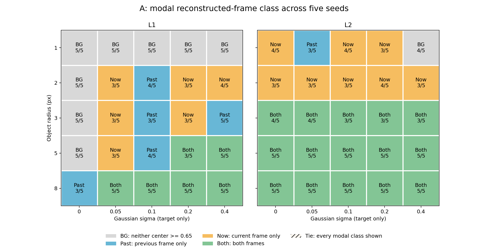

J：保存済み 514 / 514 固有モデルを再評価。再学習なし。
条件所属は重複を許すが、全体・損失別の分布はモデルと設定の同一性で重複を除外する。Gの40中間モデルは追加しない。
平坦背景は各フレームの平均中心輝度 ≥ 0.65。Hのテクスチャ背景は平均（再構成中心 − 描画前背景中心）≥ 平均（物体輝度 − 描画前背景中心）/2。過去Hの判定は書き換えず、rawルールの比較列を残す。
集計のクラスは各モデルの5,000評価例における中心平均で決まり、個々の評価例の可視性を意味しない。
[モデル別](models.csv)・[条件所属別](memberships.csv)・[条件別4分類数](condition_counts.csv)・[プローブ分布](probe_distributions.csv)・[境界近傍](borderline.csv)・[Hの旧新判定](h_rule_comparison.csv)・[未学習25参照](untrained_reference.csv)。

条件別の数は、背景のみ / 過去のみ / 現在のみ / 両フレームの順。

| 群 | 役割 | r | ノイズ | 量 / 背景SD | 入れる場所 | 方法 | n / 予定 | 背景のみ | 過去のみ | 現在のみ | 両フレーム |
|---|---|---:|---|---:|---|---|---:|---:|---:|---:|---:|
| A | primary | 1 | gaussian | 0 | target_only | l1 | 5 / 5 | 5 | 0 | 0 | 0 |
| A | primary | 1 | gaussian | 0 | target_only | l2 | 5 / 5 | 0 | 1 | 4 | 0 |
| A | primary | 1 | gaussian | 0.05 | target_only | l1 | 5 / 5 | 5 | 0 | 0 | 0 |
| A | primary | 1 | gaussian | 0.05 | target_only | l2 | 5 / 5 | 0 | 3 | 2 | 0 |
| A | primary | 1 | gaussian | 0.1 | target_only | l1 | 5 / 5 | 5 | 0 | 0 | 0 |
| A | primary | 1 | gaussian | 0.1 | target_only | l2 | 5 / 5 | 0 | 1 | 4 | 0 |
| A | primary | 1 | gaussian | 0.2 | target_only | l1 | 5 / 5 | 5 | 0 | 0 | 0 |
| A | primary | 1 | gaussian | 0.2 | target_only | l2 | 5 / 5 | 0 | 2 | 3 | 0 |
| A | primary | 1 | gaussian | 0.4 | target_only | l1 | 5 / 5 | 5 | 0 | 0 | 0 |
| A | primary | 1 | gaussian | 0.4 | target_only | l2 | 5 / 5 | 4 | 0 | 1 | 0 |
| A | primary | 2 | gaussian | 0 | target_only | l1 | 5 / 5 | 5 | 0 | 0 | 0 |
| A | primary | 2 | gaussian | 0 | target_only | l2 | 5 / 5 | 0 | 2 | 3 | 0 |
| A | primary | 2 | gaussian | 0.05 | target_only | l1 | 5 / 5 | 0 | 2 | 3 | 0 |
| A | primary | 2 | gaussian | 0.05 | target_only | l2 | 5 / 5 | 0 | 2 | 3 | 0 |
| A | primary | 2 | gaussian | 0.1 | target_only | l1 | 5 / 5 | 0 | 4 | 1 | 0 |
| A | primary | 2 | gaussian | 0.1 | target_only | l2 | 5 / 5 | 0 | 2 | 3 | 0 |
| A | primary | 2 | gaussian | 0.2 | target_only | l1 | 5 / 5 | 0 | 2 | 3 | 0 |
| A | primary | 2 | gaussian | 0.2 | target_only | l2 | 5 / 5 | 0 | 1 | 4 | 0 |
| A | primary | 2 | gaussian | 0.4 | target_only | l1 | 5 / 5 | 0 | 1 | 4 | 0 |
| A | primary | 2 | gaussian | 0.4 | target_only | l2 | 5 / 5 | 0 | 2 | 3 | 0 |
| A | primary | 3 | gaussian | 0 | target_only | l1 | 5 / 5 | 5 | 0 | 0 | 0 |
| A | primary | 3 | gaussian | 0 | target_only | l2 | 5 / 5 | 0 | 1 | 0 | 4 |
| A | primary | 3 | gaussian | 0.05 | target_only | l1 | 5 / 5 | 0 | 2 | 3 | 0 |
| A | primary | 3 | gaussian | 0.05 | target_only | l2 | 5 / 5 | 0 | 0 | 1 | 4 |
| A | primary | 3 | gaussian | 0.1 | target_only | l1 | 5 / 5 | 0 | 3 | 2 | 0 |
| A | primary | 3 | gaussian | 0.1 | target_only | l2 | 5 / 5 | 0 | 0 | 2 | 3 |
| A | primary | 3 | gaussian | 0.2 | target_only | l1 | 5 / 5 | 0 | 2 | 3 | 0 |
| A | primary | 3 | gaussian | 0.2 | target_only | l2 | 5 / 5 | 0 | 1 | 1 | 3 |
| A | primary | 3 | gaussian | 0.4 | target_only | l1 | 5 / 5 | 0 | 5 | 0 | 0 |
| A | primary | 3 | gaussian | 0.4 | target_only | l2 | 5 / 5 | 0 | 2 | 0 | 3 |
| A | primary | 5 | gaussian | 0 | target_only | l1 | 5 / 5 | 5 | 0 | 0 | 0 |
| A | primary | 5 | gaussian | 0 | target_only | l2 | 5 / 5 | 0 | 0 | 0 | 5 |
| A | primary | 5 | gaussian | 0.05 | target_only | l1 | 5 / 5 | 0 | 2 | 3 | 0 |
| A | primary | 5 | gaussian | 0.05 | target_only | l2 | 5 / 5 | 0 | 0 | 0 | 5 |
| A | primary | 5 | gaussian | 0.1 | target_only | l1 | 5 / 5 | 0 | 4 | 1 | 0 |
| A | primary | 5 | gaussian | 0.1 | target_only | l2 | 5 / 5 | 0 | 0 | 0 | 5 |
| A | primary | 5 | gaussian | 0.2 | target_only | l1 | 5 / 5 | 0 | 1 | 1 | 3 |
| A | primary | 5 | gaussian | 0.2 | target_only | l2 | 5 / 5 | 0 | 0 | 0 | 5 |
| A | primary | 5 | gaussian | 0.4 | target_only | l1 | 5 / 5 | 0 | 0 | 0 | 5 |
| A | primary | 5 | gaussian | 0.4 | target_only | l2 | 5 / 5 | 0 | 0 | 0 | 5 |
| A | primary | 8 | gaussian | 0 | target_only | l1 | 5 / 5 | 1 | 3 | 1 | 0 |
| A | primary | 8 | gaussian | 0 | target_only | l2 | 5 / 5 | 0 | 0 | 0 | 5 |
| A | primary | 8 | gaussian | 0.05 | target_only | l1 | 5 / 5 | 0 | 0 | 0 | 5 |
| A | primary | 8 | gaussian | 0.05 | target_only | l2 | 5 / 5 | 0 | 0 | 0 | 5 |
| A | primary | 8 | gaussian | 0.1 | target_only | l1 | 5 / 5 | 0 | 0 | 0 | 5 |
| A | primary | 8 | gaussian | 0.1 | target_only | l2 | 5 / 5 | 0 | 0 | 0 | 5 |
| A | primary | 8 | gaussian | 0.2 | target_only | l1 | 5 / 5 | 0 | 0 | 0 | 5 |
| A | primary | 8 | gaussian | 0.2 | target_only | l2 | 5 / 5 | 0 | 0 | 0 | 5 |
| A | primary | 8 | gaussian | 0.4 | target_only | l1 | 5 / 5 | 0 | 0 | 0 | 5 |
| A | primary | 8 | gaussian | 0.4 | target_only | l2 | 5 / 5 | 0 | 0 | 0 | 5 |
| B | primary | 1 | salt_pepper | 0.2 | target_only | l1 | 3 / 3 | 3 | 0 | 0 | 0 |
| B | primary | 1 | salt_pepper | 0.2 | target_only | l2 | 3 / 3 | 1 | 1 | 1 | 0 |
| B | primary | 1 | salt_pepper | 0.45 | target_only | l1 | 3 / 3 | 3 | 0 | 0 | 0 |
| B | primary | 1 | salt_pepper | 0.45 | target_only | l2 | 3 / 3 | 3 | 0 | 0 | 0 |
| B | primary | 2 | salt_pepper | 0.2 | target_only | l1 | 3 / 3 | 3 | 0 | 0 | 0 |
| B | primary | 2 | salt_pepper | 0.2 | target_only | l2 | 3 / 3 | 0 | 2 | 1 | 0 |
| B | primary | 2 | salt_pepper | 0.45 | target_only | l1 | 3 / 3 | 3 | 0 | 0 | 0 |
| B | primary | 2 | salt_pepper | 0.45 | target_only | l2 | 3 / 3 | 0 | 1 | 2 | 0 |
| B | primary | 3 | salt_pepper | 0.2 | target_only | l1 | 3 / 3 | 3 | 0 | 0 | 0 |
| B | primary | 3 | salt_pepper | 0.2 | target_only | l2 | 3 / 3 | 0 | 0 | 0 | 3 |
| B | primary | 3 | salt_pepper | 0.45 | target_only | l1 | 3 / 3 | 3 | 0 | 0 | 0 |
| B | primary | 3 | salt_pepper | 0.45 | target_only | l2 | 3 / 3 | 0 | 0 | 0 | 3 |
| B | primary | 5 | salt_pepper | 0.2 | target_only | l1 | 3 / 3 | 3 | 0 | 0 | 0 |
| B | primary | 5 | salt_pepper | 0.2 | target_only | l2 | 3 / 3 | 0 | 0 | 0 | 3 |
| B | primary | 5 | salt_pepper | 0.45 | target_only | l1 | 3 / 3 | 3 | 0 | 0 | 0 |
| B | primary | 5 | salt_pepper | 0.45 | target_only | l2 | 3 / 3 | 0 | 0 | 0 | 3 |
| B | primary | 8 | salt_pepper | 0.2 | target_only | l1 | 3 / 3 | 2 | 0 | 1 | 0 |
| B | primary | 8 | salt_pepper | 0.2 | target_only | l2 | 3 / 3 | 0 | 0 | 0 | 3 |
| B | primary | 8 | salt_pepper | 0.45 | target_only | l1 | 3 / 3 | 1 | 0 | 2 | 0 |
| B | primary | 8 | salt_pepper | 0.45 | target_only | l2 | 3 / 3 | 0 | 0 | 0 | 3 |
| D | primary | 5 | gaussian | 0.4 | both | l1 | 5 / 5 | 0 | 0 | 0 | 5 |
| D | primary | 5 | gaussian | 0.4 | both | l2 | 5 / 5 | 0 | 0 | 0 | 5 |
| D | primary | 5 | gaussian | 0.4 | input_only | l1 | 5 / 5 | 5 | 0 | 0 | 0 |
| D | primary | 5 | gaussian | 0.4 | input_only | l2 | 5 / 5 | 0 | 0 | 0 | 5 |
| D | primary | 5 | salt_pepper | 0.2 | both | l1 | 5 / 5 | 5 | 0 | 0 | 0 |
| D | primary | 5 | salt_pepper | 0.2 | both | l2 | 5 / 5 | 0 | 0 | 0 | 5 |
| D | primary | 5 | salt_pepper | 0.2 | input_only | l1 | 5 / 5 | 5 | 0 | 0 | 0 |
| D | primary | 5 | salt_pepper | 0.2 | input_only | l2 | 5 / 5 | 0 | 0 | 0 | 5 |
| D | target_only_control | 5 | gaussian | 0.4 | target_only | l1 | 5 / 5 | 0 | 0 | 0 | 5 |
| D | target_only_control | 5 | gaussian | 0.4 | target_only | l2 | 5 / 5 | 0 | 0 | 0 | 5 |
| D | target_only_control | 5 | salt_pepper | 0.2 | target_only | l1 | 5 / 5 | 5 | 0 | 0 | 0 |
| D | target_only_control | 5 | salt_pepper | 0.2 | target_only | l2 | 5 / 5 | 0 | 0 | 0 | 5 |
| G | primary | 5 | gaussian | 0 | target_only | l1_6000 | 5 / 5 | 5 | 0 | 0 | 0 |
| G | primary | 5 | gaussian | 0 | target_only | l2_3000_l1_3000 | 5 / 5 | 0 | 0 | 1 | 4 |
| G | primary | 5 | gaussian | 0 | target_only | l2_6000 | 5 / 5 | 0 | 0 | 0 | 5 |
| G | primary | 5 | salt_pepper | 0.1 | target_only | l1_6000 | 5 / 5 | 5 | 0 | 0 | 0 |
| G | primary | 5 | salt_pepper | 0.1 | target_only | l2_3000_l1_3000 | 5 / 5 | 0 | 0 | 0 | 5 |
| G | primary | 5 | salt_pepper | 0.1 | target_only | l2_6000 | 5 / 5 | 0 | 0 | 0 | 5 |
| G | primary | 5 | salt_pepper | 0.2 | target_only | l1_6000 | 5 / 5 | 5 | 0 | 0 | 0 |
| G | primary | 5 | salt_pepper | 0.2 | target_only | l2_3000_l1_3000 | 5 / 5 | 0 | 0 | 0 | 5 |
| G | primary | 5 | salt_pepper | 0.2 | target_only | l2_6000 | 5 / 5 | 0 | 0 | 0 | 5 |
| G | primary | 5 | salt_pepper | 0.3 | target_only | l1_6000 | 5 / 5 | 5 | 0 | 0 | 0 |
| G | primary | 5 | salt_pepper | 0.3 | target_only | l2_3000_l1_3000 | 5 / 5 | 0 | 0 | 0 | 5 |
| G | primary | 5 | salt_pepper | 0.3 | target_only | l2_6000 | 5 / 5 | 0 | 0 | 0 | 5 |
| G | primary | 5 | salt_pepper | 0.45 | target_only | l1_6000 | 5 / 5 | 5 | 0 | 0 | 0 |
| G | primary | 5 | salt_pepper | 0.45 | target_only | l2_3000_l1_3000 | 5 / 5 | 0 | 0 | 0 | 5 |
| G | primary | 5 | salt_pepper | 0.45 | target_only | l2_6000 | 5 / 5 | 0 | 0 | 0 | 5 |
| G | primary | 8 | gaussian | 0 | target_only | l1_6000 | 5 / 5 | 1 | 3 | 1 | 0 |
| G | primary | 8 | gaussian | 0 | target_only | l2_3000_l1_3000 | 5 / 5 | 0 | 0 | 0 | 5 |
| G | primary | 8 | gaussian | 0 | target_only | l2_6000 | 5 / 5 | 0 | 0 | 0 | 5 |
| G | primary | 8 | salt_pepper | 0.2 | target_only | l1_6000 | 5 / 5 | 2 | 0 | 3 | 0 |
| G | primary | 8 | salt_pepper | 0.2 | target_only | l2_3000_l1_3000 | 5 / 5 | 0 | 0 | 0 | 5 |
| G | primary | 8 | salt_pepper | 0.2 | target_only | l2_6000 | 5 / 5 | 0 | 0 | 0 | 5 |
| G | primary | 8 | salt_pepper | 0.45 | target_only | l1_6000 | 5 / 5 | 1 | 0 | 4 | 0 |
| G | primary | 8 | salt_pepper | 0.45 | target_only | l2_3000_l1_3000 | 5 / 5 | 0 | 0 | 0 | 5 |
| G | primary | 8 | salt_pepper | 0.45 | target_only | l2_6000 | 5 / 5 | 0 | 0 | 0 | 5 |
| H | flat_control | 5 | なし（平坦背景） | 背景SD 0 | 入力・教師で共通 | l1 | 5 / 5 | 5 | 0 | 0 | 0 |
| H | flat_control | 5 | なし（平坦背景） | 背景SD 0 | 入力・教師で共通 | l2 | 5 / 5 | 0 | 0 | 0 | 5 |
| H | flat_control | 8 | なし（平坦背景） | 背景SD 0 | 入力・教師で共通 | l1 | 5 / 5 | 1 | 3 | 1 | 0 |
| H | flat_control | 8 | なし（平坦背景） | 背景SD 0 | 入力・教師で共通 | l2 | 5 / 5 | 0 | 0 | 0 | 5 |
| H | primary | 5 | なし（背景模様） | 背景SD 0.1 | 入力・教師で共通 | l1 | 5 / 5 | 5 | 0 | 0 | 0 |
| H | primary | 5 | なし（背景模様） | 背景SD 0.1 | 入力・教師で共通 | l2 | 5 / 5 | 0 | 0 | 0 | 5 |
| H | primary | 5 | なし（背景模様） | 背景SD 0.4 | 入力・教師で共通 | l1 | 5 / 5 | 5 | 0 | 0 | 0 |
| H | primary | 5 | なし（背景模様） | 背景SD 0.4 | 入力・教師で共通 | l2 | 5 / 5 | 5 | 0 | 0 | 0 |
| H | primary | 8 | なし（背景模様） | 背景SD 0.1 | 入力・教師で共通 | l1 | 5 / 5 | 0 | 1 | 2 | 2 |
| H | primary | 8 | なし（背景模様） | 背景SD 0.1 | 入力・教師で共通 | l2 | 5 / 5 | 0 | 0 | 0 | 5 |
| H | primary | 8 | なし（背景模様） | 背景SD 0.4 | 入力・教師で共通 | l1 | 5 / 5 | 0 | 0 | 0 | 5 |
| H | primary | 8 | なし（背景模様） | 背景SD 0.4 | 入力・教師で共通 | l2 | 5 / 5 | 1 | 0 | 1 | 3 |

プローブ値は中央値 [最小, 最大]。未学習参照は半径別5シードで、損失・再構成分類は適用しない。

| 母集団 | 損失 | 再構成分類 | r | n | 位置MLP R² | 速度MLP R² | 未来MLP R² |
|---|---|---|---|---:|---:|---:|---:|
| trained_unique | all | 背景のみ | all | 138 | 0.92755 [-0.08480, 0.99630] | 0.04672 [-0.09328, 0.87053] | 0.66114 [-0.11748, 0.92180] |
| trained_unique | all | 過去のみ | all | 59 | 0.81888 [0.74582, 0.83662] | 0.05067 [0.03286, 0.29378] | 0.42045 [0.25556, 0.45854] |
| trained_unique | all | 現在のみ | all | 78 | 0.99250 [0.32996, 0.99845] | 0.06440 [-0.04881, 0.86357] | 0.79551 [0.15618, 0.94417] |
| trained_unique | all | 両フレーム | all | 239 | 0.98898 [0.21553, 0.99741] | 0.96415 [-0.07192, 0.99267] | 0.97345 [0.08707, 0.99250] |
| trained_unique | l1 | 背景のみ | all | 124 | 0.92801 [-0.08480, 0.99630] | 0.06605 [-0.09328, 0.87053] | 0.67369 [-0.11748, 0.92180] |
| trained_unique | l1 | 過去のみ | all | 35 | 0.81536 [0.74582, 0.82821] | 0.05151 [0.04687, 0.29378] | 0.39997 [0.25556, 0.45854] |
| trained_unique | l1 | 現在のみ | all | 38 | 0.99405 [0.98863, 0.99845] | 0.07105 [0.05692, 0.43119] | 0.78466 [0.72464, 0.81473] |
| trained_unique | l1 | 両フレーム | all | 40 | 0.99379 [0.40761, 0.99718] | 0.97916 [-0.05657, 0.99028] | 0.98056 [0.18722, 0.99193] |
| trained_unique | l2 | 背景のみ | all | 14 | 0.88209 [-0.07128, 0.99177] | 0.00939 [-0.08349, 0.14166] | 0.54028 [-0.09788, 0.80510] |
| trained_unique | l2 | 過去のみ | all | 24 | 0.82801 [0.81656, 0.83662] | 0.04812 [0.03286, 0.05775] | 0.42989 [0.40129, 0.45184] |
| trained_unique | l2 | 現在のみ | all | 39 | 0.99153 [0.32996, 0.99445] | 0.05988 [-0.04881, 0.86357] | 0.79764 [0.15618, 0.94417] |
| trained_unique | l2 | 両フレーム | all | 160 | 0.98795 [0.21553, 0.99719] | 0.96093 [-0.07192, 0.99267] | 0.97248 [0.08707, 0.99250] |
| trained_unique | l2_to_l1 | 背景のみ | all | 0 | 該当なし | 該当なし | 該当なし |
| trained_unique | l2_to_l1 | 過去のみ | all | 0 | 該当なし | 該当なし | 該当なし |
| trained_unique | l2_to_l1 | 現在のみ | all | 1 | 0.99584 [0.99584, 0.99584] | 0.07481 [0.07481, 0.07481] | 0.76499 [0.76499, 0.76499] |
| trained_unique | l2_to_l1 | 両フレーム | all | 39 | 0.99103 [0.98637, 0.99741] | 0.97056 [0.94517, 0.99159] | 0.97627 [0.96662, 0.99224] |
| untrained_reference | not_applicable | 適用なし | 1 | 5 | 0.77129 [0.70566, 0.80304] | -0.03215 [-0.03685, -0.02940] | 0.50940 [0.49481, 0.57521] |
| untrained_reference | not_applicable | 適用なし | 2 | 5 | 0.79948 [0.71712, 0.85204] | -0.00048 [-0.01792, 0.02338] | 0.52723 [0.48896, 0.64432] |
| untrained_reference | not_applicable | 適用なし | 3 | 5 | 0.83204 [0.74429, 0.88195] | 0.07694 [0.04994, 0.09192] | 0.56828 [0.51823, 0.67818] |
| untrained_reference | not_applicable | 適用なし | 5 | 5 | 0.88104 [0.80450, 0.94155] | 0.29723 [0.16992, 0.34508] | 0.67393 [0.58551, 0.74142] |
| untrained_reference | not_applicable | 適用なし | 8 | 5 | 0.92718 [0.81749, 0.96586] | 0.51984 [0.46846, 0.62137] | 0.77413 [0.64683, 0.80657] |

符号付き判定余裕の絶対値が0.05以下のモデル：13 件。境界近傍CSVに両フレームの値と元設定IDを保存。
Hの旧raw中心基準から分類が変わったモデル：1 / 60 件（平坦対照を含む）。
Aヒートマップは最頻クラスとその数を示す。同数首位は全該当クラスを明示し斜線表示する。

境界近傍モデルの全件。余裕は中心基準の左辺 − 右辺（平坦背景は中心輝度 − 0.65）。

| 群 | r | ノイズ・量 | 背景SD | 入れる場所 | 方法 | seed | 過去中心 | 現在中心 | 過去余裕 | 現在余裕 | 分類 | 元ID |
|---|---:|---|---:|---|---|---:|---:|---:|---:|---:|---|---|
| A | 1 | gaussian 0.2 | 0 | target_only | l2 | 0 | 0.30386 | 0.65955 | -0.34614 | 0.00955 | 現在のみ | db64559d8865 |
| A | 1 | gaussian 0.4 | 0 | target_only | l2 | 3 | 0.30408 | 0.68537 | -0.34592 | 0.03537 | 現在のみ | 55d6c3ad2573 |
| A | 1 | gaussian 0.4 | 0 | target_only | l2 | 4 | 0.63822 | 0.30430 | -0.01178 | -0.34570 | 背景のみ | bd27ae0db524 |
| A | 5 | gaussian 0.2 | 0 | target_only | l1 | 3 | 0.65851 | 0.97589 | 0.00851 | 0.32589 | 両フレーム | 802138c2ee11 |
| B | 1 | salt_pepper 0.2 | 0 | target_only | l2 | 0 | 0.69171 | 0.34426 | 0.04171 | -0.30574 | 過去のみ | 2704d63a58b9 |
| B | 1 | salt_pepper 0.2 | 0 | target_only | l2 | 1 | 0.34258 | 0.68339 | -0.30742 | 0.03339 | 現在のみ | a2eda4d69d6e |
| B | 1 | salt_pepper 0.2 | 0 | target_only | l2 | 2 | 0.34143 | 0.64223 | -0.30857 | -0.00777 | 背景のみ | af75fa3adc2f |
| H | 8 | なし（背景模様） | 0.1 | 入力・教師で共通 | l1 | 2 | 1.00299 | 0.60313 | 0.35327 | -0.04594 | 過去のみ | 714e0f859c99 |
| H | 8 | なし（背景模様） | 0.4 | 入力・教師で共通 | l2 | 0 | 0.64205 | 0.64500 | -0.00685 | -0.00128 | 背景のみ | 2b882c8508a9 |
| H | 8 | なし（背景模様） | 0.4 | 入力・教師で共通 | l2 | 1 | 0.68932 | 0.68106 | 0.04043 | 0.03478 | 両フレーム | 6bda93fcbd87 |
| H | 8 | なし（背景模様） | 0.4 | 入力・教師で共通 | l2 | 2 | 0.65584 | 0.65530 | 0.00694 | 0.00902 | 両フレーム | bf82276653ce |
| H | 8 | なし（背景模様） | 0.4 | 入力・教師で共通 | l2 | 3 | 0.65480 | 0.66032 | 0.00590 | 0.01404 | 両フレーム | bbd625281eb1 |
| H | 8 | なし（背景模様） | 0.4 | 入力・教師で共通 | l2 | 4 | 0.63922 | 0.64655 | -0.00968 | 0.00027 | 現在のみ | 1e7439cd292a |

Hで旧raw中心ルールから分類が変わった全件。

| r | 背景SD | 損失 | seed | 旧raw分類 | 新分類 | 過去余裕 | 現在余裕 | 元ID |
|---:|---:|---|---:|---|---|---:|---:|---|
| 8 | 0.4 | l2 | 4 | 背景のみ | 現在のみ | -0.00968 | 0.00027 | 1e7439cd292a |
