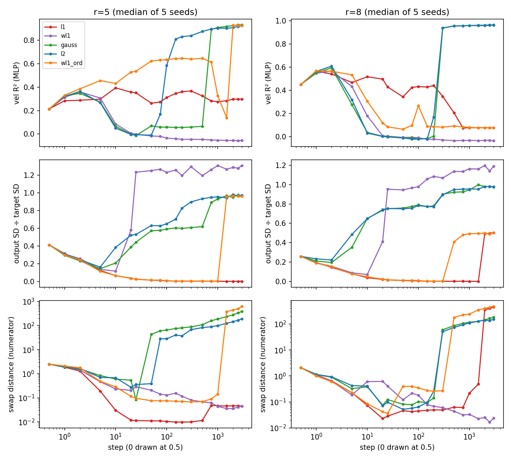
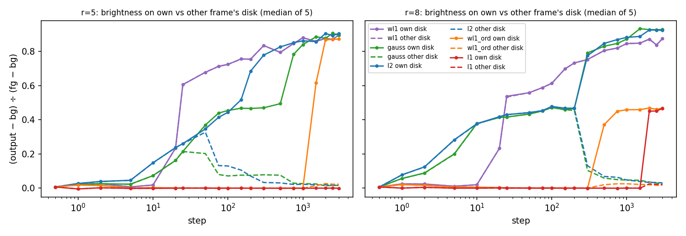
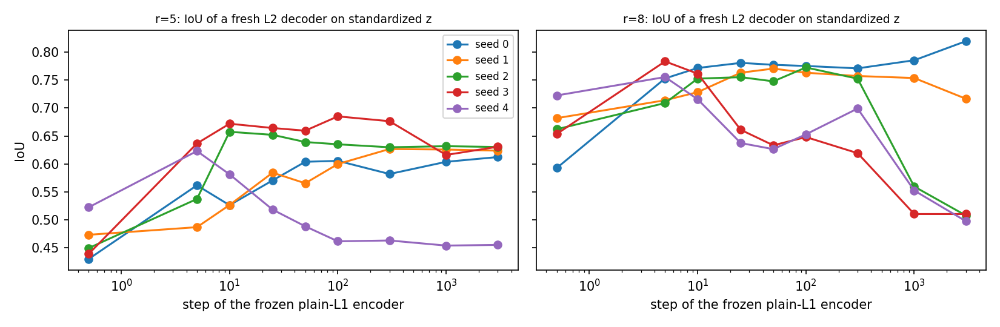
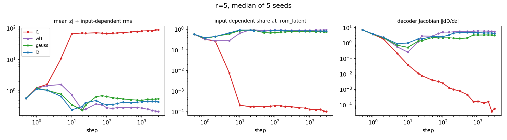
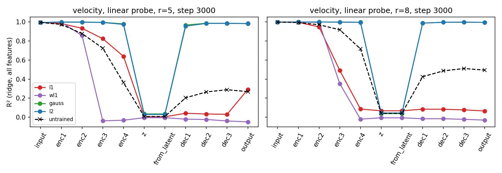

# 実験R：内部表現の形成メカニズム（報告）

- **ブランチとファイル：** ブランチ `experiment/representation-analysis`、場所は `results/r_mechanism/`。
  - 数値は `tables.md`、図は `figures/`、再現手順は `README.md` にある。
- **計画の順序：** 事前計画（`PLAN.md`、f1b76b7）は最初の学習より前にコミットした。追加実験F2の計画（`PLAN_followups.md`、c21f3bf）も、F2を走らせる前にコミットした。
- **事前の予測がない分析：** drift・cross_arm（F1）・union（F3）は、結果を見てから加えた探索的な分析である。
- **Codexの数値：** Codexが報告した数値（ブランチ experiment/representation-mechanism、未公開）は一切使っていない。

## 0. 結論の要約

1. **L1の停滞の実装：** L1の背景一色は、最初の約10更新で「z の平均ベクトルが入力による変動の約100倍に膨らむ」ことと、「デコーダの z に対する感度が下がり続ける」ことで実現されている（r=5、5/5シード）。
   - **3000更新時点：** デコーダの入口で入力に依存する成分は、エネルギーで約10⁻⁴しかない。z に対するデコーダの感度（ヤコビ行列のノルム）は、学習前の約10⁻⁵倍である。
   - **因果ではない：** これは停滞の「原因」ではなく、平坦な出力を作る「手段」である。z をBatchNormで正規化してこの手段を塞いでも、r=5では背景一色または片フレーム出力に落ち、別の経路（デコーダの感度の低下）で平坦になった。
2. **L1のエンコーダは、再構成に使える情報を学習で獲得していた。** 学習済みのL1エンコーダを固定し、z を中心化してL2でデコーダを学習し直した。
   - IoUは、学習していないエンコーダより0.12〜0.20高かった（r=5、4/5シード）。
   - **r=8では分かれる：** 元の学習で背景出力になった2シードは同じ傾向だった。片フレーム出力になった3シードは、描かなかったフレームの情報を失っていた。
   - 中心化しない場合は、逆に0.29〜0.46低かった。
   - 違いを生むのは z の「平均のずれ」である。スケーリングだけでは改善しなかった。
3. **情報を獲得した時期：** この情報は、停滞中ではなく、背景一色に落ちる過渡期（最初の約25更新）に獲得されていた。
   - 途中のチェックポイントのエンコーダで同じ再学習をすると、IoUの中央値は学習前0.45 → 5更新0.56 → 100更新0.61 → 3000更新0.62となった（r=5、追加実験F2、事前予測どおり）。
   - **例外：** シード4だけは、停滞中に0.62から0.46へ下がった。
   - z 自体も、100更新以降はほぼ一次変換の範囲でしか変わらなかった（4/5シードで、アフィン写像による決定係数 R² ≥ 0.95）。
   - したがって「停滞中も内部表現の学習が進んだ」とは言えない。
   - 停滞中も動いているのは、デコーダの感度の縮小である。これは実験Aの「更新は背景誤差の打ち消しに使われ続ける」と整合する。
4. **重み付きL1で順序が失われる理由：** 「順序が分からないときの最適な出力」が、重み付きL1では両方の円を明るく描く出力（和集合）になるからである。
   - **L2と平滑化L1も同じ段階を通る：** L2と解析的平滑化L1も、学習初期に順序のない段階を必ず通っていた（L2は半分の明るさで両方の円を描く）。それぞれ約100〜1000更新でそこから抜けた。
   - **重み付きL1は抜けない：** 他方の円を描く罰が背景の重み w しかないため、この段階に約20更新で入ったまま抜けなかった。
   - **因果的な確認：** 他方のフレームの円の画素だけ重みを1に戻すと（wl1_ord）、和集合の出力は10本中0本になった。r=5では4/5シードで順序と速度が回復した。r=8では、5/5シードが通常のL1と同じ片フレーム出力になった。
5. **順序の情報はエンコーダの畳み込み層の段階で失われる：** 重み付きL1では、エンコーダの3層目以降で速度が線形に読めなくなる。フレームを入れ替えたときの z の変化は、絶対値でも約50分の1に縮んだ（r=5）。
   - **増幅しても戻らない：** z の反対称成分を100倍に増幅してデコードしても、出力に順序は現れなかった。
   - **r=8の残りは初期値由来：** r=8では反対称成分から速度がR² 約0.38で読めた。しかしこれは、学習前のネットワークの値（0.35）と同じ水準であり、学習で得た順序の情報とは言えない。

---

## 1. 方法

### 1.1 モデルと条件
論文の設定を維持した。
- **データ：** 64×64、2フレーム、背景0.3、円1.0、Δ=4、反射を棄却。
- **モデル：** 潜在次元16、Adam、学習率0.003、バッチ128、3000更新。
- **条件：** r=5・8、シード0〜4。

| 条件 | 損失 | 備考 |
|---|---|---|
| l1 | L1 | 背景一色（r=5 5/5、r=8 2/5、残り3/5は現在フレームのみ） |
| wl1 | 背景画素の重み w=0.1（r=5）、0.3（r=8）のL1 | 4.8.8項・実験Nと同じ |
| gauss | 解析的平滑化L1、σ=0.4 | 両半径で両フレーム出力 5/5（実験M） |
| l2 | L2 | 基準 |
| 未学習 | 各シードの学習前（step 0） | 初期値と学習動画の系列は全損失で共通 |
| wl1_ord | wl1のうち、他方のフレームの円の画素だけ重み1 | 因果的な検証（4節） |
| l1_affine / l1_bn / l1_switch300 | L1に z の正規化を挿入 | G4（6節） |

- **台帳との照合：** 基本の40本は学習し直し、最終パラメータのSHA-256が論文の台帳と40/40一致した。チェックポイントは20時点（0, 1, 2, 5, 10, 20, 25, 50, 75, 100, 150, 200, 300, 500, 750, 1000, 1500, 2000, 2500, 3000）で保存した。
- **プローブ：** 学習用は系列2の4096組、評価用は系列3の2048組。論文の主実験（系列2・3、1万組）より学習データが少ない。そのため、本報告のプローブの値は論文の値より低めに出る（例：L1 r=5の速度MLP R²の中央値は、論文0.46に対して0.30）。
- **画像の指標：** 系列9の1024組で求めた。予測の円の判定は出力 > 0.65、正解の円の判定は被覆率 > 0.5 とした。

### 1.2 計算上の注意
- **G3の計算：** 108個のデコーダを、グループ化した転置畳み込みでまとめて学習した。各デコーダを個別に計算した場合との差は最大9×10⁻⁸だった。TF32は使っていない（L1の z の入力依存成分は平均の約10⁻²しかないため）。
- **層別プローブの修正：** 当初の実装は、特徴量を1次元ずつ標準化していた。この方法では、まれにしか円に覆われない画素で値が極端に大きくなる。その結果、交差検証で最も強い正則化が選ばれ、r=8の入力層で速度R²が0.25になった。
  - 中心化だけを行い、正則化の強さを特徴量の分散の総和に比例させる方式に直した。
  - 全40本を計算し直した。旧版は `layers_superseded_standardized_ridge.jsonl` に残してある。
- **次元をそろえたプローブ（PCA64）の修正：** ランク16しかない層では、数値上ほぼ0の主成分を落とすように直した。

---

## 2. G3：エンコーダを固定し、デコーダを学習し直す

新しいデコーダ（元の学習と同じ初期値・同じ学習動画の系列）を、Adam（学習率3×10⁻³）で3000更新学習した。各セルは5シードのIoUの中央値で、括弧内はIoU > 0.5のシード数である。

**L2で学習し直した場合（r=5）**

| エンコーダ | 前処理なし | 中心化 | スケーリング | 標準化 | 白色化 | ランダム線形 |
|---|---|---|---|---|---|---|
| 未学習 | 0.447 (1/5) | 0.456 (1/5) | 0.448 (1/5) | 0.456 (1/5) | 0.448 (1/5) | 0.422 (0/5) |
| L1 | 0.128 (0/5) | **0.605 (4/5)** | 0.064 (0/5) | **0.626 (4/5)** | **0.657 (5/5)** | 0.003 (0/5) |
| 重み付きL1 | 0.387 (0/5) | 0.388 (0/5) | 0.380 (0/5) | 0.393 (0/5) | 0.369 (0/5) | 0.379 (0/5) |
| 平滑化L1 | 0.931 (5/5) | 0.932 (5/5) | 0.935 (5/5) | 0.938 (5/5) | 0.936 (5/5) | 0.915 (5/5) |
| L2 | 0.934 (5/5) | 0.925 (5/5) | 0.933 (5/5) | 0.934 (5/5) | 0.932 (5/5) | 0.914 (5/5) |

**L2で学習し直した場合（r=8）**

| エンコーダ | 前処理なし | 中心化 | スケーリング | 標準化 | 白色化 | ランダム線形 |
|---|---|---|---|---|---|---|
| 未学習 | 0.661 (5/5) | 0.656 (5/5) | 0.660 (5/5) | 0.659 (5/5) | 0.664 (5/5) | 0.633 (5/5) |
| L1 | 0.509 (3/5) | 0.511 (4/5) | 0.508 (3/5) | 0.510 (4/5) | 0.511 (5/5) | 0.507 (3/5) |
| 重み付きL1 | 0.523 (5/5) | 0.530 (5/5) | 0.528 (5/5) | 0.526 (5/5) | 0.522 (5/5) | 0.533 (5/5) |
| 平滑化L1 | 0.960 (5/5) | 0.965 (5/5) | 0.965 (5/5) | 0.965 (5/5) | 0.963 (5/5) | 0.953 (5/5) |
| L2 | 0.965 (5/5) | 0.962 (5/5) | 0.963 (5/5) | 0.962 (5/5) | 0.966 (5/5) | 0.951 (5/5) |

r=8のL1は、元の学習の最終状態がシードで分かれる（シード0・1は背景出力、シード2〜4は現在フレームだけの片フレーム出力）。

| L1エンコーダ・r=8 | 前処理なし | 標準化 | 未学習（標準化） |
|---|---|---|---|
| シード0（背景出力） | 0.595 | **0.810** | 0.59 |
| シード1（背景出力） | 0.460 | **0.713** | 0.68 |
| シード2〜4（片フレーム出力） | 0.50〜0.51 | 0.50〜0.51 | 0.65〜0.72 |

- **背景出力の2シード：** r=5と同じく、標準化で大きく改善した。
- **片フレーム出力の3シード：** 前処理によらず約0.5で、ちょうど1フレームだけを正しく描いた値である。描かなかったフレームの位置の情報を、エンコーダが失っている（実験Nの片フレーム出力の結果と同じ）。

**L1で学習し直した場合：**
- 未学習とL1のエンコーダは、すべての前処理・学習率・SGDで、r=5の5/5シードがIoU 0（背景一色）だった。
- L2と平滑化L1のエンコーダでは、中心化・標準化・白色化でIoU 約0.45だった。これは片方のフレームだけを描いた出力である（標準化の10本中9本が片フレーム、1本が背景）。
- **r=8：** 未学習のエンコーダでも、L1で学習し直すとIoU 約0.42（片フレーム出力、1〜2/5がIoU > 0.5）だった。L1エンコーダは約0.48だった。
  - **L2エンコーダの例外：** 次の2つの設定では、両フレームを描いた。
    - 「標準化（初期の関数は前処理なし版）」：0.887（3/5）
    - SGD（学習率0.1）：0.81（5/5）
  - **未検証：** L1でのデコーダの学習が、最適化器やパラメータ化の違いに敏感である可能性を示すが、検証はしていない。

### 事前に定めた判定
- **G3-info（学習で再構成に使える情報が加わったか）：** 基準は、未学習より0.1以上高いシードが4/5以上あることとした。
  - **L1エンコーダ・r=5：** 中心化・標準化とも4/5で、**支持**。差は +0.12〜+0.20 で、例外はシード4（−0.09／−0.05）。
  - **前処理なしの場合：** 0/5で、L1エンコーダのほうが未学習より悪い。
  - **重み付きL1：** 0/5で、どの前処理でも未学習より低い。
  - **L2・平滑化L1：** 5/5。
  - **L1エンコーダ・r=8：** 1/5で、**支持されない**。差はシード0から順に +0.22, +0.03, −0.15, −0.14, −0.22。
    - 背景出力の2シードは正、片フレーム出力の3シードは負で、元の学習の最終状態で分かれる。
- **G3-L1specific（標準化の効果はL1に特有か）：** 標準化による向上の中央値は、L1エンコーダが +0.51、L2エンコーダが +0.00 で、差は0.51（基準は ≥ 0.1）。r=5で**支持**。
  - **r=8：** 中央値の差は0.004で、**支持されない**。ただし背景出力の2シードに限れば、+0.21と+0.25だった。
- **G3-param（効果は初期の関数か、パラメータ化か）：** 下の表は、L1エンコーダ・L2デコーダ・r=5のIoUである。

  | シード | なし | なし（初期の関数だけ標準化版） | 標準化（初期の関数は「なし」版） | 標準化 |
  |---|---|---|---|---|
  | 0 | 0.000 | 0.342 | 0.542 | 0.610 |
  | 1 | 0.000 | 0.365 | 0.464 | 0.626 |
  | 2 | 0.128 | 0.391 | 0.495 | 0.635 |
  | 3 | 0.143 | 0.360 | 0.490 | 0.636 |
  | 4 | 0.227 | 0.279 | 0.367 | 0.475 |

  - 5/5シードで、なし < 初期の関数だけ標準化 < パラメータ化だけ標準化 < 標準化、の順になった。
  - パラメータ化の効果（中央値 +0.36）が、初期の関数の効果（+0.23）より大きい。ただし、どちらか一方だけでは標準化に届かない。
  - **部分的に支持：** 主な経路は最適化のパラメータ化であり、出発点の違いも一部寄与する。
- **事前の予測の当否：** 当たらなかったものがある。
  - **予測「L2で学習し直せば、未学習を含む全エンコーダでIoU > 0.5」：棄却。** 未学習は0.45、中心化しないL1は0.13だった。
  - **予測「L1で学習し直すと、L2エンコーダを含め全エンコーダで停滞する」：棄却。** L2と平滑化L1のエンコーダでは、片フレーム出力まで進んだ。

### 解釈
- **平均のずれ：** L1で学習したエンコーダの z は、平均が1次元あたりの標準偏差の約350倍ずれている（未学習は約2.3倍、L2は1.8倍）。
- **ずれが学習を妨げる仕組み：** 第1層の重みの勾配は δzᵀ に比例するので、z ≈ z̄ のとき、更新のほとんどは z̄ 方向（定数出力）に使われる。入力に依存する成分を増幅する方向には、ほとんど進まない。
  - これは「入力の平均を0にしないと勾配降下が遅くなる」という一般的な現象（LeCun et al., Efficient BackProp）の極端な例である。
  - **最適化の問題であることの裏付け：** 学習率を変えても（3×10⁻⁴、3×10⁻²）、SGDにしても解消しなかった。初期の出力をそろえた対照では、パラメータ化の効果が大きかった。
- **L1に特有な点：** 平均のずれを作るのがL1の学習だという点である。標準化の効果そのものは、L1に特有の現象ではない。
- **L1で学習し直すと戻らない理由：** 再学習でも背景勾配の支配（実験A）が同じように起きるためと考えられる。エンコーダが良い（L2・平滑化L1）と、片フレームまでは進む。

---

## 3. D：学習途中の表現の追跡

### 3.1 中央値の推移
（速度R²（MLP）／現在位置R²（MLP）／出力の空間SD÷正解の空間SD、5シードの中央値）

| r=5 | 0 | 1 | 2 | 5 | 10 | 25 | 50 | 100 | 300 | 1000 | 3000 |
|---|---|---|---|---|---|---|---|---|---|---|---|
| l1 | 0.21/0.87/0.41 | 0.28/0.91/0.31 | 0.29/0.93/0.24 | 0.30/0.94/0.12 | 0.39/0.89/0.07 | 0.35/0.93/0.02 | 0.26/0.94/0.01 | 0.31/0.94/0.01 | 0.37/0.95/0.00 | 0.28/0.95/0.00 | 0.30/0.95/0.00 |
| wl1 | 0.21/0.87/0.41 | 0.31/0.92/0.31 | 0.36/0.92/0.26 | 0.31/0.95/0.14 | 0.09/0.94/0.12 | −0.00/0.93/1.23 | −0.02/0.94/1.25 | −0.03/0.94/1.23 | −0.04/0.94/1.30 | −0.05/0.93/1.31 | −0.05/0.93/1.31 |
| gauss | 0.21/0.87/0.41 | 0.32/0.93/0.29 | 0.35/0.93/0.23 | 0.27/0.96/0.14 | 0.07/0.95/0.21 | −0.01/0.94/0.44 | 0.07/1.00/0.57 | 0.06/1.00/0.59 | 0.06/1.00/0.61 | 0.91/0.98/0.93 | 0.93/0.98/0.96 |
| l2 | 0.21/0.87/0.41 | 0.32/0.93/0.31 | 0.36/0.93/0.24 | 0.27/0.96/0.16 | 0.05/0.93/0.38 | −0.01/0.94/0.53 | −0.01/0.93/0.63 | 0.59/0.98/0.65 | 0.84/0.97/0.90 | 0.90/0.98/0.96 | 0.92/0.98/0.97 |

### 3.2 停滞の判定と事前の予測D1
- **判定基準（事前に固定）：** 両フレームの中心輝度 < 0.65 かつ、出力の空間SD < 正解の10%。
  - **r=5のL1：** 5/5シードが5〜10更新で基準を満たし、3000更新まで戻らなかった。
- **予測D1：** 速度R²の上昇（0→3000）の80%以上が、停滞の開始より前に起きる。
  - **結果：** シード0〜4で 0.58, 0.55, 1.00, 2.59, 0.59 となり、**支持されなかった**。
  - **停滞中の変化はシードで逆向き：**
    - シード0：0.45 → 0.62
    - シード1：0.30 → 0.37
    - シード2：0.30 → 0.30
    - シード3：0.39 → 0.25
    - シード4：0.11 → 0.02
  - 「L1でも停滞中に変位の表現が学習される」とも、「停滞前にすべて決まる」とも言えない。速度R²の値は、停滞中にシードごとに逆向きに動いた。
- **表現そのものの変化（drift.py）：** z_3000 を z_i のアフィン写像で近似したときのR²で測った（r=5のL1）。
  - **100更新から：** 0.69, 0.95, 0.99, 0.95, 0.97。
  - **1000更新から：** 全シードで ≥ 0.97。
  - **解釈：** 5シード中4シードでは、100更新以降の z は一次変換の範囲でしか変わっていない。例外のシード0は、750更新前後に一度大きく変わった（速度R²も0.69→0.61）。
- **デコーダは停滞中も変わり続ける：** z に対するデコーダの感度（ヤコビ行列のノルム）は、10更新で4×10⁻²、100更新で2.5×10⁻³、3000更新で6×10⁻⁵ と下がり続けた（中央値）。

### 3.3 損失によらない初期の変化と、順序のない過渡期
- **最初の1〜2更新：** すべての損失で、速度R²が上がる（0.21→約0.35）。
- **10〜50更新：** L2・平滑化L1・重み付きL1では、速度R²がほぼ0まで下がる。L1は下がり方が小さく、0.26〜0.39を保つ。
- **追加の分析F3（union.py）で分かったこと：** この時期の出力は「順序のない和集合」だった。
  - **方法：** 各チャネルについて、自分の円と他方の円の上の明るさ（背景との差、円の輝度差で割った値）を測った。

| r=8（中央値） | 5 | 10 | 25 | 50 | 100 | 200 | 300 | 1000 | 3000 |
|---|---|---|---|---|---|---|---|---|---|
| L2 | 0.28/0.28 | 0.38/0.38 | 0.43/0.43 | 0.44/0.44 | 0.48/0.48 | 0.47/0.47 | 0.78/0.13 | 0.88/0.05 | 0.92/0.03 |
| 平滑化L1 | 0.20/0.20 | 0.38/0.38 | 0.42/0.42 | 0.43/0.43 | 0.47/0.47 | 0.47/0.46 | 0.79/0.10 | 0.87/0.05 | 0.93/0.03 |
| 重み付きL1 | 0.01/0.01 | 0.02/0.02 | 0.54/0.53 | 0.56/0.56 | 0.61/0.61 | 0.73/0.73 | 0.75/0.75 | 0.85/0.85 | 0.87/0.87 |
| wl1_ord | 0.01/0.01 | 0.01/0.01 | 0.00/0.00 | 0.00/0.00 | 0.00/0.00 | 0.00/0.00 | 0.00/0.00 | 0.46/0.03 | 0.47/0.02 |
| L1 | 0.00/0.00 | 0.00/0.00 | 0.00/0.00 | 0.00/0.00 | 0.00/0.00 | 0.00/0.00 | −0.00/−0.00 | 0.00/0.00 | 0.47/0.02 |

（自分の円／他方の円。r=5も同じ傾向で、L2は100〜200更新、平滑化L1は500〜1000更新で順序のある出力に移った。）

- **L2と平滑化L1：** 順序が分かる前は、両方の円をほぼ半分の明るさで描く。これは、順序が五分五分のときのL2の最適解（平均値）に当たる。順序を学ぶと、自分の円だけを描く出力に移る。
- **重み付きL1：** 両方の円をほぼ最大の明るさで描き、そのまま抜けない（4節）。
- **L1：** 和集合の段階にすら達しない。

### 3.4 F2：再構成に使える情報はいつ獲得されたか（事前予測あり）
L1学習の途中のチェックポイントのエンコーダを固定し、z を標準化して、L2で新しいデコーダを学習した（IoU）。

| r=5 | 0 | 5 | 10 | 25 | 50 | 100 | 300 | 1000 | 3000 |
|---|---|---|---|---|---|---|---|---|---|
| シード0 | 0.43 | 0.56 | 0.53 | 0.57 | 0.60 | 0.61 | 0.58 | 0.60 | 0.61 |
| シード1 | 0.47 | 0.49 | 0.53 | 0.58 | 0.57 | 0.60 | 0.63 | 0.63 | 0.62 |
| シード2 | 0.45 | 0.54 | 0.66 | 0.65 | 0.64 | 0.64 | 0.63 | 0.63 | 0.63 |
| シード3 | 0.44 | 0.64 | 0.67 | 0.66 | 0.66 | 0.69 | 0.68 | 0.62 | 0.63 |
| シード4 | 0.52 | 0.62 | 0.58 | 0.52 | 0.49 | 0.46 | 0.46 | 0.45 | 0.46 |
| **中央値** | **0.45** | **0.56** | **0.58** | **0.58** | **0.60** | **0.61** | **0.63** | **0.62** | **0.62** |
| 中央値（前処理なし） | 0.45 | 0.42 | 0.22 | 0.18 | 0.16 | 0.15 | 0.16 | 0.15 | 0.14 |

| r=8（標準化） | 0 | 5 | 10 | 25 | 100 | 300 | 1000 | 3000 |
|---|---|---|---|---|---|---|---|---|
| シード0・1（最終が背景出力） | 0.59 / 0.68 | 0.75 / 0.71 | 0.77 / 0.73 | 0.78 / 0.76 | 0.78 / 0.76 | 0.77 / 0.76 | 0.79 / 0.75 | 0.82 / 0.72 |
| シード2〜4（最終が片フレーム出力） | 0.65〜0.72 | 0.71〜0.78 | 0.72〜0.76 | 0.64〜0.76 | 0.65〜0.77 | 0.62〜0.75 | 0.51〜0.56 | 0.50〜0.51 |

- **事前の判定 F2-transient（r=5・標準化・中央値）：** 100更新の0.61と3000更新の0.62の差は0.05以内で、どちらも学習前の0.45より0.1以上高い。**支持**。対立仮説 F2-stall（100→3000で0.1以上上昇）は**棄却**。
- **シード4の例外：** 5更新で0.62まで上がった後、停滞中に0.46まで下がった。停滞中に情報が失われる場合もある。
- **r=8：** 5更新で上がり、300更新まで保たれた。その後、片フレーム出力に移ったシード（2〜4）だけが、移行の時期（1000更新前後）に約0.5へ下がった。
- **前処理なしの場合：** 10更新で既に0.22まで下がる。平均のずれが10更新以内にできることと一致する。

---

## 4. B・G5：重み付きL1で順序が失われる仕組み

### 4.1 縮むのは交換距離そのものか、比だけか（事前の仮説 W-shrink と W-relative）
（r=5、中央値。分子＝フレームを入れ替えたときの z の変化、分母＝別の入力との z の距離）

| | 0 | 10 | 100 | 1000 | 3000 |
|---|---|---|---|---|---|
| wl1 分子 / 分母 | 2.5 / 4.4 | 0.23 / 32 | 0.13 / 73 | 0.044 / 190 | 0.045 / 280 |
| l2 分子 / 分母 | 2.5 / 4.4 | 0.68 / 50 | 28 / 88 | 100 / 180 | 190 / 330 |

- **判定：** 0→100更新で、分子は約19分の1に縮み（W-shrink、基準は10倍以上）、分母は約17倍に広がった。**両方が起きている。** r=8でも同じだった（分子 2.1→0.18→0.024、分母 3.8→73→170）。
- **反対称成分 z_asym = (E(A,B) − E(B,A))/2 からの速度R²（MLP）：**
  - **r=5の重み付きL1：** 0.08（学習前）→ **0.68（10更新）** → 0.39（100）→ 0.03（3000）。順序の情報は学習初期に一度現れ、その後失われた。
  - **r=8の重み付きL1：** 3000更新で0.38。ただし学習前の値も0.35なので、学習で得た順序の情報とは言えない。
- **対称成分からの速度R²：** すべての条件で ≤ 0 だった（順序がなければ速度の符号は決まらないので当然である）。

### 4.2 機構：順序が分からないときの最適な出力（W-union）
各画素で、ある円の画素が自分のフレームの円である確率が1/2しか分からないとする。
- **L2：** 最適な出力は平均で、背景より 0.35 明るい半分の明るさになる（3.3節の観測と一致）。
- **重み付きL1：** 最適な出力は重み付き中央値で、円の値（1.0）になる。和集合の出力は、他方の円の画素で w×0.7 の誤差しか生まない。
  - 順序を学んで改善できる損失は、この w 倍の項だけである。
- **学習中に測った順序の損失差（入れ替えた正解との差）：** 和集合の出力では、この差は0になる。
  - **重み付きL1：** 学習を通じて10⁻⁶以下だった。
  - **L2：** 11〜100更新で 1.9×10⁻³、その後 1.2×10⁻² だった。

**因果的な検証（wl1_ord、事前予測あり）：** 他方のフレームの円の画素だけ重みを1に戻し、他は重み付きL1と同じにした。

| | 最終の出力状態 | 速度R² MLP（シード別） | 和集合の段階 |
|---|---|---|---|
| r=5 | 両フレーム4、現在のみ1 | 0.07, 0.93, 0.93, 0.93, 0.92（4/5が >0.8） | 0/5 |
| r=8 | 過去のみ3、現在のみ2 | 0.08 ×5 | 0/5 |

- **事前予測：** 「4/5以上で速度R² > 0.8 かつ交換距離比 > 0.1」。
  - **r=5：支持**（4/5、比0.61）。
  - **r=8：棄却**（0/5）。
- **和集合の出力は10本とも現れなかった。** wl1_ord は、通常のL1と同じく最初に背景一色に落ちた。その後、r=5では約1000更新で順序のある出力に抜け、r=8では約500〜750更新で片フレーム出力に抜けた。
- **結論：**
  - **確かめられたこと：** 「他方の円を描く罰が軽いこと」が、和集合の出力と順序の消失の原因である。
  - **それだけでは足りないこと：** 罰を戻すとL1型の停滞と片フレーム出力の問題に戻り、順序のある出力に至るかは半径に依存した。

### 4.3 デコーダは順序を使えるか（E）
3000更新時点で、実際の z を使って介入した（中央値）。

| 条件 | 順序指標 | 入れ替え後 | 入れ替えによる出力変化 ÷ 自然な変化 | 反対称成分×k の順序指標 (k=1/10/100) |
|---|---|---|---|---|
| wl1 r=5 | 0.00 | 0.00 | 0.016 | 0.00 / 0.00 / 0.00 |
| wl1 r=8 | 0.00 | 0.00 | 0.013 | 0.00 / 0.00 / 0.00 |
| l2 r=5 | 0.76 | −0.76 | 0.92 | 0.76 / 0.94 / 0.92 |
| gauss r=5 | 0.77 | −0.77 | 0.93 | 0.77 / 0.95 / 0.94 |

- **順序指標：** チャネルごとの（自分の円 − 他方の円）÷（両者の和）。+1は順序どおり、0は和集合である。
- **重み付きL1：** 反対称成分を100倍にしても、出力に順序は現れない。
  - **注意：** 100倍にした z は学習時の分布から離れる。それでもL2・平滑化L1では順序指標が上がった（0.76→0.94）ので、介入自体は順序を表す方向として機能している。
  - したがって重み付きL1では、エンコーダで順序の信号が縮み、デコーダもその方向を使わない。
- **L1の背景一色のモデル：** 出力の自然な変化そのものが約3×10⁻⁸しかない。介入への応答が小さくても、「デコーダが情報を使わない」とは言えない。「全ての z に対してほぼ同じ画像を出す」と言うのが正確である。

---

## 5. G2：数値的性質（r=5、5シードの中央値）

（z の平均の大きさ／入力による変動のRMS／デコーダ入口で入力に依存する成分のエネルギー比／デコーダのヤコビ行列のノルム）

| | 0 | 10 | 100 | 1000 | 3000 | 実効次元@3000 | 条件数@3000 |
|---|---|---|---|---|---|---|---|
| l1 | 0.88/1.5/0.56/7.1 | 10/0.15/2.1e-4/3.9e-2 | 16/0.29/1.9e-4/2.5e-3 | 23/0.26/1.3e-4/1.7e-4 | 23/0.25/1.0e-4/5.8e-5 | 2.1 | 9.9e2 |
| wl1 | 同上 | 3/4/0.63/0.26 | 1.7/6/0.89/5.1 | 2.7/9.7/0.88/6.0 | 2.6/12/0.92/5.5 | 11.4 | 8.2 |
| gauss | 同上 | 1.7/4.9/0.86/0.52 | 5/7.3/0.69/2.2 | 5.4/13/0.78/3.3 | 9.8/18/0.73/3.2 | 12.7 | 1.2e2 |
| l2 | 同上 | 1.2/5/0.91/1.0 | 2.3/6.7/0.87/2.6 | 4.1/9.4/0.83/4.7 | 6/13/0.81/4.2 | 12.9 | 93 |

- **L1だけの性質：** 平均が膨らみ、入力に依存する成分が埋もれ、実効次元が約2に潰れる。これはL1だけに起き、最初の10更新で完成する。
- **ChatGPTの仮説について：** 「定数成分が大きく、入力に応じた変化が小さい」という仮説は、データで**確認された**。
  - **因果について（6節）：** 学習中にこの経路を塞いでも、停滞は防げなかった。したがって、停滞の原因ではなく、平坦な出力を作る手段の1つである。

## 6. G4：学習中の正規化介入

| 条件 | r=5 最終状態 | r=5 速度R² MLP | r=8 最終状態 | r=8 速度R² MLP |
|---|---|---|---|---|
| L1（介入なし） | 背景5 | 0.30 | 背景2・現在3 | 0.08 |
| 固定アフィン（学習前の統計で標準化、出力は一致） | 背景5 | 0.33 | 背景2・現在1・過去2 | 0.08 |
| 300更新で固定標準化に切り替え（出力は一致） | 背景5 | 0.15 | 背景3・過去2 | 0.08 |
| BatchNorm1d（affineなし） | 背景3・現在1・過去1 | 0.06 | 過去4・現在1 | 0.07 |

- **事前予測（どの介入でも4/5以上が停滞）：**
  - **固定アフィン・切り替え：支持。**
  - **BatchNorm：r=5で3/5しか背景に残らず、基準を満たさなかった。**
- **ただし改善ではない：** BatchNormで抜けた先は片フレーム出力で、速度R²はかえって下がった（0.30→0.06）。
- **BatchNormで z を正規化した場合（r=5）：** デコーダ入口で入力に依存する成分は0.95に保たれた。それでもデコーダの感度は 2.8×10⁻² まで下がり、出力の自然な変化も 1.8×10⁻³ と小さいままだった。
  - 「平均のずれ」の経路を塞ぐと、ネットワークはデコーダ側で平坦化する。
- **論文4.6節のL2→L1の切り替えとの関係：** 切り替えが成功するのは、z の統計ではなく出発点（円を描ける重み）を変えるためである。今回の結果はその解釈と整合する。

## 7. A：層別プローブ

全特徴量に線形のプローブ（中心化のみ、正則化の強さは交差検証）を当てた。各層の速度R²である（5シードの中央値）。

| r=5 | 入力 | enc1 | enc2 | enc3 | enc4 | z | デコーダ1 | デコーダ2 | デコーダ3 | 出力 |
|---|---|---|---|---|---|---|---|---|---|---|
| 学習前（全損失共通） | 0.99 | 0.97 | 0.88 | 0.72 | 0.36 | 0.01 | 0.20 | 0.26 | 0.29 | 0.27 |
| L1 @3000 | 0.99 | 0.98 | 0.93 | 0.82 | 0.64 | 0.00 | 0.04 | 0.03 | 0.03 | 0.29 |
| 重み付きL1 @3000 | 0.99 | 1.00 | 0.86 | **−0.04** | −0.03 | −0.01 | −0.02 | −0.02 | −0.04 | −0.05 |
| 平滑化L1 @3000 | 0.99 | 1.00 | 1.00 | 1.00 | 0.98 | 0.03 | 0.97 | 0.99 | 0.99 | 0.98 |
| L2 @3000 | 0.99 | 1.00 | 1.00 | 0.99 | 0.97 | 0.03 | 0.96 | 0.98 | 0.99 | 0.98 |

- **入力の画素：** 速度は線形でほぼ完全に読める（0.99）。重心は画素の線形関数だからである。
- **z（16次元）：** どの損失でも、z からは速度が線形に読めない（≤ 0.03）。
  - L2と平滑化L1でも同じなので、16次元への圧縮で速度が非線形な表現になること自体は、損失によらない。
  - **デコーダが線形に戻す：** L2と平滑化L1では、デコーダの第1層で再び線形に読める（0.96〜0.97）。L1ではそれが起きない。
  - **L1はデコーダで下がる：** L1のデコーダ層（0.03〜0.04）は、学習前のデコーダ層（0.20〜0.29）より低い。デコーダが z の変化を出力に伝えないよう減衰していること（5節）と整合する。
- **L1のエンコーダの畳み込み層：** 学習前より線形に読みやすくなっている（enc3 0.72→0.82、enc4 0.36→0.64）。2節・3.4節の「L1のエンコーダは学習している」と整合する。ただし、L2（enc4 0.97）には届かない。
- **重み付きL1：** enc2までは速度が読める（0.86）が、**enc3で0になる**。現在位置はenc3以降も読める（R² 0.94）。
  - 順序の情報は、16次元の z に圧縮する前の畳み込みの段階で既に除かれている。
- **r=8：** 傾向は同じ。重み付きL1は enc2 1.00 → enc3 0.35 → enc4 −0.02。L1は片フレーム出力のシードが多く、enc4で0.09まで下がる。
- **注意：**
  - 次元をそろえた比較（主成分64個でのMLP）は、分散の大きい方向が位置と無関係な層では過小評価になる。例えば r=8のL1のenc1では、全特徴量の線形プローブでは1.00なのに、主成分64個のMLPでは0.01だった。そのため、本文の比較には全特徴量の線形プローブを用いた。
  - L1の出力層では、入力による出力の変化が約3×10⁻⁸しかない。float32の量子化に近く、値は参考程度である。

## 8. 損失による違いの比較（F1、探索的）
同じシード・同じステップで損失だけを変え、表現どうしの線形CKAを比べた（r=5、中央値）。
- **エンコーダの最後の畳み込み層（enc4）：** 3000更新でも学習前との類似度は約0.86で、L1とL2の間も0.84と高い。
- **z（16次元への射影）：** L1とL2の間は0.32まで下がる。
- **まとめ：** 損失による違いは主に16次元への射影に集中し、畳み込み層の変化は損失によらず似ている。
- **注意：** 線形CKAは分散の大きい方向に支配される。小さいが重要な方向の違いは見落とし得る。

---

## 9. 仮説ごとの判定

| 仮説 | 判定 | 根拠 |
|---|---|---|
| H1：L1の情報は初期値の残りにすぎない | **r=5で否定。r=8は最終状態で分かれる** | r=5：中心化した後のG3で、未学習より +0.12〜0.20（4/5）。位置R²も0.87→0.95。r=8：背景出力の2シードは+0.22・+0.03、片フレーム出力の3シードは一方のフレームの情報を失い −0.14〜−0.22 |
| H1'：情報は停滞中に学習された | **否定** | F2：5〜25更新で獲得され、以後は一定。z は100更新以降ほぼアフィン不変（4/5） |
| H2：重み付きL1では順序への感度が下がる | **支持** | 交換距離の分子が19分の1（絶対値）、分母は17倍 |
| H2'：その原因は他方の円を描く罰の軽さ（W-union） | **r=5で支持、r=8では不十分** | wl1_ord で和集合の出力 0/10。順序の回復は r=5 4/5、r=8 0/5 |
| H3：L1ではデコーダが情報を使えていない | **言い換えが必要** | 元のデコーダは z の変動を約10⁻⁵倍に減衰させて出力する（入力による出力の変化は約3×10⁻⁸しかないが、出力の画素から現在位置が線形R² 0.95で読める。ただしfloat32の精度に近い）。「使わない」より「振幅を潰している」が正確 |
| H4：損失によって表現の形成過程が異なる | **支持** | 和集合の過渡期の有無と長さ、z の平均のずれ、デコーダの感度で明確に異なる |
| 追加：z の数値的性質が情報の利用を妨げる（再学習時） | **支持**（r=5） | 中心化で 0.13→0.61。主因は平均のずれで、スケールではない（スケーリングのみでは0.06） |
| 追加：z の数値的性質が元のL1の停滞を引き起こす | **否定** | 固定アフィンでも停滞5/5。BatchNormで経路を塞いでも平坦化した（6節） |
| D1：速度R²の上昇の80%以上が停滞前 | **支持されず** | 0.55〜2.6。停滞中の変化の向きはシードで逆 |

## 10. 研究上の疑問への回答

1. **背景一色でも位置・変位を読める理由：**
   - **エンコーダは学習している：** 背景一色に落ちる過渡期（約25更新まで）に、エンコーダは位置の情報を学習で改善する。
   - **プローブは平均のずれの影響を受けない：** 出力の平坦化は、主に z の平均のずれとデコーダの減衰で実現されている。プローブは z を標準化するので、このずれに影響されない。
   - **速度が読みにくい理由：** 実効次元が約2に潰れており、順序の情報は位置の成分と絡み合っている。反対称成分を取り出すと、速度は R² 0.72（MLP）で読めた（r=5）。
2. **獲得か残存か：** 位置と再構成に使える情報は、学習で獲得されたもの（G3・F2）である。ただし獲得の時期は過渡期であり、停滞中ではない。
3. **デコーダが使えない理由：**
   - **元のデコーダ：** 背景勾配の支配（実験A）のもとで、z への感度を下げ続ける方向に更新される。
   - **新しいデコーダ：** 平均のずれのため勾配が定数方向に偏り、3000更新では入力に依存する成分を学べない。中心化すれば学べる。
4. **重み付きL1で速度が読めない理由：**
   - 順序が分からない段階で、和集合の出力がほぼ最適になる。
   - 順序を学ぶことによる損失の改善が w 倍に小さい。
   - その結果、エンコーダが交換による変化を絶対値でも縮め、デコーダもその方向を使わない。
5. **損失による違い：**
   - **初期の共通段階：** すべての損失が「最初の数更新で位置を学ぶ → 約10更新で出力が崩れる」を共有する。
   - **その後の分岐：**
     - L1は崩れたまま平均のずれで固定される。
     - L2と平滑化L1は、順序のない和集合（半分の明るさ）を経て順序を学ぶ。
     - 重み付きL1は、明るい和集合で止まる。

## 11. 卒論での扱い（提案）

### 書いてよい主張（本実験の範囲：一様背景の合成動画、1つのモデル構造、Adam、3000更新、5シード）
1. **L1の停滞の実装：** z の平均のずれ（入力による変動の約100倍）と、デコーダの感度の約10⁻⁵倍への低下で実現されている。
   - z の正規化（固定アフィン・BatchNorm）では防げず、平均のずれは停滞の原因ではない。
2. **L1のエンコーダの情報：** 中心化さえすれば、未学習より再構成に役立つ情報を持つ（r=5で4/5）。その情報は学習の最初の約25更新で獲得され、停滞中には増えない。
3. **重み付きL1の順序の消失の機構：** 「順序が不明なときの最適な出力が和集合になり、順序を学ぶ利得が w 倍に縮む」ことで説明でき、wl1_ord で因果的に確かめた（r=5）。
4. **順序のない過渡期：** L2と平滑化L1も順序のない和集合の段階を経由し、そこから抜けるかどうかが損失で分かれる。

### 現時点では書くべきでない主張
- **「L1でも停滞中に内部表現の学習が進む」：** 停滞中の速度R²の変化はシードで逆向きであり、z はほぼアフィン不変だった。
- **「標準化で元のL1学習が改善する」：** 学習後の再学習での効果と、元の学習での効果は別である。
- **「重み付きL1の z には順序の情報がまったくない」：** プローブで読めないことと、情報がないことは別である。r=8の反対称成分は、学習前と同程度の値を残していた。
- **世界モデルとしての性能（未来の予測）の違い：** 検証していない。
- **一般性：** 実画像、別のモデル構造、別の最適化器への一般化。

## 12. 既存の論文への修正案
- **4.7節「L：デコーダの重みと出力の変動」：**
  - 「重みの縮小だけを原因とは断定できない」の後に、G2の結果を追記できる。z の平均のずれでデコーダ入口の入力依存成分が10⁻⁴になること、ヤコビ行列が停滞中も縮み続けること、BatchNormでは別の経路で平坦化すること。
- **4.8.8項の最終段落：** 「時間の順序が本プローブでは利用しにくい表現になった可能性がある……推測であり、直接は検証していない」を書き換えられる。
  - 和集合の出力が重み付き中央値の最適解であること。
  - 交換距離が絶対値で縮むこと。
  - wl1_ord による因果的な確認（r=5 4/5、r=8 0/5）。
- **4.9節「片フレーム出力で停滞する理由」の候補1：** 「学習初期にデコーダが一方の円を両フレーム共通の特徴として学ぶ」に関連して、次の観測を加えられる。L2・平滑化L1も和集合の段階を経由すること、wl1_ord がr=8で片フレーム出力に落ちたこと。
- **4.9節 RQ1・5.1節：**
  - 「円を描かない背景出力でも位置は保持された」に、次の2点を加えられる。その情報は学習初期に獲得されたもので、z を中心化すれば新しいデコーダが利用できること（G3・F2）。
  - **注意：** 「残存」と書いている箇所があれば「獲得（ただし過渡期）」に改める。
- **5.3節 今後の課題1：** 学習中のフレームごとの中心輝度とプローブの推移を記録する課題は、本実験で一部実施できた。図の推移で置き換えられる。

## 13. 学術的な新規性の候補
- **背景一色への崩壊の分解：** 「エンコーダ側の平均のずれ」と「デコーダの減衰」に分け、正規化介入で原因ではないと示した。
- **2フレームAEの順序のない過渡期：** 損失ごとの「順序が不明なときの最適な出力」（平均／重み付き中央値）でその有無と脱出を説明し、損失の改変で因果的に確認した。
- **注意：** いずれも、表現の診断の道具（プローブ、CKA、介入）自体は既知である。新しいのは、この設定での機構の切り分けである。先行研究との比較は未実施である。

## 14. 制約と未解決
- **シード数：** 各条件5シードで、検定はしていない。G3-info（r=5）の例外はシード4だった。
- **プローブ：** 学習データは4096組で、論文の主実験より少ない。MLPプローブは入力の回転でも値が0.1程度変わる（同じ z を主成分の座標に変えて0.62→0.71）。
- **G3の範囲：** デコーダの学習は3000更新、Adam 1設定（と対照）に限った。
- **wl1_ord の r=8：** 片フレーム出力に落ちた理由は、通常のL1の片フレーム出力と同じく未解明である。
- **層別プローブ：** 最初の実装の不具合（1.2節）で計算し直した。次元をそろえた比較（PCA16/64）は、主成分が位置の情報と無関係な分散に支配される層で過小評価になる。
- **未実施：** 未来の位置の予測、実画像、別のモデル構造。

## 15. 再現
`README.md` を参照。チェックポイントは git に含めていない（`~/thesis-cuda/checkpoints/r_mechanism/`、計約400MB）。`train.py` で同じものがビット単位で再生成される。
